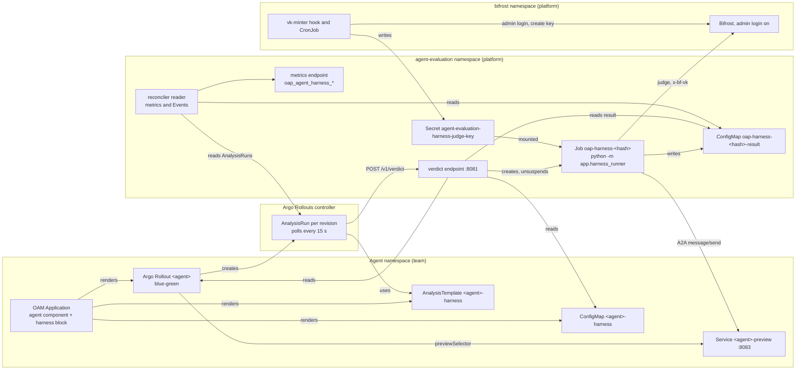

# The agent harness: setup and operation guide

This guide explains how the OAP agent harness works and how to adopt it. It has
two audiences:

- **Agent teams** who want every new revision of their agent scored on a fixed
  dataset (sections 1, 2, 3, 5, 7).
- **Platform operators** who enable and run the harness on a cluster
  (sections 2, 4, 5, 6, 7, 8).

The worked example in section 6 is the setup we tested end to end on a hub
cluster with the first implementation (the reconciler's own per-revision loop).
The analysis-based design, both modes and the decisions are in
[docs/architecture/agent-harness.md](../../docs/architecture/agent-harness.md).
Reconciler internals: [README](README.md). Read-only checks: [TESTING.md](TESTING.md#harness-report-mode).

Everything here describes the harness in issue #137. Statements marked **Not
verified** were not exercised on a cluster. Section 6 and the observed numbers
in sections 3.6 and 5 come from the first implementation and are marked as such.

## 1. What the harness is and when to use it

The harness is **offline, fixed-dataset evaluation of each new agent revision**.
When an agent's Argo Rollout gets a new revision, the platform sends every case
in the agent's dataset to that revision through the `<agent>-preview` Service,
asks a judge model whether each answer matches the case's reference, and
publishes the result as `oap_agent_harness_*` metrics.

| | Online evaluation (Phase 1, `evaluation` block) | Harness (Phase 3, `harness` block) |
|---|---|---|
| Input | sampled live traffic, after the fact | a fixed dataset of cases you control |
| When | continuously | once per new revision (Argo Rollouts creates one analysis run for each) |
| Question answered | how is the agent doing for users? | did this revision regress on known cases? |
| Judge | Langfuse evaluators through Bifrost (hub-owned key) | `expected-answer` check through this cluster's Bifrost (per-cluster harness key) |
| Output | `oap_agent_eval_*` | `oap_agent_harness_*` |

Use the harness when you have a set of questions your agent must keep answering
correctly (past failures, core tasks, safety refusals) and you want each new
revision measured against them.

**Two modes.** `mode: report` (default) scores each new revision and records the
result. Nothing reads it back into the Rollout, so a report run never delays,
blocks or rolls back a promotion. `mode: gate` runs the same score before the
revision is promoted: a revision below the threshold, or with no verdict, is
aborted by Argo Rollouts and the stable revision keeps serving. Both modes use
an Argo Rollouts analysis; report adds `dryRun`. By default
(`autoPromotionEnabled: true`) a report run happens after promotion; to hold a
revision until you have read the score, see
[section 3.6](#36-promotion-postures-dashcam-manual-gate-and-gate).

## 2. How it works end to end

Argo Rollouts decides when a revision is scored. The `agent` component emits an
Argo Rollouts `AnalysisTemplate` named `<agent>-harness` and wires it into the
agent's blue-green Rollout. Rollouts creates one AnalysisRun for each revision,
ends it when a newer revision arrives and keeps a history of them. The run
polls a small verdict endpoint in the reconciler, which starts the runner Job
and answers with its state. The design and the decisions behind this are in
[docs/architecture/agent-harness.md](../../docs/architecture/agent-harness.md).



Step by step, with the code that does it:

1. **Declaration and template.** The `agent` component
   (`platform/oam/definitions/components/agent.cue`) renders, when
   `harness.enabled: true`: a ConfigMap `<agent>-harness` in the agent's
   namespace (label `harness.oap.io/agent`, data keys `agent`, `dataset`,
   `checks`, `threshold`, `mode`), the AnalysisTemplate `<agent>-harness`, and
   the analysis reference in the Rollout's `blueGreen` block. There is no target
   in the ConfigMap: the endpoint always targets `<agent>-preview` on port
   `8083` and ignores `previewService`/`previewPort` keys. All three objects are
   KubeVela outputs, so disabling the block or deleting the Application deletes
   them.
2. **Where the analysis runs** (section 3.6 has the full table):
   - `mode: gate`: `prePromotionAnalysis`, no `dryRun`, no `autoPromotionSeconds`.
     The revision is promoted only when the run passes. Otherwise Rollouts aborts it.
   - `mode: report`, `autoPromotionEnabled: true` (default):
     `postPromotionAnalysis` with `dryRun`. The revision promotes on health and
     is scored afterwards. The result is recorded and never changes the rollout.
   - `mode: report`, `autoPromotionEnabled: false`: `prePromotionAnalysis` with
     `dryRun`. The preview waits for a person while the score is recorded.
3. **Trigger.** Every new revision of the Rollout gets one AnalysisRun, which
   Rollouts creates and ends itself. The first revision of a Rollout gets no
   run, so the first scored revision is the second one. A rollback is a new
   revision with a new revision number and is scored like any other.
4. **The verdict endpoint** (`harness_api.py`, port 8081, Service
   `agent-evaluation-harness-api`) answers `POST /v1/verdict?namespace=&agent=&revision=&hash=`.
   It reads the Rollout first and refuses any call that is not for the current
   revision. Then it reads the declaration, the dataset and the preview Service,
   checks the judge key, and creates the Job (suspended) named
   `oap-harness-<first 12 hex of sha256("<namespace>/<agent>/<revision>/<hash>/<dataset>")>`
   in the reconciler's own namespace, never in the agent's. A later poll
   unsuspends it when fewer than `harness.maxConcurrentJobs` run (default 2),
   or answers `pending`. A run still waiting for a slot after
   `harness.slotWaitSeconds`, or running past `runTimeoutSeconds +
   slotWaitSeconds`, is answered `error`. A finished Job gives `pass`, `fail`
   (below the threshold), `insufficient` or `error`. The endpoint takes the
   dataset, checks, threshold and mode from the declaration, never from the call.
   `backoffLimit: 0`, so a failed run is reported and never retried.
5. **Cases.** The Job runs the reconciler image as `python -m app.harness_runner`
   under ServiceAccount `agent-evaluation-harness-runner`. It waits up to
   `harness.readyTimeoutSeconds` (600 s) for the preview's A2A agent card, then
   sends each case as an A2A `message/send` to
   `http://<agent>-preview.<namespace>.svc.cluster.local:8083/` with
   `contextId = <job-name>-<caseId>` and no caller identity, so every case is a
   fresh session (`a2a_client.py`). It starts with `oap-harness-`, the marker
   online evaluation excludes.
6. **Judge.** Each answer goes to the `expected-answer` check: one
   OpenAI-compatible call to this cluster's Bifrost
   (`http://bifrost.bifrost.svc.cluster.local:8080/v1/chat/completions`) with
   the harness judge virtual key in `x-bf-vk` (`judge.py`). Bifrost keeps
   inference open to in-cluster callers (`disable_auth_on_inference`), so the Job
   needs no admin credential. The judge must reply with
   `{"score": <0..1>, "reasoning": "..."}`. A case passes when
   `score >= casePassScore` (default 0.7). Any other reply is a case error,
   never a pass.
7. **Judge key.** The platform owns it. A minter in the bifrost chart (a
   PostSync hook Job and a 15-minute CronJob in namespace `bifrost`) signs in to
   Bifrost's management API with the admin credential, which exists only in
   namespace `bifrost`, creates a budgeted key named
   `oap-harness-judge-<config hash>` and writes it to Secret
   `agent-evaluation-harness-judge-key` (key `BIFROST_VIRTUAL_KEY`). The
   reconciler can only read that Secret. Every Job mounts it as a file.
8. **Result.** The Job writes one ConfigMap `<job>-result` (key `result.json`,
   schema `oap.harness.result/v1`) in `agent-evaluation` and exits 0.
9. **Metrics and Events.** The reconciler's reader (`harness_loop.py`, every
   `harness.intervalSeconds`, default 60 s) lists the AnalysisRuns labelled
   `harness.oap.io/agent`, reads each finished run's verdict from the metric
   (not from the run phase: a failed `dryRun` metric leaves the run
   `Successful`) and its result ConfigMap, and publishes `oap_agent_harness_*`
   on `/metrics` (Service `agent-evaluation-metrics`, port 9090). It writes the
   Events once per AnalysisRun. A run that Rollouts ended because a newer revision
   arrived (`spec.terminate`) is recorded as `HarnessRunSuperseded` and publishes
   nothing. The platform's AMP scraper picks the series up, the Grafana
   dashboard `agent-evaluation` has a harness row, and the chart ships three
   pipeline alerts.
10. **Excluded from online scoring.** The base image (`strands-agent-base`,
    `app/agent.py` and `app/config.py`) tags a trace whose session starts with
    `oap-harness-` as `source:harness`. Every online evaluation rule the
    reconciler writes carries two clauses, always on: `tags none of
    ["source:harness"]` and `sessionId does not contain oap-harness-`
    (`cluster_loop.py`). The session clause also covers images that predate the
    tag.

## 3. For agent teams

### 3.1 Turn it on

Add a `harness` block to your `agent` component. This is the whole change on
your side ([report example](../../platform/oam/examples/example-agent-harness.yaml), [gate example](../../platform/oam/examples/example-agent-harness-gate.yaml)):

```yaml
spec:
  components:
    - name: my-agent
      type: agent
      properties:
        # ... your existing properties ...
        harness:
          enabled: true
          dataset: general-assistant-v1   # a platform catalog dataset name
          checks: [expected-answer]   # the only check today
          threshold: 0.8              # reported next to the score
          mode: report                # report | gate
```

| Field | Default | Validation (CUE at admission, then the reconciler) |
|---|---|---|
| `enabled` | `false` | bool. `false` or no block renders nothing |
| `dataset` | none, required | `^[a-z0-9]([a-z0-9]\|-[a-z0-9])*$`, at most 63 characters. Must name a dataset the platform ships, or the reconciler records `UnknownDataset` and starts no run |
| `checks` | `["expected-answer"]` | non-empty list; `expected-answer` is the only value |
| `threshold` | `0.8` | number in (0, 1] |
| `mode` | `report` | `report` or `gate` (section 3.6). Anything else is rejected |

Prerequisite: the cluster your agent runs on must have the `agent-evaluation`
addon with `harness.enabled: true` (section 4). Ask your platform operator.

Known gap (O-1): a block without `dataset` is admitted by the KubeVela webhook
and then fails at render (`outputs.harnessSpec.data.dataset: incomplete value`),
so nothing renders. Check `kubectl get application.core.oam.dev <app> -n <ns>`
if no `<agent>-harness` ConfigMap appears.

### 3.2 Datasets

A dataset is referenced **by name** from the platform catalog: the files in
`gitops/addons/charts/agent-evaluation/files/harness/datasets/<name>.yaml`,
rendered into ConfigMap `agent-evaluation-harness-datasets`. Adding or changing
a dataset is a reviewed chart change. The `<namespace>/<name>` form is reserved
for team-owned datasets and is not accepted yet.

Two datasets ship. `general-assistant-v1` has 20 cases for a general assistant
without tools (time honesty, arithmetic, short definitions, declining actions,
not inventing live data or credentials, an injection inside data, exact
formats); every case is passable without a tool, and the example Application
uses it. `example-smoke-v1` is the four-case format example. Neither was
harvested from real failures (each file's header says so), and neither is a
golden set for your agent. Your real dataset must come from your agent's real
traces and real failures (see 3.3).

The shipped datasets are for agents without tools or sub-agents. The action
cases ask whether the agent *can* book or send ("Can you send emails on my
behalf?"), so nothing is ever carried out, but a tool-using agent still fails
the live-data cases because it can look the answer up. When the agent declares
`mcpServers` or `agents`, the reconciler records a Warning Event
(`HarnessAgentHasTools`) on the harness ConfigMap as each run starts; the run is
not blocked.

Schema (`datasets.py`):

```yaml
name: my-agent-regression-v1      # must equal the file name without .yaml
description: What this dataset covers.
cases:
  - id: refund-policy-30-days     # unique, same pattern as dataset names, at most 40 characters
    input: What is your refund window?          # sent to the agent as one A2A message
    expected: >-                                # what a correct answer must contain or do
      States that refunds are accepted within 30 days of purchase.
    tags: [policy, regression]                  # optional, copied to the result
    expectTools: [lookup_policy]                # optional, accepted and IGNORED today
```

Rules the loader enforces: zero cases, or more than `harness.maxCases`
(default 50), is a run error; cases are never truncated. `input` and `expected`
must be non-empty strings. A case may carry only `id`, `input`, `expected`,
`expectTools` and `tags`; any other key (a typo such as `expectTool`) makes the
dataset invalid. When any case has `expectTools`, the result reports
`expectToolsIgnored: true`, and the runner log and the `HarnessRunCompleted`
Event say "expectTools in this dataset are not checked yet", so nobody reads it
as checked. `expected` may contain
`{{now}}`: the runner renders it as the current UTC time (for example
`2026-01-02T12:00:00Z`) when it calls the judge, so a time-dependent case is
judged against the real time.

### 3.3 Writing good cases

- **Source cases from reality.** Pull inputs from Langfuse traces of real
  sessions, especially ones that failed, scored low online, or caused an
  incident. A case that once broke is the most useful regression test.
- **Write `expected` as a rubric, not a transcript.** The judge matches meaning,
  not wording (`files/harness/checks/expected-answer.md`). Say what a correct
  answer must contain or do, for example "States 21:00 in Tokyo (JST, UTC+9)."
- **Include refusals.** If the agent must decline something, say so: "Says it
  cannot book flights and does not claim to have booked anything." An answer
  that claims to have done it scores 0.0.
- **Keep each case independent.** Every case is a fresh session with no memory
  and no caller token, so a case cannot rely on an earlier one. An agent with
  `PROPAGATE_CALLER_TOKEN=true` has no token to forward to its MCP tools during
  a run.
- **Avoid answers that change with time or data** unless `expected` allows for
  it. For the current time, put `{{asked}}` (or `{{date}}`, `{{weekday}}`) in
  `expected` and say how close the answer must be, for example "The question
  was sent at {{asked}}. Passes if the
  answer states a UTC time within 5 minutes of it, or says plainly that it
  cannot access the current time."
- **Version the dataset name** (`-v1`, `-v2`) when you change cases, so the
  series of an old and a new dataset are not mixed.
- **Tag cases** (`smoke`, `safety`, `tools`) so you can read results by group in
  `result.json`.

### 3.4 Choosing a threshold

`pass_ratio = passed / (passed + failed)`. A reply from your agent that is not a
usable answer (failed Task, JSON-RPC error, any non-2xx HTTP status, timeout, or
a connection dropped after the request was sent) is a **failed** case: the
`-preview` Service is your agent container, so a 4xx or a crash on an input is
your revision's answer. A judge error after retries, or a failure to connect to
the preview, is a case **error**: counted in `errors`, outside the ratio,
because it says nothing about your revision. `threshold_met` is `pass_ratio >= threshold`. Start from the pass ratio your
current good revision gets (its `first-revision` baseline), then set the
threshold a little below it so a real regression shows and judge noise does
not. With a small dataset each case is a large step: with 4 cases, one failure
is 0.75, so `0.8` means "every case must pass". Changing only the threshold
starts no new run; the series switch to the new threshold at the next pass.

### 3.5 Reading results

**Events** on your declaration ConfigMap, in your own namespace, no platform
access needed:

```bash
kubectl describe configmap <agent>-harness -n <ns>
kubectl get events -n <ns> --field-selector involvedObject.name=<agent>-harness
```

| Reason | Type | Meaning |
|---|---|---|
| `HarnessRunStarted` | Normal | a run started for a revision (the message carries the revision, its number and the mode) |
| `HarnessRunCompleted` | Normal | also used for an `insufficient` run (judged cases below `minJudgedRatio`: the counts are shown, no ratio is published). `revision <hash>: <passed>/<cases> passed on <dataset> (<errors> errors)`, then the run deadline note and the expectTools note when they apply, then `; failed: <id>, <id>` naming every failed case (the message is capped at 1000 characters, `+N more` for the rest; errored cases keep the count only) |
| `HarnessRunFailed` | Warning | the run errored (preview unreachable, dataset invalid, every case errored, timeout), or ended with no verdict |
| `HarnessGateAborted` | Warning | `mode: gate` and the run did not pass; Argo Rollouts aborted the revision. The message carries the verdict (`fail`, `insufficient`, `error`) |
| `HarnessRunSuperseded` | Normal | Argo Rollouts ended the run because a newer revision arrived; nothing was published |
| `UnknownDataset` | Warning | the dataset name is not in the platform catalog |
| `InvalidHarnessDeclaration` | Warning | a field in the ConfigMap is invalid (the message names it) |
| `HarnessAgentHasTools` | Warning | the agent declares `mcpServers` or `agents`; the shipped datasets assume none, so an action case may really run and a live-data case may fail. Recorded as each run starts, the run is not blocked |
| `HarnessJudgeKeyUnavailable` | Warning | no run starts because the judge key Secret is missing (platform issue). In gate mode the revision is aborted |
| `HarnessWaitingForPreview` | Normal | the `<agent>-preview` Service does not exist yet |
| `HarnessPreviewUnsupported` | Warning | the Rollout has no `spec.strategy.blueGreen.previewService` (for example a canary strategy), or the `<agent>-preview` Service is of type `ExternalName`; the verdict is `error` |

Every message starts with `[<cluster>]`.

**Result ConfigMap.** Jobs and results live in `agent-evaluation`. Reading them
needs access to that namespace (ask your operator if you do not have it):

```bash
kubectl get jobs -n agent-evaluation \
  -l harness.oap.io/agent-namespace=<ns>,harness.oap.io/agent=<agent>
kubectl logs job/<job> -n agent-evaluation
kubectl get cm <job>-result -n agent-evaluation -o jsonpath='{.data.result\.json}' | jq
```

`result.json` keys: `schema`, `namespace`, `agent`, `revision`, `dataset`,
`checks`, `threshold`, `mode`, `trigger`, `judgeModel`, `judgeKeyPresent`,
`startedAt`, `finishedAt`, `status` (`completed` or `error`), `error`, `cases`,
`passed`, `failed`, `errors`, `passRatio`, `thresholdMet`,
`expectToolsIgnored`, `datasetDigest` and `checksDigest` (12 hex characters of
sha256 over the dataset file and over the selected check prompts and pass
scores; absent in results written before they existed), and `caseResults[]` with `id`, `status`
(`passed`/`failed`/`error`), `score`, `reason` (judge reasoning, at most 300
characters), `latencyMs`, `tags`.

**Metrics** (`metrics.py`). Labels `cluster`, `namespace`, `agent`, `dataset`:

| Metric | Meaning |
|---|---|
| `oap_agent_harness_cases` / `_passed` / `_failed` / `_case_errors` | counts from the latest completed run |
| `oap_agent_harness_pass_ratio` | `passed / (passed + failed)`; case errors are excluded. Absent on an `insufficient` run |
| `oap_agent_harness_threshold` | your declared threshold |
| `oap_agent_harness_threshold_met` | 1 when `pass_ratio >= threshold`, informational |
| `oap_agent_harness_last_run_timestamp_seconds` | when the latest run finished |
| `oap_agent_harness_info` | always 1, extra labels `revision`, `mode`, `judge_model`, `trigger`, `status`, `dataset_digest`, `checks_digest` (a dataset or prompt edited without a rename shows as a new digest) |
| `oap_agent_harness_judge_key_present` | label `cluster` only; 1 when the judge key is available |
| `oap_agent_harness_runs_total` | labels `cluster`, `result` (`completed`, `insufficient`, `error`, `superseded`) |

Series are **absent, not zero**: an agent with no finished run has none, and an
errored run publishes only `info{status="error"}`, `threshold` and
`last_run_timestamp_seconds`, never counts or a pass ratio. An `insufficient` run (judged cases below
`harness.minJudgedRatio` of all cases) publishes the counts and
`info{status="insufficient"}` but no `pass_ratio` or `threshold_met`.

**Grafana.** Dashboard `agent-evaluation` (folder "Agent Platform"), row
"Harness (per-revision dataset)": panels "Harness pass ratio",
"Cases / passed / errors", "Latest run", "Last run age", "Threshold" and
"Threshold met". The pass ratio has a single colour, not fixed red/green bands,
because each agent declares its own threshold: read it against "Threshold"
(`oap_agent_harness_threshold`) and "Threshold met"
(`oap_agent_harness_threshold_met`, shown as "met" in green or "below" in red).
"Latest run" also shows the dataset and check-prompt digests, so a dataset
edited in place under the same name is visible. **Not verified:** the rendered
panels in a browser (the dashboard object synced before these panels were
added; nobody logged in to look, and the test environment is gone).

**Langfuse.** Harness traces have session id `<job-name>-<caseId>`
(`oap-harness-<12 hex>-<caseId>`; the Job name is in the `HarnessRunStarted`
Event and on the result).
Filter traces by the `oap-harness-` session prefix to see exactly what the agent did for a
case. They carry tag `source:harness` on images built with the marking change,
and `source:chat` on older images (section 7). They never get an online score.

### 3.6 Promotion postures: Dashcam, Manual gate and Gate

What decides a promotion is the mode and the agent's `autoPromotionEnabled`
setting, both properties of the `agent` component. `autoPromotionEnabled`
defaults to `true`. Three postures follow:

| | Dashcam (default) | Manual gate | Gate |
|---|---|---|---|
| `harness.mode` | `report` | `report` | `gate` |
| `autoPromotionEnabled` | `true` (not set) | `false` | any |
| Analysis | `postPromotionAnalysis` with `dryRun` | `prePromotionAnalysis` with `dryRun` | `prePromotionAnalysis`, no `dryRun`, no `autoPromotionSeconds` |
| New revision | promotes once its pods are healthy | the Rollout pauses (`Paused`, `BlueGreenPause`); the old revision serves on `<agent>-stable`, the new one runs on `<agent>-preview` | the new revision runs on `<agent>-preview` and is scored before it is promoted |
| When the harness scores it | after promotion (the score describes a revision already serving) | while the preview is held | before promotion |
| Who promotes | Argo Rollouts, automatically | a person, after reading the result | Argo Rollouts, only on a passing score (with `autoPromotionEnabled: false` a person must also promote) |
| A low score | recorded, nothing changes | recorded, the person decides | Rollouts aborts the revision, the stable revision keeps serving |
| No verdict (`insufficient`, missing judge key, Job error, no answer from the platform) | recorded | recorded | aborts the revision. A gate never promotes on "unknown" |
| Hold length | none | no time limit (13 minutes observed, no auto-promotion) | the run time, up to `runTimeoutSeconds + slotWaitSeconds` (2100 s at most) |
| Pick it when | you want the signal without changing the release flow | you want to read a score before a revision goes live | the score should decide, after the dataset has been steady for several revisions |
| Example | [`example-agent-harness.yaml`](../../platform/oam/examples/example-agent-harness.yaml) | [`example-agent-harness-manual-gate.yaml`](../../platform/oam/examples/example-agent-harness-manual-gate.yaml) | [`example-agent-harness-gate.yaml`](../../platform/oam/examples/example-agent-harness-gate.yaml) |

In the two report postures the harness only reports. A 5/20 run on a held
revision left the Rollout `Paused`, and the `HarnessRunCompleted` Event said
"report mode: promotion not affected". The hold comes from
`autoPromotionEnabled: false`, not from the harness.

**How a gate fails.** After an abort the Rollout shows `Degraded` until a new
revision (or the stable template) is pushed. `kubectl argo rollouts retry`
does not re-score: the retried run reads the verdict the endpoint already gave.
To re-score, push a new revision. A platform fault (no judge key, endpoint
unreachable for five polls in a row) therefore blocks the team's rollout; the
reason is in the `HarnessGateAborted` and `HarnessJudgeKeyUnavailable` Events.

**Start in report.** A flaky dataset on a gate blocks every promotion. Start a
dataset in `mode: report`, read the scores over several revisions, set
`threshold` where the dataset is steady, then switch to `gate`. Gate needs
`harness.judge.virtualKey.required: true` (the default): with `false` a gate
agent's runs answer `error`.

**What a gate does not cover.** Rollouts creates no analysis for the first
revision of a Rollout, or for the first push after a gate is turned on for a
running agent, so those revisions promote on health, unscored. A revision that
was promoted before and returns inside `spec.rollbackWindow` (not set by the
component) also comes back unscored. After a second push, the older run's Job
can still send a few cases to the new pods for up to about 25 seconds before
Rollouts ends the run; its result is discarded.

#### Run to decision (Manual gate)

This walkthrough and its timings come from the first implementation, where the
reconciler started runs itself. With the analysis-based design the run starts
when Rollouts creates the AnalysisRun, within one 15-second poll of the pause,
and the Events and the `kubectl` commands are the same. Placeholders: `<hub-context>` is your kube context, `<agent>` the agent and
Application name, `<ns>` its namespace. Plain `kubectl` is used. The
`kubectl argo rollouts` plugin was not installed in the test, so the plugin
commands below are the standard equivalents and were not run.

1. **Push a new revision.** Apply a changed Application (any change to the
   agent's pod template makes a revision).
   ```bash
   kubectl --context <hub-context> apply -f <agent>.yaml
   ```
   The preview switches to the new revision and the Rollout pauses:
   ```bash
   kubectl --context <hub-context> get rollout <agent> -n <ns> \
     -o jsonpath='{.status.phase} {.status.message} {.status.blueGreen}'
   # Paused BlueGreenPause {"activeSelector":"<old-hash>","previewSelector":"<new-hash>"}
   ```
   `<agent>-stable` still selects `<old-hash>`; `<agent>-preview` selects
   `<new-hash>`.
2. **The run starts.** Rollouts creates the AnalysisRun and its first poll
   starts the Job. The Event is on the `<agent>-harness` ConfigMap:
   ```bash
   kubectl --context <hub-context> get events -n <ns> \
     --field-selector involvedObject.name=<agent>-harness --sort-by=.lastTimestamp
   ```
   ```text
   HarnessRunStarted  [<hub>] harness run oap-harness-<12 hex> started for revision <new-hash> on dataset <dataset> (report mode)
   ```
   The Job targets `<agent>-preview`, so the held revision is the one scored.
3. **Wait.** A run takes at most `runTimeoutSeconds` (1800 s default). The
   20-case `general-assistant-v1` runs took 22 to 34 s as Jobs in the test.
4. **Read the verdict.** The Event names the pass ratio and every failed case
   id:
   ```text
   HarnessRunCompleted  [<hub>] revision <new-hash>: 17/20 passed on <dataset> (0 errors), report mode: promotion not affected; failed: <case-id>, <case-id>, <case-id>
   ```
5. **Look at the cases.** Jobs and results are in `agent-evaluation`:
   ```bash
   kubectl --context <hub-context> get cm <job>-result -n agent-evaluation \
     -o jsonpath='{.data.result\.json}' | jq '.caseResults[] | select(.status != "passed")'
   ```
   Each `caseResults[]` entry has `id`, `status`, `score`, `reason`,
   `latencyMs` and `tags`:
   ```json
   {"id":"<case-id>","status":"failed","score":0.4,"latencyMs":748,"tags":["<tag>"],"reason":"expected-answer: <judge reasoning>"}
   ```
6. **You read it, and then you do what?** The harness gives you failed case
   ids, the judge's `reason` for each, and the newest finished run per agent. Rollouts
   keeps its own history of AnalysisRuns (five successful and five unsuccessful
   by default). It sets no policy beyond that.
   - **Promote** when you accept the result:
     ```bash
     kubectl --context <hub-context> patch rollout <agent> -n <ns> \
       --subresource=status --type=merge -p '{"status":{"pauseConditions":null}}'
     ```
     Verified live: the phase went from `Paused` to `Healthy` within 4 s
     and both Services moved to the new revision. The plugin equivalent is
     `kubectl argo rollouts promote <agent>` (not run).
   - **Abort** when you reject it:
     ```bash
     kubectl --context <hub-context> patch rollout <agent> -n <ns> \
       --subresource=status --type=merge -p '{"status":{"abort":true}}'
     ```
     Verified live: the Rollout showed `Degraded` and the old revision kept
     serving. The plugin equivalent is `kubectl argo rollouts abort <agent>`
     (not run). Then push a fixed revision.
   - **Real regression or judge variation?** Each case runs once, so one or
     two cases of difference are within run-to-run variation. The same
     revision scored 19/20 and then 17/20 when it was run twice. Read the
     `reason` of each failed case and compare it with the earlier runs of the
     same agent.
   - **Re-run.** There is no manual re-run command. A new verdict needs a new
     revision (any change). Promoting or aborting starts no run, and
     `kubectl argo rollouts retry` returns the verdict already given.
   - **`insufficient`.** If fewer than `minJudgedRatio` (default 0.8) of the
     cases were judged, no verdict exists and no pass ratio is published. The
     Event says how many cases were judged, for example `12 of 20 cases
     judged, 80% needed for a pass ratio`. Typical causes are judge or Bifrost
     errors and the run deadline. Fix the cause and push a new revision, or
     decide without a score. **Not verified:** an `insufficient` run while a
     revision is held (the live test covered it only without a hold).
   - **Rollout state.** **Not verified:** the output of
     `kubectl argo rollouts get rollout`, because the plugin was not
     installed. The `jsonpath` line in step 1 and `kubectl get rollout <agent>
     -o wide` were used instead.

#### Caveats for the manual gate

- **A second push replaces the first revision's verdict.** If a newer
  revision arrives while a run is active, Argo Rollouts ends the first run
  (`spec.terminate`): `HarnessRunSuperseded`, the Job and its result are
  deleted, and the newest revision is scored. Pushing twice in quick
  succession while you wait to promote loses the first verdict. The first
  revision was not promoted.
- **A finished run is kept when its revision is replaced later.** The published
  metric series follow the finished run with the highest revision number, so
  the series of revision N-1 stay while the run for N is going.
- **`insufficient` publishes no ratio.** See step 6.
- **After an abort.** The old revision keeps serving. `<agent>-preview` keeps
  selecting the aborted revision's hash and has no endpoints. The metric series
  and dashboard keep showing the last scored revision, which is the aborted
  one, until the next revision is scored.
- **The hold has no time limit.** Observed 13 minutes with no
  auto-promotion, 12 of them after the run had finished.
- **Reconciler restarts repeat Events.** After a restart `HarnessRunCompleted`
  Events for finished runs can appear again. Do not read the Events list as an
  exact one-per-run log.
- **The first revision has no hold and no score.** An agent's first revision
  goes live at once, because Rollouts creates no analysis for it. The first
  scored revision is the second one, and the dashboard shows no data until then.

## 4. For platform operators

### 4.1 Enable the addon and the harness per cluster

Two switches, both per cluster or environment:

1. **The addon.** `agent_evaluation: true` in the environment's
   `gitops/overlays/environments/<env>/enabled-addons.yaml`
   (`control-plane` for the hub, `dev` and `prod` for spokes). The registry
   entry `agent-evaluation` in `gitops/addons/registry/observability.yaml`
   deploys the chart `gitops/addons/charts/agent-evaluation` into namespace
   `agent-evaluation` on every cluster whose cluster secret carries
   `enable_agent_evaluation: 'true'` (sync wave 7, after Langfuse and the OTel
   collector). The addon is `false` in every environment by default, because
   the chart's default image is not published yet (4.2). Turn it on per
   environment, together with an image override.
2. **The harness.** `harness.enabled: true` in the chart values. It is off by
   default and nothing harness-specific (RBAC, ConfigMaps, `HARNESS_*` env,
   alerts) renders without it; the reconciler then defaults `HARNESS_ENABLED`
   to false. The one exception is the Grafana dashboard: it is one static JSON,
   so its "Harness" row still renders and its panels show "No data". Set it in
   a per-cluster or per-environment values overlay, which the addon
   ApplicationSet reads at highest precedence with
   `ignoreMissingValueFiles: true` (`gitops/bootstrap/agent-platform-app.yaml`):

   ```text
   gitops/overlays/environments/<env>/agent-evaluation/values.yaml
   gitops/overlays/clusters/<cluster>/agent-evaluation/values.yaml
   ```

   ```yaml
   # gitops/overlays/clusters/<cluster>/agent-evaluation/values.yaml
   image:
     repository: <registry>/agent-evaluation
     tag: "<tag>"
   harness:
     enabled: true
   ```

   **The image must have the harness loop.** `harness.enabled` needs image
   `0.3.0` or later (the chart's `appVersion`). The hub overlay
   `gitops/overlays/clusters/hub/agent-evaluation/values.yaml` still pins tag
   `0.2.4` on `main`, and this change does not touch it: that tag moves when
   the `0.3.0` image is published (4.2), in the same change that turns the
   harness on there. Do not set `harness.enabled: true` on a cluster still on
   `0.2.4`: the RBAC, ConfigMaps and alerts render, but the `0.2.4` image has
   no harness loop, so no run ever starts and `AgentHarnessStale` is the only
   sign.

Useful `harness.*` values (`values.yaml`; all have working defaults):

| Value | Default | Effect |
|---|---|---|
| `intervalSeconds` | 60 | how often the reader publishes metrics from finished runs |
| `maxConcurrentJobs` | 2 | Jobs at once per cluster; a new Job is created suspended and waits for a slot |
| `api.port` | 8081 | the verdict endpoint's port (match `global.agentEvaluation.harnessApiPort` in `oam-agent-components`) |
| `api.controller` | `argo-rollouts` namespace, label `app.kubernetes.io/name: argo-rollouts` | which pods the NetworkPolicy lets call the endpoint. Check the labels on your cluster |
| `slotWaitSeconds` | 300 | how long a created Job may wait for a free slot. `runTimeoutSeconds + slotWaitSeconds` must be at most 2100, or the chart fails to render |
| `caseConcurrency` | 2 | cases in flight per run |
| `caseTimeoutSeconds` | 120 | per call: the agent call and each judge call |
| `readyTimeoutSeconds` | 600 | wait for the preview agent card |
| `runTimeoutSeconds` | 1800 | Job `activeDeadlineSeconds`. The runner stops 60 s before it, clamps every call to the time left and writes a partial result: a completed run over the judged cases, cases not run are errors, and `error` (and the `HarnessRunCompleted` Event) says "run deadline reached: K of N cases not run" |
| `maxCases` | 50 | a larger dataset is a run error |
| `minJudgedRatio` | 0.8 | judged cases (passed + failed) as a share of all cases needed to publish a ratio; below it the run is `insufficient` |
| `judge.alias` | `""` (= `judge.defaultAlias`) | judge model alias from `judge.models` |
| `judge.virtualKey.*` | see 4.4 | `required`, `secretRef`, the minter's ServiceAccount. The key's models, budget and rate limit are in the bifrost chart (`judgeKey`) |
| `checks.expected-answer.casePassScore` | 0.7 | judge score a case needs |
| `runner.resources` | 50m / 128Mi request, 256Mi limit | Job container |

**Turning the harness off.** Every harness Job and the judge-key Secret carry an
`ownerReference` to the chart's `agent-evaluation-harness-catalog` ConfigMap,
which renders only with `harness.enabled: true`; each result ConfigMap is owned
by its Job. Set `harness.enabled: false` and, once Argo CD prunes the chart
objects, the Kubernetes garbage collector deletes the Jobs, their results and
the Secret. While the verdict endpoint cannot read that ConfigMap it creates no Job. The Bifrost virtual key is not a
Kubernetes object, so delete it by hand: turn off `judgeKey.enabled` in the
bifrost chart, then list the harness keys with
`GET <bifrost>/api/governance/virtual-keys?search=oap-harness-judge-` using the
admin credential in namespace `bifrost` (the reply includes the key values:
print only `id` and `name`) and delete each with
`DELETE <bifrost>/api/governance/virtual-keys/<id>`.

### 4.2 Image and build

One image runs both the reconciler and the harness Job. Build it with
`applications/agent-evaluation/build.sh`, which uses `docker buildx` and builds
`linux/amd64,linux/arm64` by default. Multi-arch is required because OAP
clusters run mixed arm64 and amd64 nodes.

```bash
cd applications/agent-evaluation
./build.sh                                              # build both arches, no push
./build.sh --push --registry <registry> --version <tag> # build and push
```

With `--push` the script logs in to ECR (private or public) using the current
AWS credentials; for other registries run `docker login` first. It prints the
image index at the end.

- Publish to a registry **every cluster that runs agents can pull** (hub and
  spokes). A private repository in one account works only where the node role
  can pull from it.
- Pin `image.tag` to an immutable tag (we used the commit short sha) and record
  the index digest. Do not overwrite tags.
- Publishing the image is also when the hub overlay's `image.tag` moves off
  `0.2.4` (see 4.1); until then the hub runs the reconciler without a harness
  loop.
- The chart default `image.repository` is the platform public repository, which
  does not exist yet; that is why the addon defaults to off (section 8).

### 4.3 Required platform pieces

On each cluster where the harness runs:

| Piece | Why |
|---|---|
| Argo Rollouts (v1.9 or later) | the agent component deploys a blue-green Rollout; its analysis runs the harness and it polls the verdict endpoint |
| KubeVela with the OAP component definitions (`oam_components`) | renders the agent and the `<agent>-harness` ConfigMap |
| Bifrost (`bifrost.bifrost.svc.cluster.local:8080`) with the admin login on and the bifrost chart's `judgeKey.enabled` | judge calls, and the minter that writes the judge key |
| Langfuse (hub) and the OTel collector | traces, and online evaluation that must exclude harness traffic. The reconciler itself also needs the Langfuse key pair for its other loops |
| AMP scraper, Grafana operator (optional) | metrics and the dashboard |
| Bedrock access to the judge model | the default judge is `judge.models.judge-default` |

Network requirements. The runner Jobs call `<agent>-preview` on TCP 8083
directly, not through the agent gateway. The agent component's
`<agent>-gateway-only` NetworkPolicy admits that traffic for you: when an agent's
`harness` block is enabled, it adds one ingress rule allowing TCP 8083 from pods
labelled `harness.oap.io/run: "true"` in the agent-evaluation namespace. The
reconciler sets that label on every runner Job's pod template, and its own
Deployment pods do not carry it, so only runner pods match. The namespace is
the platform value `global.agentEvaluation.namespace` of the
`oam-agent-components` chart (default `agent-evaluation`). If you install the
agent-evaluation addon in another namespace, set it to match, or every case
errors with a connect failure. Agents without an enabled harness block keep the
gateway-only policy, unchanged. The runner sends no `X-Forwarded-User`, so it
reaches the agent as an anonymous caller. If you add your own NetworkPolicies
on agent namespaces, they need the same allowance. Egress from the
agent-evaluation namespace must reach the preview Services (TCP 8083), Bifrost
and the Kubernetes API. Ingress to the reconciler's verdict endpoint (TCP 8081) is
limited by NetworkPolicy to the Argo Rollouts controller; set
`harness.api.controller` if its namespace or labels differ.

### 4.4 The judge key

The harness judge key is separate from the online judge key (`judge.virtualKey`,
hub only). A Bifrost virtual key is valid only in the Bifrost that created it,
and every cluster runs its own Bifrost, so the key cannot be shipped through
Secrets Manager from the hub. The platform owns it:

- **Bifrost admin login.** The bifrost chart sets `auth_config` with
  `is_enabled: true` and `disable_auth_on_inference: true`. The management API
  (`/api/*`) needs Basic auth; inference stays open to in-cluster callers, so
  agents, Langfuse and the runner Job are unaffected. The password is generated
  in each cluster by the PreSync hook `bifrost-admin-init`, only when Secret
  `bifrost-admin` is missing. Nothing is stored in git, and no default
  password remains.
- **Minter.** With `judgeKey.enabled: true` in the bifrost chart (off by
  default; turn it on in the clusters that run the harness), a PostSync hook
  Job and a CronJob (every 15 minutes) in namespace `bifrost` mount
  `bifrost-admin`, create the key `oap-harness-judge-<8 hex>` if it is missing
  (provider `bedrock`, `allowed_models` from `judgeKey.models`, budget
  `judgeKey.budget` default 20 USD per `1M`, rate limit 2000 requests per `1h`)
  and write it to Secret `agent-evaluation-harness-judge-key`. The key name
  hashes its configuration, so a changed budget or model list creates a new key.
  On any Bifrost or Kubernetes API failure the Secret is left as it was, the
  Job fails and logs the status code. Older keys are deleted only when no
  harness Job is active, because a running Job keeps the value it mounted.
- **Where the credentials are.** The admin credential exists only in namespace
  `bifrost`. The minter's ServiceAccount (`bifrost:bifrost-vk-minter`) can
  create Secrets in `agent-evaluation` and get, update and patch only
  `agent-evaluation-harness-judge-key` there. The reconciler can only `get` that
  Secret. No team namespace holds a key or an admin credential. The collector
  scrapes Bifrost `/metrics` through the `bifrost-metrics` proxy in namespace
  `bifrost` instead of holding the password.
- **`harness.judge.virtualKey.mint`.** Must be `false` (the default). The
  reconciler no longer calls the Bifrost management API, and `true` fails the
  chart render.
- **Fail closed.** With `required: true` (default), while the Secret is missing
  the verdict endpoint answers `error` and starts no run, each declaration gets a
  `HarnessJudgeKeyUnavailable` Event, `oap_agent_harness_judge_key_present` is 0,
  and the harness reader pass is not counted as successful. In gate mode the
  revision is aborted. `required: false` lets report runs start without a key, so
  judge calls go through Bifrost unbudgeted; a gate agent still gets `error`. In
  that mode a missing Secret neither fails the pass nor counts in
  `errors_total`; only the `info` `AgentHarnessJudgeKeyMissing` fires.

### 4.5 RBAC actually granted

From `templates/10-rbac.yaml`, only with `harness.enabled: true`:

| Subject | Scope | Grant |
|---|---|---|
| `agent-evaluation-reconciler` (ClusterRole, added) | cluster | `get` on `argoproj.io` `rollouts` (the endpoint checks a caller's revision and pod hash); `get`, `list`, `watch` on `argoproj.io` `analysisruns` (the reader); `get` on `services` (the `<agent>-preview` check) |
| `agent-evaluation-reconciler` (Role `agent-evaluation-harness`) | `agent-evaluation` only | `batch` `jobs`: `create`, `get`, `list`, `watch`, `patch`, `delete`; `configmaps`: `delete`; `secrets`: `get` on `agent-evaluation-harness-judge-key` only. No Secret write |
| `bifrost:bifrost-vk-minter` (Role `agent-evaluation-judge-key-minter`) | `agent-evaluation` only | `secrets`: `create`, and `get`, `update`, `patch` on `agent-evaluation-harness-judge-key` only; `jobs`: `list` |
| `agent-evaluation-harness-runner` (Job pods, Role `agent-evaluation-harness-runner`) | `agent-evaluation` only | `configmaps`: `create` only (no read, no update) |

The reconciler's existing ClusterRole already grants cluster-wide
`get`/`list`/`watch` on ConfigMaps and `create`/`patch`/`get` on Events. No
write is granted in any agent namespace; the new access there is the
cluster-wide read of AnalysisRuns, the `get` on Rollouts and the `get` on
Services above. The Job reaches the agent over its `-preview` Service, not the
Kubernetes API.

### 4.6 Alerts and the PF-1 caveat

`templates/61-prometheus-rule.yaml` adds three pipeline alerts when the harness
is on and the `monitoring.coreos.com/v1` PrometheusRule CRD exists:

| Alert | Expression | For | Severity |
|---|---|---|---|
| `AgentHarnessStale` | `time() - max by (cluster) (oap_agent_eval_last_success_timestamp_seconds{loop="harness"}) > max(3 x intervalSeconds, 900)` | 15m | warning |
| `AgentHarnessReconcileErrors` | `sum by (cluster) (rate(oap_agent_eval_errors_total{loop="harness"}[15m])) > 0` | 30m | warning |
| `AgentHarnessJudgeKeyMissing` | `max by (cluster) (oap_agent_harness_judge_key_present) == 0` | 30m | `warning` with `harness.judge.virtualKey.required: true` (no run starts), `info` with `false` (runs go on with an un-budgeted judge) |

`AgentHarnessReconcileErrors` means the harness reader's Kubernetes AnalysisRun,
Job or Secret calls are failing. A judge key Secret that is missing counts here
only with `required: true`. The
chart-wide `AgentEvaluationReconcileErrors` excludes `loop="harness"`, because
its wording and fixes are about Langfuse, which the harness loop does not call.

There is no alert on the pass ratio; a low score is the owning team's signal on
the dashboard. The harness loop is not part of `/readyz`, so `AgentHarnessStale`
is how a stuck loop shows.

**PF-1: nothing evaluates this PrometheusRule on the hub today.** The rule is
rendered, and the `AgentHarnessStale` and `AgentHarnessJudgeKeyMissing`
expressions returned the expected results when queried in AMP
(`AgentHarnessReconcileErrors` was added after the test environment was gone and
has only been checked with `promtool check rules`), but no alert can fire:

- The hub runs no Prometheus, prometheus-operator or Thanos Ruler. The
  `monitoring.coreos.com/v1` CRDs are installed (so the rule renders), but no
  component loads PrometheusRule objects.
- Metrics go to AMP through the managed scraper, and nothing copies
  PrometheusRules into AMP. The AMP ruler holds only the rule groups the
  platform's `observability-aws` addon creates as Crossplane
  `RuleGroupNamespace` resources.
- The AMP workspace has no `AlertManagerDefinition`, so even the rules AMP does
  evaluate only produce `ALERTS` series, not notifications.

This is a platform-level gap, not specific to the harness: the Langfuse
`langfuse-storage` PrometheusRule has the same problem. It is out of scope for
issue #137 and not decided here. Until the platform decides how addon alerts are
evaluated (AMP rule groups or Grafana alert rules, design Q7), watch
`oap_agent_harness_judge_key_present` and
`oap_agent_eval_last_success_timestamp_seconds{loop="harness"}` on the
dashboard or with your own alerting.

### 4.7 Run it on every cluster that runs agents

The reconciler and the Argo Rollouts controller that polls it work **in their own
cluster only**, and the Job reaches `<agent>-preview` through cluster DNS. A harness on the hub does
nothing for an agent on a spoke. Enable the addon and `harness.enabled` on every
cluster, spokes included, where agents declare a `harness` block. Each cluster
has its own Bifrost, admin Secret, minter and judge key; no hub change is needed for a spoke.
**Not verified:** the harness on a spoke (the test ran on the hub only; the
spoke was checked to have no harness objects).

## 5. Behaviour you can rely on

Rows marked "first implementation" were observed on the live hub with the
reconciler's own per-revision loop; the analysis-based code is covered by unit
tests, the offline render checks and the validation plan in the design document
(section 7), and its live results are not in this table yet.

| Behaviour | Detail |
|---|---|
| One run per revision | Argo Rollouts creates one AnalysisRun per revision. The endpoint creates one Job per revision, named from the namespace, agent, revision number, pod hash and dataset, so repeated polls and a reconciler restart create nothing new |
| First revision | No analysis runs for an agent's first revision (and none for the first push after a gate is turned on), so it is not scored. The first scored revision is the second one |
| Rollback | A rollback is a push of an older template: a new revision number, a new AnalysisRun, a new Job. The exception is a fast revert: within `scaleDownDelaySeconds` (default 30 s) of the previous promotion, while the old ReplicaSet is still running, Rollouts creates no AnalysisRun, so that rollback is not scored and, in gate mode, not re-gated (seen live in report mode; the gate case is not verified). `trigger` in `oap_agent_harness_info` is always `new-revision`. With `spec.rollbackWindow` set by hand, a previously promoted revision inside the window comes back with no run |
| Report never changes a rollout | The AnalysisTemplate has `dryRun`: a failed metric is recorded and the Rollout is untouched. Verified for a failed metric. An endpoint outage (a measurement error) is not verified under `dryRun` (design P6) |
| Gate never promotes on "unknown" | Only a `pass` verdict promotes. `fail`, `insufficient`, a missing judge key, a Job error, a preview that no longer selects the revision, and a run past its time cap all fail the metric and abort the revision. Five endpoint errors in a row do the same |
| The endpoint owns the clock | It answers `error` once a Job has existed longer than `runTimeoutSeconds + slotWaitSeconds`, so 160 `pending` answers cannot end as a pass |
| Superseded runs are discarded | When a newer revision arrives, Rollouts ends the older run (`spec.terminate`); the endpoint deletes the older active Job when the newer run first polls; the reader records `HarnessRunSuperseded` and publishes nothing for it. For about 25 seconds the old Job can still send cases to the new pods (first implementation observation) |
| Restart is safe | A reconciler restart creates or deletes no Job and holds no key. Gauges come back from the retained results. `runs_total` and completion Events are counted again once after a restart for runs Rollouts still lists. A restart longer than about 75 seconds ends the in-flight gate runs in `Error` and aborts them: sync the reconciler only when no gate run is active |
| Invalid declaration keeps history (first implementation) | A hand-edited or otherwise invalid `<agent>-harness` gets `InvalidHarnessDeclaration`, starts no run (the verdict is `error`), and keeps the agent's Jobs, results and series |
| All cases errored is a run error (D2) | The agent's own unusable replies (failed Task, JSON-RPC error, any non-2xx status incl. 4xx, timeout, a connection dropped after the request was sent) are failed cases and count in the pass ratio. Judge errors (retried up to 3 times on transport, 429 and 5xx) and a failure to connect to the preview are case errors, outside the ratio. If every case errored, the run is `status=error` with no counts or pass ratio, so a judge or path outage never reads as a 0% revision |
| Series follow the current declaration | Metrics show the finished run with the highest revision number on the **declared** dataset against the **declared** threshold. A threshold-only change starts no run; `threshold` and `threshold_met` update at the next pass |
| Disable cleans up | `enabled: false` or removing the block deletes the ConfigMap, the AnalysisTemplate and the analysis reference; the reader then deletes that agent's Jobs and results and drops its series (absent, not 0) |
| History | The reader keeps the Job of the published run and newer ones; older Jobs and Jobs whose AnalysisRun Rollouts has pruned are deleted, with their results. Rollouts prunes AnalysisRuns itself (five successful and five unsuccessful by default) |
| Validation (first implementation) | 14 hostile hand-written ConfigMaps (agent names with `../` or capitals, `previewService` set to an external host, an IP, a dotted name or a URL, out-of-range ports and thresholds, unknown checks) were each refused with the field named; no Job was created. `previewService`/`previewPort` are no longer read, so those cases now run against `<agent>-preview`. The endpoint also rejects any call whose arguments do not match the current Rollout |
| O-1 | A block without `dataset` passes admission and fails at render; nothing renders |

## 6. Worked example: our tested hub setup

This is the setup we tested end to end with the first implementation (the
reconciler's own loop and a reconciler-minted key). The enablement steps still
apply; for the judge key and the verdict endpoint, follow 4.1 to 4.5. Command
output and Event texts below are from that test and may differ in detail.

Placeholders: `<registry>` for the image registry, `<tag>` for the image tag,
`<hub-context>` for the hub kube context.

### 6.1 Enablement (hub only)

We enabled the harness on the hub only; `dev` and `prod` stayed off. We set
these two files locally and did not commit them; on `main` the addon is off
and the hub overlay only pins an image:

- `gitops/overlays/environments/control-plane/enabled-addons.yaml`:
  `agent_evaluation: true`.
- `gitops/overlays/clusters/hub/agent-evaluation/values.yaml`:

  ```yaml
  image:
    repository: <registry>/agent-evaluation
    tag: "<tag>"            # the fix commit's short sha, multi-arch index
  harness:
    enabled: true           # everything else: chart defaults
  ```

  Defaults in use: judge key minted in the hub's Bifrost, judge model
  `judge.defaultAlias`, interval 60 s, history 3, `casePassScore` 0.7.

The image was built with `./build.sh --push --registry <registry> --version <sha>`
and pushed to a private registry in the hub's account, so the node role could
pull it.

### 6.2 The test agent

The test agent is [`platform/oam/examples/example-agent-harness.yaml`](../../platform/oam/examples/example-agent-harness.yaml)
(agent `harness-assistant` in namespace `default`, `harness: {enabled: true,
dataset: example-smoke-v1, checks: [expected-answer], threshold: 0.8, mode:
report}`) plus a time tool, because the `utc-time-now` case in
`example-smoke-v1` then asked for a stated current time and needed one. That
case is now judged against `{{now}}` and also passes an honest "I cannot access
the current time", and the example Application now names
`general-assistant-v1`, so the example needs no time tool any more.

For that live test we added to the agent component:

```yaml
        mcpServers:
          - name: time-server
      traits:
        - type: gateway-identity   # secretless identity for AgentGateway
```

and a second component, the server from
`workshop/applications/agents/deployment/templates/time-server.yaml`:

```yaml
    - name: time-server
      type: mcp-server
      properties:
        image: <time-server-image>   # pin by digest
        port: 8000
        registerWithGateway: true
        allowedAgents: [harness-assistant]
        env:
          - name: LOCAL_TIMEZONE
            value: UTC
```

No Argo CD application syncs OAM Applications onto the hub from this repo, so
apply it by hand once the hub addons are Healthy:

```bash
kubectl --context <hub-context> apply -f <harness-assistant.yaml>
kubectl --context <hub-context> get application.core.oam.dev harness-assistant -n default
```

### 6.3 Verification commands (read only)

Metrics and readiness through the API server's service proxy, so no
port-forward is needed:

```bash
K="kubectl --context <hub-context>"
EV=agent-evaluation

# reconciler and readiness
$K get pods -n $EV
$K get --raw "/api/v1/namespaces/$EV/services/agent-evaluation-metrics:9090/proxy/readyz"

# declaration and its Events
$K get cm -A -l harness.oap.io/agent
$K describe cm harness-assistant-harness -n default

# revision vs preview: a run starts when the first two values are equal
$K get rollout harness-assistant -n default \
  -o jsonpath='{.status.currentPodHash} {.status.blueGreen.previewSelector} {.status.blueGreen.activeSelector}{"\n"}'

# runs and results, always in the platform namespace
$K get jobs -n $EV -l harness.oap.io/run=true -L harness.oap.io/revision
$K get cm -n $EV -l harness.oap.io/result=true
$K get cm <job>-result -n $EV -o jsonpath='{.data.result\.json}' | jq '{status, cases, passed, passRatio, thresholdMet}'

# metrics and loop health
$K get --raw "/api/v1/namespaces/$EV/services/agent-evaluation-metrics:9090/proxy/metrics" \
  | grep -E '^oap_agent_harness_|oap_agent_eval_(last_success_timestamp_seconds|errors_total)\{.*loop="harness"'

# judge key: key names only, never the value
$K get secret agent-evaluation-harness-judge-key -n $EV -o jsonpath='{.data}' | jq 'keys'
$K get secret agent-evaluation-harness-judge-key -n $EV \
  -o jsonpath='{.metadata.annotations.harness\.oap\.io/judge-key-name}{"\n"}'

# the key in Bifrost: print metadata only (the list reply includes the key value)
$K get --raw "/api/v1/namespaces/bifrost/services/bifrost:8080/proxy/api/governance/virtual-keys?search=oap-harness-judge-" \
  | jq '.virtual_keys[] | {name, budgets, rate_limit, provider_configs}'
```

For the Langfuse exclusion check (rule filters, and a harness trace with no
score) follow step 6 of [TESTING.md, "Harness (report mode)"](TESTING.md#harness-report-mode).

### 6.4 What the test covered

Eleven scenarios, all passing on the final build after six defects were fixed
and the whole suite was rerun from a clean state:

| # | Scenario |
|---|---|
| S1 | First-revision baseline: one Job in `agent-evaluation`, 4/4 passed, promotion not held |
| S2 | New revision runs once; superseded runs (active and finished-after-move) are discarded |
| S3 | Reconciler restart: no Job, key or gauge change, budget not reset |
| S4 | Judge key lifecycle: Secret deleted (reused, no mint), and fail closed with `mint: false` |
| S5 | Result correctness: passing, failing (failed, not error) and threshold-only change |
| S6 | Error paths: preview unreachable, agent JSON-RPC error, oversize dataset, judge failure |
| S7 | Admission and validation: CUE rejection, hostile ConfigMaps, hand-edited declaration |
| S8 | Online-evaluation exclusion: harness traces unscored, normal traffic scored |
| S9 | Disable and cleanup, history limit, re-enable as baseline |
| S10 | Non-default agent namespace, RBAC matrix, nothing created in the agent namespace, spoke untouched |
| S11 | Observability: PrometheusRule, AMP series, dashboard synced (alerts cannot fire, PF-1) |

Commands per check and what each mismatch means are in
[TESTING.md](TESTING.md#harness-report-mode).

## 7. Troubleshooting

### Issues we hit and how they were resolved

| Symptom | Cause | Resolution |
|---|---|---|
| Every judge call returned HTTP 400, 0 cases scored | The key had no provider config `key_ids`, which Bifrost treats as "no provider keys allowed" | Fixed in code: the minter creates keys with `key_ids: ["*"]` (still limited by `allowed_models`), and the key name hashes its configuration so an old key is replaced |
| Keycloak or Langfuse sign-in timed out for in-cluster callers | Traffic from inside the cluster to the platform's public endpoint leaves through the cluster's NAT gateway and comes back to the load balancer, which did not allow those source IPs | Allow the clusters' NAT gateway egress IPs on the platform load balancer (the platform install records them as `nat_egress_cidrs` in the hub's `<hub>/config` secret) |
| A spoke did not register with the hub | A `<cluster>/config` Secrets Manager secret from an earlier install still existed in "scheduled for deletion" state, so the new install could not recreate it | Either restore the old secret or delete it without a recovery window, then rerun the install for that cluster |
| Harness traces tagged `source:chat`, not `source:harness` (PF-2) | The published agent image predates the harness marking change in `strands-agent-base` | Not a harness defect: the `sessionId does not contain oap-harness-` clause still excludes them (0 scores in every pass). Publish an agent image with the change to make both clauses effective |
| Alerts never fired, even while the condition was true | PF-1: nothing evaluates the PrometheusRule | See 4.6 |

### Where the harness Events are

Every harness Event is recorded on the agent's declaration ConfigMap
`<agent>-harness` in the agent's namespace. That covers the refusals
(`UnknownDataset`, `InvalidHarnessDeclaration`, `HarnessJudgeKeyUnavailable`,
`HarnessWaitingForPreview`, `HarnessPreviewUnsupported`) and the run lifecycle (`HarnessRunStarted`, `HarnessRunCompleted`,
`HarnessRunFailed`, `HarnessRunSuperseded`, `HarnessGateAborted`). List them with:

```bash
kubectl get events -n <ns> --field-selector involvedObject.name=<agent>-harness
```

The `oap-harness-*-result` ConfigMaps in `agent-evaluation` never get these
Events. An `InvalidHarnessDeclaration` Event on a result ConfigMap
("dataset None is missing") means the reconciler image predates the DEF-3 fix.

### Common checks per symptom

| Symptom | Check |
|---|---|
| No `<agent>-harness` ConfigMap | `enabled: true` set? `dataset` set (O-1)? Application status and render errors: `kubectl get application.core.oam.dev <app> -n <ns> -o yaml` |
| ConfigMap exists but no Job | Events on the ConfigMap (`UnknownDataset`, `InvalidHarnessDeclaration`, `HarnessJudgeKeyUnavailable`, `HarnessPreviewUnsupported`); is this the agent's first revision (no analysis runs for it)?; `kubectl get analysisrun -n <ns> -l harness.oap.io/agent=<agent>`; `harness.enabled` on this cluster's addon?; the AnalysisRun's measurement message shows the endpoint's answer; `maxConcurrentJobs` slots busy ("waiting for a free slot")? |
| `HarnessJudgeKeyUnavailable`, `judge_key_present` 0 | Secret `agent-evaluation-harness-judge-key` exists? `judgeKey.enabled` set in the bifrost chart? Logs of the `bifrost-vk-minter` Job or CronJob in namespace `bifrost` (the status code of the failed call is logged) |
| `info{status="error"}`, no counts | `kubectl logs job/<job> -n agent-evaluation` and `result.json` `error` and `caseResults[].reason`: preview not reachable within `readyTimeoutSeconds`, dataset invalid or over `maxCases`, every case errored (judge failing after retries, or no connection to the preview; a 404 or 403 from the agent is a failed case, not this), or the Job killed at `runTimeoutSeconds` before it wrote a result (the runner normally stops 60 s earlier with a partial result). An agent answering with errors is not this: it shows as a completed run with failed cases |
| Many case errors with reason `expected-answer: judge returned HTTP 4xx` | Judge key scope (`judgeKey.models` in the bifrost chart), budget exhausted, or Bedrock access to the judge model |
| Run discarded with `HarnessRunSuperseded` | A newer revision arrived and Rollouts ended the run; the new revision gets its own run (5) |
| Gate revision aborted, Rollout `Degraded` | `kubectl get events -n <ns> --field-selector involvedObject.name=<agent>-harness`: `HarnessGateAborted` carries the verdict. `kubectl describe analysisrun` shows the endpoint's answer. Push a new revision to try again |
| Series missing | Absent means no finished run on the declared dataset yet, the last run errored (no counts), or the harness was disabled. `oap_agent_eval_last_success_timestamp_seconds{loop="harness"}` advancing? |
| Job `ImagePullBackOff` | The image registry is not pullable from this cluster, or the image lacks an arch (4.2) |

## 8. Limitations and follow-ups

- **Exact per-reply revision check.** Gate relies on Rollouts ending the older
  run and on a start and end check of the preview Service and the Rollout. An
  exact check needs the agent to expose its pod-template hash (the downward API
  in the component plus the base image) and the runner to compare it on every
  reply. Until then a few replies from the wrong revision are possible for up to
  about 25 seconds after a second push; Rollouts discards that run's result.
- **First revision is not scored.** Rollouts creates no analysis for it, so a
  gate agent's first revision, and the first push after gate is turned on, are
  promoted on health.
- **Endpoint restarts.** A reconciler restart longer than about 75 seconds ends
  in-flight gate runs in `Error` and aborts them.
- **Provider.** The template uses the Argo Rollouts `web` provider with the
  endpoint, not the `job` provider, because that provider runs its Job in the
  agent's namespace and would copy the judge key and datasets into team
  namespaces. The design document (D2, 4.8) lists what changes if reviewers
  choose the job provider.
- **Harvested dataset.** `general-assistant-v1` (20 cases) and
  `example-smoke-v1` ship, both written by hand, not harvested. A dataset
  harvested from real traces and failures is a TODO on #137.
  The trace-to-case converter for that TODO is shared ground with #146 (the
  replay work) and should be solved once; see the design note in
  [docs/architecture/agent-harness.md](../../docs/architecture/agent-harness.md). A design note, not a commitment.
- **Publishing images and bumping pins.** The reconciler image with the harness
  is not in the platform's public registry yet, so `agent_evaluation` stays off
  on `main`. Once published, set the chart's `image.tag` and remove per-cluster
  image overrides. Publish a `strands-agent` image with the harness marking
  change and bump its default pin.
- **Team-owned datasets.** The `<namespace>/<name>` dataset form is reserved and
  rejected today; datasets are platform chart files.
- **`expectTools`.** Accepted and ignored; there is no tool-call capture yet.
- **Alert evaluation (PF-1).** Platform-level and not decided: choose how addon
  alerts are evaluated (AMP rule groups, a PrometheusRule-to-AMP sync, or
  Grafana alert rules) and add an `AlertManagerDefinition` for notifications.
  See 4.6.
- **PF-2, `source:chat` on harness traces.** The published `strands-agent`
  image predates the marking change, so its harness traces are tagged
  `source:chat` and the exclusion from online scoring relies on the
  `sessionId does not contain oap-harness-` clause alone. Known limitation
  until a base image with the change is published and its pin bumped (see
  "Publishing images and bumping pins").
- **O-1.** Make `dataset` a concrete required constraint so admission rejects a
  block without it.
- **O-2.** Optionally prefer the current revision's run when one is retained
  (a contract change).
- **Spokes.** Running the harness on a spoke is supported by design but was not
  tested live.
