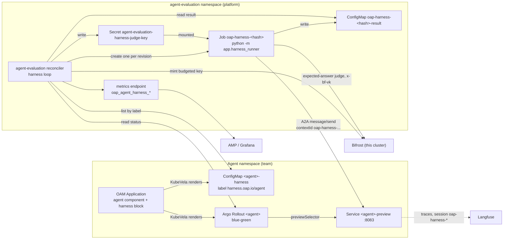

# The agent harness: setup and operation guide

This guide explains how the OAP agent harness works and how to adopt it. It has
two audiences:

- **Agent teams** who want every new revision of their agent scored on a fixed
  dataset (sections 1, 2, 3, 5, 7).
- **Platform operators** who enable and run the harness on a cluster
  (sections 2, 4, 5, 6, 7, 8).

The worked example in section 6 is the setup we tested end to end on a hub
cluster. Design and contracts: [§4b of the design doc](../../docs/architecture/agent-evaluation.md#4b-the-agent-harness-phase-3-report-mode).
Reconciler internals: [README](README.md). Read-only checks: [TESTING.md](TESTING.md#harness-report-mode).

Everything here describes the harness on `main` (issue #137). Statements
marked **Not verified** were not exercised on a cluster.

## 1. What the harness is and when to use it

The harness is **offline, fixed-dataset evaluation of each new agent revision**.
When an agent's Argo Rollout gets a new revision, the platform sends every case
in the agent's dataset to that revision through the `<agent>-preview` Service,
asks a judge model whether each answer matches the case's reference, and
publishes the result as `oap_agent_harness_*` metrics.

| | Online evaluation (Phase 1, `evaluation` block) | Harness (Phase 3, `harness` block) |
|---|---|---|
| Input | sampled live traffic, after the fact | a fixed dataset of cases you control |
| When | continuously | once per new revision, and again when a revision becomes current after a rollback |
| Question answered | how is the agent doing for users? | did this revision regress on known cases? |
| Judge | Langfuse evaluators through Bifrost (hub-owned key) | `expected-answer` check through this cluster's Bifrost (per-cluster harness key) |
| Output | `oap_agent_eval_*` | `oap_agent_harness_*` |

Use the harness when you have a set of questions your agent must keep answering
correctly (past failures, core tasks, safety refusals) and you want each new
revision measured against them before you rely on it.

**Report mode only.** The harness scores each new revision and promotion goes
ahead regardless of the score. `mode: gate` is reserved for a later phase and is
rejected at admission today. The score is published next to your threshold;
nothing reads it back into the Rollout, so the harness never blocks or delays a
promotion. Gate mode (hold promotion below the threshold) is not built: the
`agent` component CUE rejects `mode: gate`, and the reconciler also refuses any mode other than
`report` in a hand-written declaration (`harness_declarations.py`, `VALID_MODES`).

## 2. How it works end to end



Step by step, with the code that does it:

1. **Declaration.** The `agent` component (`platform/oam/definitions/components/agent.cue`)
   renders a ConfigMap `<agent>-harness` in the agent's namespace when
   `harness.enabled: true`. It carries the label `harness.oap.io/agent: <agent>`
   and the data keys `agent`, `dataset`, `checks` (JSON list), `threshold`,
   `mode`, `previewService` (`<agent>-preview`) and `previewPort` (`8083`). It
   is a KubeVela output, so disabling the block or deleting the Application
   deletes it.
2. **Discovery.** The reconciler runs in the **same cluster** as the agent. Its
   harness loop (`harness_loop.py`, every `harness.intervalSeconds`, default
   60 s) lists ConfigMaps with the `harness.oap.io/agent` label in every
   namespace and reads the agent's `rollouts.argoproj.io` object in that
   cluster. It cannot see another cluster's agents. The selector is
   `harness.oap.io/agent,!harness.oap.io/result`: the runner's result
   ConfigMaps also carry `harness.oap.io/agent`, so anything labelled
   `harness.oap.io/result` is excluded. Results are never read as
   declarations and never get declaration Events.
3. **Trigger.** The revision is the Rollout's `status.currentPodHash`. A run
   starts only when `status.blueGreen.previewSelector` equals it, meaning
   `<agent>-preview` already selects the newest ReplicaSet. The first revision
   the harness sees for an agent runs as a baseline (`trigger=first-revision`);
   later ones are `new-revision`. A revision that ran before and becomes
   current again after another revision was current (a rollback) runs again as
   `trigger=rollback` (see §5 for the limits).
4. **One Job per (namespace, agent, revision, dataset) each time the revision
   becomes current.** The first run is named
   `oap-harness-<first 12 hex of sha256("<namespace>/<agent>/<revision>/<dataset>")>`;
   run n >= 2 (a rollback) hashes `"<namespace>/<agent>/<revision>/<dataset>/<n>"`
   (`naming.py`). Every Job and its pod carry `harness.oap.io/run-number`
   (a Job without it counts as run 1). Jobs are created in the reconciler's own
   namespace (`agent-evaluation`), never in the agent's. The Job objects are
   the "already ran" record. `backoffLimit: 0`, so a failed run is reported and never
   retried. At most `harness.maxConcurrentJobs` (default 2) run at once; a new
   revision waits for a slot.
5. **Cases.** The Job runs the reconciler image as `python -m app.harness_runner`
   under ServiceAccount `agent-evaluation-harness-runner`. It waits up to
   `harness.readyTimeoutSeconds` (600 s) for the preview's A2A agent card, then
   sends each case as an A2A `message/send` to
   `http://<agent>-preview.<namespace>.svc.cluster.local:8083/` with
   `contextId = oap-harness-<revision>-<caseId>` (run n >= 2:
   `oap-harness-<revision>-r<n>-<caseId>`) and no caller identity, so every
   case is a fresh session (`a2a_client.py`). Every form starts with
   `oap-harness-`, the marker online evaluation excludes.
6. **Judge.** Each answer goes to the `expected-answer` check: one
   OpenAI-compatible call to this cluster's Bifrost
   (`http://bifrost.bifrost.svc.cluster.local:8080/v1/chat/completions`) with
   the harness judge virtual key in `x-bf-vk` (`judge.py`). The judge must reply
   with `{"score": <0..1>, "reasoning": "..."}`. A case passes when
   `score >= casePassScore` (default 0.7). Any other reply is a case error,
   never a pass.
7. **Judge key.** The reconciler mints a harness-only, budgeted virtual key
   named `oap-harness-judge-<config hash>` in this cluster's Bifrost through
   the management API and writes it to Secret
   `agent-evaluation-harness-judge-key` (key `BIFROST_VIRTUAL_KEY`), which every
   Job mounts as a file (`bifrost_admin.py`).
8. **Result.** The Job writes one ConfigMap `<job>-result` (key `result.json`,
   schema `oap.harness.result/v1`) in `agent-evaluation` and exits.
9. **Metrics.** Only the long-lived reconciler publishes `oap_agent_harness_*`
   on its `/metrics` (Service `agent-evaluation-metrics`, port 9090). The Job
   publishes nothing. The platform's AMP scraper picks the series up through
   the Service's `prometheus.io/scrape` annotations, the Grafana dashboard
   `agent-evaluation` has a harness row, and the chart ships two pipeline
   alerts.
10. **Excluded from online scoring.** The base image (`strands-agent-base`,
    `app/agent.py` and `app/config.py`) tags a trace whose session starts with
    `oap-harness-` as `source:harness`. Every online evaluation rule the
    reconciler writes carries two clauses, always on: `tags none of
    ["source:harness"]` and `sessionId does not contain oap-harness-`
    (`cluster_loop.py`). The session clause also covers images that predate the
    tag.

## 3. For agent teams

### 3.1 Turn it on

Add a `harness` block to your `agent` component. This is the whole change on
your side ([full example](../../platform/oam/examples/example-agent-harness.yaml)):

```yaml
spec:
  components:
    - name: my-agent
      type: agent
      properties:
        # ... your existing properties ...
        harness:
          enabled: true
          dataset: example-smoke-v1   # a platform catalog dataset name
          checks: [expected-answer]   # the only check today
          threshold: 0.8              # reported next to the score
          mode: report                # the only accepted mode
```

| Field | Default | Validation (CUE at admission, then the reconciler) |
|---|---|---|
| `enabled` | `false` | bool. `false` or no block renders nothing |
| `dataset` | none, required | `^[a-z0-9]([a-z0-9]\|-[a-z0-9])*$`, at most 63 characters. Must name a dataset the platform ships, or the reconciler records `UnknownDataset` and starts no run |
| `checks` | `["expected-answer"]` | non-empty list; `expected-answer` is the only value |
| `threshold` | `0.8` | number in (0, 1] |
| `mode` | `report` | only `report`; `gate` is rejected |

Prerequisite: the cluster your agent runs on must have the `agent-evaluation`
addon with `harness.enabled: true` (section 4). Ask your platform operator.

Known gap (O-1): a block without `dataset` is admitted by the KubeVela webhook
and then fails at render (`outputs.harnessSpec.data.dataset: incomplete value`),
so nothing renders. Check `kubectl get application.core.oam.dev <app> -n <ns>`
if no `<agent>-harness` ConfigMap appears.

### 3.2 Datasets

A dataset is referenced **by name** from the platform catalog: the files in
`gitops/addons/charts/agent-evaluation/files/harness/datasets/<name>.yaml`,
rendered into ConfigMap `agent-evaluation-harness-datasets`. Adding or changing
a dataset is a reviewed chart change. The `<namespace>/<name>` form is reserved
for team-owned datasets and is not accepted yet.

Only one dataset ships: `example-smoke-v1`, four smoke cases for a general
assistant with a time tool. It is an **example** that shows the format. It is
not a golden set for your agent. Your real dataset must come from your agent's
real traces and real failures (see 3.3).

Schema (`datasets.py`):

```yaml
name: my-agent-regression-v1      # must equal the file name without .yaml
description: What this dataset covers.
cases:
  - id: refund-policy-30-days     # unique, same pattern as dataset names, at most 40 characters
    input: What is your refund window?          # sent to the agent as one A2A message
    expected: >-                                # what a correct answer must contain or do
      States that refunds are accepted within 30 days of purchase.
    tags: [policy, regression]                  # optional, copied to the result
    expectTools: [lookup_policy]                # optional, accepted and IGNORED today
```

Rules the loader enforces: zero cases, or more than `harness.maxCases`
(default 50), is a run error; cases are never truncated. `input` and `expected`
must be non-empty strings. When any case has `expectTools`, the result reports
`expectToolsIgnored: true` so nobody reads it as checked. `expected` may contain
`{{now}}`: the runner renders it as the current UTC time (for example
`2026-01-02T12:00:00Z`) when it calls the judge, so a time-dependent case is
judged against the real time.

### 3.3 Writing good cases

- **Source cases from reality.** Pull inputs from Langfuse traces of real
  sessions, especially ones that failed, scored low online, or caused an
  incident. A case that once broke is the most useful regression test.
- **Write `expected` as a rubric, not a transcript.** The judge matches meaning,
  not wording (`files/harness/checks/expected-answer.md`). Say what a correct
  answer must contain or do, for example "States 21:00 in Tokyo (JST, UTC+9)."
- **Include refusals.** If the agent must decline something, say so: "Says it
  cannot book flights and does not claim to have booked anything." An answer
  that claims to have done it scores 0.0.
- **Keep each case independent.** Every case is a fresh session with no memory
  and no caller token, so a case cannot rely on an earlier one. An agent with
  `PROPAGATE_CALLER_TOKEN=true` has no token to forward to its MCP tools during
  a run.
- **Avoid answers that change with time or data** unless `expected` allows for
  it. For the current time, put `{{now}}` in `expected` and say how close the
  answer must be, for example "The current UTC time is {{now}}. Passes if the
  answer states a UTC time within 5 minutes of it, or says plainly that it
  cannot access the current time."
- **Version the dataset name** (`-v1`, `-v2`) when you change cases, so the
  series of an old and a new dataset are not mixed.
- **Tag cases** (`smoke`, `safety`, `tools`) so you can read results by group in
  `result.json`.

### 3.4 Choosing a threshold

`pass_ratio = passed / (passed + failed)`. A reply from your agent that is not a
usable answer (failed Task, JSON-RPC error, HTTP 5xx, timeout) is a **failed**
case. A judge error after retries, or a transport error or HTTP 4xx on the path
to the preview, is a case **error**: counted in `errors`, outside the ratio,
because it says nothing about your revision. `threshold_met` is `pass_ratio >= threshold`. Start from the pass ratio your
current good revision gets (its `first-revision` baseline), then set the
threshold a little below it so a real regression shows and judge noise does
not. With a small dataset each case is a large step: with 4 cases, one failure
is 0.75, so `0.8` means "every case must pass". Changing only the threshold
starts no new run; the series switch to the new threshold at the next pass.

### 3.5 Reading results

**Events** on your declaration ConfigMap, in your own namespace, no platform
access needed:

```bash
kubectl describe configmap <agent>-harness -n <ns>
kubectl get events -n <ns> --field-selector involvedObject.name=<agent>-harness
```

| Reason | Type | Meaning |
|---|---|---|
| `HarnessRunStarted` | Normal | a run started for a revision (`first-revision`, `new-revision` or `rollback`; a re-run says `run <n>`) |
| `HarnessRunCompleted` | Normal | `revision <hash>: <passed>/<cases> passed on <dataset> (<errors> errors)` |
| `HarnessRunFailed` | Warning | the run errored (preview unreachable, dataset invalid, every case errored, timeout) |
| `HarnessRunSuperseded` | Normal | the revision moved during the run; the result was discarded |
| `UnknownDataset` | Warning | the dataset name is not in the platform catalog |
| `InvalidHarnessDeclaration` | Warning | a field in the ConfigMap is invalid (the message names it) |
| `HarnessJudgeKeyUnavailable` | Warning | no run starts because the judge key is missing (platform issue) |

Every message starts with `[<cluster>]`.

**Result ConfigMap.** Jobs and results live in `agent-evaluation`. Reading them
needs access to that namespace (ask your operator if you do not have it):

```bash
kubectl get jobs -n agent-evaluation \
  -l harness.oap.io/agent-namespace=<ns>,harness.oap.io/agent=<agent>
kubectl logs job/<job> -n agent-evaluation
kubectl get cm <job>-result -n agent-evaluation -o jsonpath='{.data.result\.json}' | jq
```

`result.json` keys: `schema`, `namespace`, `agent`, `revision`, `dataset`,
`checks`, `threshold`, `mode`, `trigger`, `judgeModel`, `judgeKeyPresent`,
`startedAt`, `finishedAt`, `status` (`completed` or `error`), `error`, `cases`,
`passed`, `failed`, `errors`, `passRatio`, `thresholdMet`,
`expectToolsIgnored`, and `caseResults[]` with `id`, `status`
(`passed`/`failed`/`error`), `score`, `reason` (judge reasoning, at most 300
characters), `latencyMs`, `tags`.

**Metrics** (`metrics.py`). Labels `cluster`, `namespace`, `agent`, `dataset`:

| Metric | Meaning |
|---|---|
| `oap_agent_harness_cases` / `_passed` / `_failed` / `_case_errors` | counts from the latest completed run |
| `oap_agent_harness_pass_ratio` | `passed / (passed + failed)`; case errors are excluded |
| `oap_agent_harness_threshold` | your declared threshold |
| `oap_agent_harness_threshold_met` | 1 when `pass_ratio >= threshold`, informational |
| `oap_agent_harness_last_run_timestamp_seconds` | when the latest run finished |
| `oap_agent_harness_info` | always 1, extra labels `revision`, `mode`, `judge_model`, `trigger`, `status` |
| `oap_agent_harness_judge_key_present` | label `cluster` only; 1 when the judge key is available |
| `oap_agent_harness_runs_total` | labels `cluster`, `result` (`completed`, `error`, `superseded`) |

Series are **absent, not zero**: an agent with no finished run has none, and an
errored run publishes only `info{status="error"}`, `threshold` and
`last_run_timestamp_seconds`, never counts or a pass ratio.

**Grafana.** Dashboard `agent-evaluation` (folder "Agent Platform"), row
"Harness (pre-promotion dataset, report mode)": panels "Harness pass ratio",
"Cases / passed / errors", "Latest run" and "Last run age". **Not verified:**
the rendered panels in a browser (the dashboard object synced; nobody logged in
to look).

**Langfuse.** Harness traces have session id `oap-harness-<revision>-<caseId>`
(run n >= 2, a rollback re-run: `oap-harness-<revision>-r<n>-<caseId>`).
Filter traces by the `oap-harness-` session prefix to see exactly what the agent did for a
case. They carry tag `source:harness` on images built with the marking change,
and `source:chat` on older images (section 7). They never get an online score.

## 4. For platform operators

### 4.1 Enable the addon and the harness per cluster

Two switches, both per cluster or environment:

1. **The addon.** `agent_evaluation: true` in the environment's
   `gitops/overlays/environments/<env>/enabled-addons.yaml`
   (`control-plane` for the hub, `dev` and `prod` for spokes). The registry
   entry `agent-evaluation` in `gitops/addons/registry/observability.yaml`
   deploys the chart `gitops/addons/charts/agent-evaluation` into namespace
   `agent-evaluation` on every cluster whose cluster secret carries
   `enable_agent_evaluation: 'true'` (sync wave 7, after Langfuse and the OTel
   collector). The addon is `false` in every environment by default, because
   the chart's default image is not published yet (4.2). Turn it on per
   environment, together with an image override.
2. **The harness.** `harness.enabled: true` in the chart values. It is off by
   default and nothing harness-specific (RBAC, ConfigMaps, env, alerts) renders
   without it. Set it in a per-cluster or per-environment values overlay, which
   the addon ApplicationSet reads at highest precedence with
   `ignoreMissingValueFiles: true` (`gitops/bootstrap/agent-platform-app.yaml`):

   ```text
   gitops/overlays/environments/<env>/agent-evaluation/values.yaml
   gitops/overlays/clusters/<cluster>/agent-evaluation/values.yaml
   ```

   ```yaml
   # gitops/overlays/clusters/<cluster>/agent-evaluation/values.yaml
   image:
     repository: <registry>/agent-evaluation
     tag: "<tag>"
   harness:
     enabled: true
   ```

Useful `harness.*` values (`values.yaml`; all have working defaults):

| Value | Default | Effect |
|---|---|---|
| `intervalSeconds` | 60 | harness loop period |
| `maxConcurrentJobs` | 2 | Jobs at once per cluster |
| `historyLimit` | 3 | finished runs kept per agent |
| `caseConcurrency` | 2 | cases in flight per run |
| `caseTimeoutSeconds` | 120 | per case (agent answer, then judge) |
| `readyTimeoutSeconds` | 600 | wait for the preview agent card |
| `runTimeoutSeconds` | 1800 | Job `activeDeadlineSeconds` |
| `maxCases` | 50 | a larger dataset is a run error |
| `judge.alias` | `""` (= `judge.defaultAlias`) | judge model alias from `judge.models` |
| `judge.virtualKey.*` | see 4.4 | key minting, budget, rate limit |
| `checks.expected-answer.casePassScore` | 0.7 | judge score a case needs |
| `runner.resources` | 50m / 128Mi request, 256Mi limit | Job container |

### 4.2 Image and build

One image runs both the reconciler and the harness Job. Build it with
`applications/agent-evaluation/build.sh`, which uses `docker buildx` and builds
`linux/amd64,linux/arm64` by default. Multi-arch is required because OAP
clusters run mixed arm64 and amd64 nodes.

```bash
cd applications/agent-evaluation
./build.sh                                              # build both arches, no push
./build.sh --push --registry <registry> --version <tag> # build and push
```

With `--push` the script logs in to ECR (private or public) using the current
AWS credentials; for other registries run `docker login` first. It prints the
image index at the end.

- Publish to a registry **every cluster that runs agents can pull** (hub and
  spokes). A private repository in one account works only where the node role
  can pull from it.
- Pin `image.tag` to an immutable tag (we used the commit short sha) and record
  the index digest. Do not overwrite tags.
- The chart default `image.repository` is the platform public repository, which
  does not exist yet; that is why the addon defaults to off (section 8).

### 4.3 Required platform pieces

On each cluster where the harness runs:

| Piece | Why |
|---|---|
| Argo Rollouts | the agent component deploys a blue-green Rollout; the harness keys on its status and the `-preview` Service |
| KubeVela with the OAP component definitions (`oam_components`) | renders the agent and the `<agent>-harness` ConfigMap |
| Bifrost (`bifrost.bifrost.svc.cluster.local:8080`) | judge calls and the management API for the judge key |
| Langfuse (hub) and the OTel collector | traces, and online evaluation that must exclude harness traffic. The reconciler itself also needs the Langfuse key pair for its other loops |
| AMP scraper, Grafana operator (optional) | metrics and the dashboard |
| Bedrock access to the judge model | the default judge is `judge.models.judge-default` |

### 4.4 The judge key

The harness judge key is separate from the online judge key (`judge.virtualKey`,
hub only). A Bifrost virtual key is valid only in the Bifrost that minted it,
and every cluster runs its own Bifrost, so the key cannot be shipped through
Secrets Manager from the hub.

- **Mint.** With `harness.judge.virtualKey.mint: true` (default), each pass the
  reconciler computes the key name `oap-harness-judge-<8 hex>` from the allowed
  models, the provider key ids (`["*"]`), the budget and the rate limit. It
  creates the key in Bifrost if missing (provider `bedrock`,
  `allowed_models` = the judge model unless `allowedModels` is set, budget
  `budget.maxLimitUsd` per `budget.resetDuration`, default 20 USD per `1M`,
  rate limit 2000 requests per `1h`) and deletes stale keys with the prefix.
- **Reuse.** The Secret's annotation `harness.oap.io/judge-key-name` records
  which key the value belongs to. On restart the reconciler reuses the existing
  key and value, so the budget is not reset and running Jobs keep a valid key.
  A config change (budget, models) produces a new name and replaces the key.
- **Fail closed.** With `required: true` (default), while the key is unavailable
  no new Job starts, each declaration gets a `HarnessJudgeKeyUnavailable`
  Event, `oap_agent_harness_judge_key_present` is 0, and the harness loop pass
  is not counted as successful. `required: false` lets runs start without a key,
  so judge calls go through Bifrost unbudgeted.
- **`mint: false`.** The reconciler only checks that Secret
  `agent-evaluation-harness-judge-key` holds a value. Use this when something
  else owns the key.
- **Governance-auth caveat.** Minting relies on Bifrost's management API being
  reachable in-cluster without credentials, which is true only while Bifrost
  governance auth is off (the current config). When governance auth is turned
  on (#18), set `mint: false` and let a platform minter write the Secret.

### 4.5 RBAC actually granted

From `templates/10-rbac.yaml`, only with `harness.enabled: true`. The live test
compared every verb against this template with no mismatch.

| Subject | Scope | Grant |
|---|---|---|
| `agent-evaluation-reconciler` (ClusterRole, added) | cluster | `get`, `list`, `watch` on `argoproj.io` `rollouts` (read only) |
| `agent-evaluation-reconciler` (Role `agent-evaluation-harness`) | `agent-evaluation` only | `batch` `jobs`: `create`, `get`, `list`, `watch`, `delete`; `configmaps`: `delete`; `secrets`: `create`, and `get`, `update`, `patch` on `agent-evaluation-harness-judge-key` only |
| `agent-evaluation-harness-runner` (Job pods, Role `agent-evaluation-harness-runner`) | `agent-evaluation` only | `configmaps`: `create` only (no read, no update) |

The reconciler's existing ClusterRole already grants cluster-wide
`get`/`list`/`watch` on ConfigMaps and `create`/`patch`/`get` on Events. Nothing
new is granted in any agent namespace: the Job reaches the agent over its
`-preview` Service, not the Kubernetes API.

### 4.6 Alerts and the PF-1 caveat

`templates/61-prometheus-rule.yaml` adds two pipeline alerts when the harness
is on and the `monitoring.coreos.com/v1` PrometheusRule CRD exists:

| Alert | Expression | For |
|---|---|---|
| `AgentHarnessStale` | `time() - max by (cluster) (oap_agent_eval_last_success_timestamp_seconds{loop="harness"}) > max(3 x intervalSeconds, 900)` | 15m |
| `AgentHarnessJudgeKeyMissing` | `max by (cluster) (oap_agent_harness_judge_key_present) == 0` | 30m |

There is no alert on the pass ratio; a low score is the owning team's signal on
the dashboard. The harness loop is not part of `/readyz`, so `AgentHarnessStale`
is how a stuck loop shows.

**PF-1: nothing evaluates this PrometheusRule on the hub today.** The rule is
rendered, and both expressions return the expected results when queried in AMP,
but neither alert can fire:

- The hub runs no Prometheus, prometheus-operator or Thanos Ruler. The
  `monitoring.coreos.com/v1` CRDs are installed (so the rule renders), but no
  component loads PrometheusRule objects.
- Metrics go to AMP through the managed scraper, and nothing copies
  PrometheusRules into AMP. The AMP ruler holds only the rule groups the
  platform's `observability-aws` addon creates as Crossplane
  `RuleGroupNamespace` resources.
- The AMP workspace has no `AlertManagerDefinition`, so even the rules AMP does
  evaluate only produce `ALERTS` series, not notifications.

This is a platform-level gap, not specific to the harness: the Langfuse
`langfuse-storage` PrometheusRule has the same problem. It is out of scope for
issue #137 and deferred. Until the platform decides how addon alerts are
evaluated (AMP rule groups or Grafana alert rules, design Q7), watch
`oap_agent_harness_judge_key_present` and
`oap_agent_eval_last_success_timestamp_seconds{loop="harness"}` on the
dashboard or with your own alerting.

### 4.7 Run it on every cluster that runs agents

The reconciler reads Rollouts and declarations **in its own cluster only**, and
the Job reaches `<agent>-preview` through cluster DNS. A harness on the hub does
nothing for an agent on a spoke. Enable the addon and `harness.enabled` on every
cluster, spokes included, where agents declare a `harness` block. Each cluster
mints its own judge key in its own Bifrost; no hub change is needed for a spoke.
**Not verified:** the harness on a spoke (the test ran on the hub only; the
spoke was checked to have no harness objects).

## 5. Behaviour you can rely on

All of the following was observed on the live hub in the final test pass, unless
marked otherwise. Ids (D1 to D5, O-1, O-2) refer to the test report.

| Behaviour | Detail |
|---|---|
| First-revision baseline | When no Job exists for the agent, the current revision runs once as `trigger=first-revision`. On a first deploy `-preview` and `-stable` select the same pods, so the baseline exercises pods that also serve users |
| One run per time a revision becomes current | A new pod hash creates exactly one Job (`new-revision`). A revision that stays current is never re-run, not on later passes and not after a restart |
| Rollback re-runs | A revision that ran before and becomes current again runs again as `trigger=rollback`, run n+1 (label `harness.oap.io/run-number`). It counts as having come back when a retained Job of another revision of the agent was created after its newest run. Once that run finishes, the series show it. Limits: if the in-between revision left no retained Job (it never started a run, its run was stopped or discarded before the re-run could start, for example while all job slots were busy, or it was pruned), there is no re-run and the series keep the revision's own earlier run. If all of the revision's runs were pruned, it runs as `new-revision`, run 1 |
| Restart is safe | A reconciler restart creates or deletes no Job, re-mints no key and does not reset its budget; gauges come back from the retained results. `runs_total` and completion Events are counted again once after a restart (by design) |
| Superseded runs are discarded (D5) | If the revision moves while a run is active, the Job is stopped. If a run the reconciler saw active finishes after `-preview` moved to another revision, it is discarded. Both delete the Job and its result, record `HarnessRunSuperseded` and increment `runs_total{result="superseded"}`; nothing is published for it. Accepted trade-off: a valid run that ended just before a rollout within one pass interval is discarded too. After a restart, an already finished run is taken as it is |
| Invalid declaration keeps history (D1) | A hand-edited or otherwise invalid `<agent>-harness` gets `InvalidHarnessDeclaration`, starts no run, and keeps the agent's Jobs, results and series. KubeVela restores a rendered ConfigMap on its next reconcile, with no re-run |
| All cases errored is a run error (D2) | The agent's own unusable replies (failed Task, JSON-RPC error, HTTP 5xx, timeout) are failed cases and count in the pass ratio. Judge errors (retried up to 3 times on transport, 429 and 5xx) and transport or 4xx errors on the preview path are case errors, outside the ratio. If every case errored, the run is `status=error` with no counts or pass ratio, so a judge or path outage never reads as a 0% revision; an agent failing every case is a completed run at 0 |
| Series follow the current declaration (D3, D4) | Metrics show the newest finished run on the **declared** dataset against the **declared** threshold. A threshold-only change starts no run; `threshold` and `threshold_met` update at the next pass |
| Disable cleans up | `enabled: false` or removing the block deletes the ConfigMap; the reconciler then deletes that agent's Jobs and results and drops its series (absent, not 0). Later revisions start no run. Re-enabling runs as `first-revision` |
| History limit | Finished runs are pruned to `historyLimit` (default 3) per agent, newest by finish time, with no orphan result ConfigMaps |
| Validation | 14 hostile hand-written ConfigMaps (agent names with `../` or capitals, `previewService` set to an external host, an IP, a dotted name or a URL, `mode: gate`, out-of-range ports and thresholds, unknown checks) were each refused with the field named; no Job was created and the loop kept running |
| O-1 | A block without `dataset` passes admission and fails at render; nothing renders |
| O-2 | Fixed (DEF-2): a rollback now starts a `rollback` run, and the series show it once it finishes. Until then they show the latest finished run on the declared dataset, which can belong to another revision; the `revision` label stays accurate. See "Rollback re-runs" for when no re-run starts |

## 6. Worked example: our tested hub setup

Placeholders: `<registry>` for the image registry, `<tag>` for the image tag,
`<hub-context>` for the hub kube context.

### 6.1 Enablement (hub only)

We enabled the harness on the hub only; `dev` and `prod` stayed off. We set
these two files locally and did not commit them; on `main` the addon is off
and the hub overlay only pins an image:

- `gitops/overlays/environments/control-plane/enabled-addons.yaml`:
  `agent_evaluation: true`.
- `gitops/overlays/clusters/hub/agent-evaluation/values.yaml`:

  ```yaml
  image:
    repository: <registry>/agent-evaluation
    tag: "<tag>"            # the fix commit's short sha, multi-arch index
  harness:
    enabled: true           # everything else: chart defaults
  ```

  Defaults in use: judge key minted in the hub's Bifrost, judge model
  `judge.defaultAlias`, interval 60 s, history 3, `casePassScore` 0.7.

The image was built with `./build.sh --push --registry <registry> --version <sha>`
and pushed to a private registry in the hub's account, so the node role could
pull it.

### 6.2 The test agent

The test agent is [`platform/oam/examples/example-agent-harness.yaml`](../../platform/oam/examples/example-agent-harness.yaml)
(agent `harness-assistant` in namespace `default`, `harness: {enabled: true,
dataset: example-smoke-v1, checks: [expected-answer], threshold: 0.8, mode:
report}`) plus a time tool, because the `utc-time-now` case in
`example-smoke-v1` needs one. Without the tool that case fails, as expected.

We added to the agent component:

```yaml
        mcpServers:
          - name: time-server
      traits:
        - type: gateway-identity   # secretless identity for AgentGateway
```

and a second component, the server from
`workshop/applications/agents/deployment/templates/time-server.yaml`:

```yaml
    - name: time-server
      type: mcp-server
      properties:
        image: <time-server-image>   # pin by digest
        port: 8000
        registerWithGateway: true
        allowedAgents: [harness-assistant]
        env:
          - name: LOCAL_TIMEZONE
            value: UTC
```

No Argo CD application syncs OAM Applications onto the hub from this repo, so
apply it by hand once the hub addons are Healthy:

```bash
kubectl --context <hub-context> apply -f <harness-assistant.yaml>
kubectl --context <hub-context> get application.core.oam.dev harness-assistant -n default
```

### 6.3 Verification commands (read only)

Metrics and readiness through the API server's service proxy, so no
port-forward is needed:

```bash
K="kubectl --context <hub-context>"
EV=agent-evaluation

# reconciler and readiness
$K get pods -n $EV
$K get --raw "/api/v1/namespaces/$EV/services/agent-evaluation-metrics:9090/proxy/readyz"

# declaration and its Events
$K get cm -A -l harness.oap.io/agent
$K describe cm harness-assistant-harness -n default

# revision vs preview: a run starts when the first two values are equal
$K get rollout harness-assistant -n default \
  -o jsonpath='{.status.currentPodHash} {.status.blueGreen.previewSelector} {.status.blueGreen.activeSelector}{"\n"}'

# runs and results, always in the platform namespace
$K get jobs -n $EV -l harness.oap.io/run=true -L harness.oap.io/revision
$K get cm -n $EV -l harness.oap.io/result=true
$K get cm <job>-result -n $EV -o jsonpath='{.data.result\.json}' | jq '{status, cases, passed, passRatio, thresholdMet}'

# metrics and loop health
$K get --raw "/api/v1/namespaces/$EV/services/agent-evaluation-metrics:9090/proxy/metrics" \
  | grep -E '^oap_agent_harness_|oap_agent_eval_(last_success_timestamp_seconds|errors_total)\{.*loop="harness"'

# judge key: key names only, never the value
$K get secret agent-evaluation-harness-judge-key -n $EV -o jsonpath='{.data}' | jq 'keys'
$K get secret agent-evaluation-harness-judge-key -n $EV \
  -o jsonpath='{.metadata.annotations.harness\.oap\.io/judge-key-name}{"\n"}'

# the key in Bifrost: print metadata only (the list reply includes the key value)
$K get --raw "/api/v1/namespaces/bifrost/services/bifrost:8080/proxy/api/governance/virtual-keys?search=oap-harness-judge-" \
  | jq '.virtual_keys[] | {name, budgets, rate_limit, provider_configs}'
```

For the Langfuse exclusion check (rule filters, and a harness trace with no
score) follow step 6 of [TESTING.md, "Harness (report mode)"](TESTING.md#harness-report-mode).

### 6.4 What the test covered

Eleven scenarios, all passing on the final build after six defects were fixed
and the whole suite was rerun from a clean state:

| # | Scenario |
|---|---|
| S1 | First-revision baseline: one Job in `agent-evaluation`, 4/4 passed, promotion not held |
| S2 | New revision runs once; superseded runs (active and finished-after-move) are discarded |
| S3 | Reconciler restart: no Job, key or gauge change, budget not reset |
| S4 | Judge key lifecycle: Secret deleted (reused, no mint), and fail closed with `mint: false` |
| S5 | Result correctness: passing, failing (failed, not error) and threshold-only change |
| S6 | Error paths: preview unreachable, agent JSON-RPC error, oversize dataset, judge failure |
| S7 | Admission and validation: CUE rejection, hostile ConfigMaps, hand-edited declaration |
| S8 | Online-evaluation exclusion: harness traces unscored, normal traffic scored |
| S9 | Disable and cleanup, history limit, re-enable as baseline |
| S10 | Non-default agent namespace, RBAC matrix, nothing created in the agent namespace, spoke untouched |
| S11 | Observability: PrometheusRule, AMP series, dashboard synced (alerts cannot fire, PF-1) |

Commands per check and what each mismatch means are in
[TESTING.md](TESTING.md#harness-report-mode).

## 7. Troubleshooting

### Issues we hit and how they were resolved

| Symptom | Cause | Resolution |
|---|---|---|
| Every judge call returned HTTP 400, 0 cases scored | The minted key had no provider config `key_ids`, which Bifrost treats as "no provider keys allowed" | Fixed in code: keys are minted with `key_ids: ["*"]` (still limited by `allowed_models`), and `key_ids` is part of the name hash so an old key is replaced automatically. Use an image with this fix |
| Keycloak or Langfuse sign-in timed out for in-cluster callers | Traffic from inside the cluster to the platform's public endpoint leaves through the cluster's NAT gateway and comes back to the load balancer, which did not allow those source IPs | Allow the clusters' NAT gateway egress IPs on the platform load balancer (the platform install records them as `nat_egress_cidrs` in the hub's `<hub>/config` secret) |
| A spoke did not register with the hub | A `<cluster>/config` Secrets Manager secret from an earlier install still existed in "scheduled for deletion" state, so the new install could not recreate it | Either restore the old secret or delete it without a recovery window, then rerun the install for that cluster |
| Harness traces tagged `source:chat`, not `source:harness` (PF-2) | The published agent image predates the harness marking change in `strands-agent-base` | Not a harness defect: the `sessionId does not contain oap-harness-` clause still excludes them (0 scores in every pass). Publish an agent image with the change to make both clauses effective |
| Alerts never fired, even while the condition was true | PF-1: nothing evaluates the PrometheusRule | See 4.6 |

### Where the harness Events are

Every harness Event is recorded on the agent's declaration ConfigMap
`<agent>-harness` in the agent's namespace. That covers the refusals
(`UnknownDataset`, `InvalidHarnessDeclaration`, `HarnessJudgeKeyUnavailable`)
and the run lifecycle (`HarnessRunStarted`, `HarnessRunCompleted`,
`HarnessRunFailed`, `HarnessRunSuperseded`). List them with:

```bash
kubectl get events -n <ns> --field-selector involvedObject.name=<agent>-harness
```

The `oap-harness-*-result` ConfigMaps in `agent-evaluation` never get these
Events. An `InvalidHarnessDeclaration` Event on a result ConfigMap
("dataset None is missing") means the reconciler image predates the DEF-3 fix.

### Common checks per symptom

| Symptom | Check |
|---|---|
| No `<agent>-harness` ConfigMap | `enabled: true` set? `dataset` set (O-1)? Application status and render errors: `kubectl get application.core.oam.dev <app> -n <ns> -o yaml` |
| ConfigMap exists but no Job | Events on the ConfigMap (`UnknownDataset`, `InvalidHarnessDeclaration`, `HarnessJudgeKeyUnavailable`); Rollout `currentPodHash` equals `blueGreen.previewSelector`?; `harness.enabled` on this cluster's addon?; `maxConcurrentJobs` slots busy (reconciler log "waits")? |
| `HarnessJudgeKeyUnavailable`, `judge_key_present` 0 | Reconciler log "harness judge key unavailable"; Bifrost reachable at `harness.judge.virtualKey.bifrostAdminUrl`; governance auth on (4.4)? |
| `info{status="error"}`, no counts | `kubectl logs job/<job> -n agent-evaluation` and `result.json` `error` and `caseResults[].reason`: preview not reachable within `readyTimeoutSeconds`, dataset invalid or over `maxCases`, every case errored (judge failing after retries, preview path refusing or answering 4xx), or `runTimeoutSeconds` hit. An agent answering with errors is not this: it shows as a completed run with failed cases |
| Many case errors with reason `expected-answer: judge returned HTTP 4xx` | Judge key scope (`allowedModels`), budget exhausted, or Bedrock access to the judge model |
| Run discarded with `HarnessRunSuperseded` | The revision moved during the run; the new revision gets its own run (5, D5) |
| Series missing | Absent means no finished run on the declared dataset yet, the last run errored (no counts), or the harness was disabled. `oap_agent_eval_last_success_timestamp_seconds{loop="harness"}` advancing? |
| Job `ImagePullBackOff` | The image registry is not pullable from this cluster, or the image lacks an arch (4.2) |

## 8. Limitations and follow-ups

- **Gate mode.** Not built. It needs an exact per-reply revision check (option
  3 in the design follow-up): the agent exposes its `rollouts-pod-template-hash`
  through the downward API (agent component CUE plus the base image), and the
  runner checks it on every reply and treats a reply from another revision as
  superseding the run. Today a run is tied to its revision by timing only.
- **Real golden dataset.** Only `example-smoke-v1` ships. A real dataset of
  about 20 cases, harvested from real traces and failures, is a TODO on #137.
- **Publishing images and bumping pins.** The reconciler image with the harness
  is not in the platform's public registry yet, so `agent_evaluation` stays off
  on `main`. Once published, set the chart's `image.tag` and remove per-cluster
  image overrides. Publish a `strands-agent` image with the harness marking
  change and bump its default pin.
- **Team-owned datasets.** The `<namespace>/<name>` dataset form is reserved and
  rejected today; datasets are platform chart files.
- **`expectTools`.** Accepted and ignored; there is no tool-call capture yet.
- **Alert evaluation (PF-1).** Platform-level and deferred: choose how addon
  alerts are evaluated (AMP rule groups, a PrometheusRule-to-AMP sync, or
  Grafana alert rules) and add an `AlertManagerDefinition` for notifications.
  See 4.6.
- **PF-2, `source:chat` on harness traces.** The published `strands-agent`
  image predates the marking change, so its harness traces are tagged
  `source:chat` and the exclusion from online scoring relies on the
  `sessionId does not contain oap-harness-` clause alone. Known limitation
  until a base image with the change is published and its pin bumped (see
  "Publishing images and bumping pins").
- **O-1.** Make `dataset` a concrete required constraint so admission rejects a
  block without it.
- **O-2.** Optionally prefer the current revision's run when one is retained
  (a contract change).
- **Spokes.** Running the harness on a spoke is supported by design but was not
  tested live.
