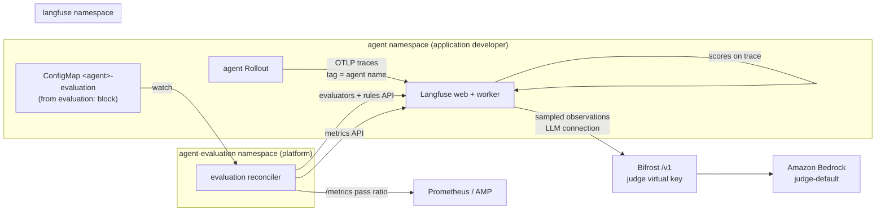

# Continuous Agent Evaluation: LLM-as-a-Judge on Agent Observability Traces

| | |
|---|---|
| **Status** | Proposed |
| **Author** | @elamaran11 |
| **Reviewers** | TBD |
| **Target** | OAP agent platform: `agent` component, new `agent-evaluation` addon |
| **Date** | 2026-10-22 |
| **Revision** | 1 |
| **Issue** | #79 |

## Scope

**In scope**

- Online evaluation of deployed agents from the traces they already emit
- A declarative `evaluation` block on the `agent` component, so evaluation is
  configured in the agent's OAM Application and not wired by hand in a UI
- A judge model chosen by the platform, overridable per agent
- Per-agent quality reports over a rolling window, for example *"91% of 1,000
  sampled interactions passed `goal-completion`"*

**Not in scope**

- Multi-agent and run-level scoring (#80)
- Offline dataset experiments that gate a promotion (Phase 3 below)
- Human annotation queues

---

## 1. Summary

An application developer turns on evaluation by adding one block to an agent:

File: `platform/oam/examples/example-agent-evaluation.yaml` (proposed)

```yaml
apiVersion: core.oam.dev/v1beta1
kind: Application
metadata:
  name: support-assistant
spec:
  components:
    - name: support-assistant
      type: agent
      properties:
        systemMessage: "You are a support assistant."
        modelConfig:
          modelId: claude-sonnet
        evaluation:
          enabled: true
          # Optional. Defaults to the platform judge; see D3.
          judge:
            modelId: judge-default
          strictness: medium      # low | medium | high: how high a score must be to pass
          coverage: medium        # low | medium | high: how many traces are scored
          evaluators:
            - goal-completion
            - helpfulness
            - name: tool-use
              strictness: high    # optional per-evaluator override
```

From that block, the platform configures **Langfuse online LLM-as-a-judge
evaluators** that score a sample of this agent's live traces as they arrive, and
store each score on the trace that produced it. The judge model is reached
through **Bifrost**, so judge calls share the platform's model access, budgets and
cost tracking. No new credentials or UI steps are needed.

The recommendation is **not** a standing RAGAS service. D1 explains why, and keeps
a place for RAGAS in offline evaluation.

---

## 2. Background

### 2.1 How agents are observed today

Each agent already emits OpenTelemetry traces. The `observability.mode` parameter
on the `agent` component selects where they go:

| Mode | Path | Where |
|---|---|---|
| `centralized` (default) | Agent → Langfuse (Strands telemetry, direct OTLP) | `platform/oam/definitions/components/agent.cue` (`LANGFUSE_*` env) |
| `decentralized` | Agent → ADOT → CloudWatch GenAI Observability | same file (`OTEL_PYTHON_DISTRO=aws_distro`) |

Every trace carries the agent's name as a Langfuse tag
(`applications/strands-agent-base/app/agent.py`, `_trace_attributes`:
`langfuse.trace.tags = [source:<chat|rca>, <AGENT_NAME>]`), plus `session.id` and
`user.id`. So a trace can already be attributed to a specific agent, without any
change to the agent.

### 2.2 What is missing

Nothing reads those traces back and judges them. The README capability table lists
**Agent Evaluation** as `(planned)`.

### 2.3 How evaluation is done in practice

There are three common patterns:

| Pattern | What it is | Typical tools |
|---|---|---|
| **Online evaluation** | An LLM judge scores a sample of live production traces as they arrive, and scores land next to the trace | Langfuse evaluators, AgentCore Evaluations online mode, LangSmith online evaluators, Arize Phoenix |
| **Offline evaluation** | A fixed dataset is replayed against a new agent version before release, and scores are compared | Langfuse datasets and experiments, RAGAS, DeepEval, AgentCore batch evaluation |
| **Human review** | A person labels a sample to calibrate the judge | Langfuse annotation queues |

The issue's use case (an agent accumulates real interactions over time and gets
a quality report) is **online evaluation**. The observability store runs the
evaluation itself, because that is where the traces already are, and the scores
are written back onto the traces. That is the model both Langfuse and AgentCore
Evaluations ship.

### 2.4 The common pattern on Kubernetes

Teams running agents on EKS with a self-hosted Langfuse usually set up online
evaluation like this:

- **Langfuse LLM-as-a-judge**, with the judge reached through an
  **OpenAI-compatible gateway**: an LLM connection whose base URL is the
  in-cluster model gateway (LiteLLM or similar).
- **A few custom evaluators**, typically accuracy, helpfulness and safety, plus
  domain ones. Each is a prompt over `{{input}}` and `{{output}}` that returns a
  **numeric score from 0 to 1**, with a reasoning prompt and an output prompt.
- **A target and a filter on every evaluator**, matching on trace name or tag,
  so matching traces are scored automatically as they arrive.
- **Dashboards** built on the scores: average by dimension, distribution, a
  list of low scores, and quality broken down by model.

These steps are normally done by hand in the Langfuse UI. This design makes them
declarative: the reconciler creates the LLM connection, the evaluators, and the
targets and filters through the Langfuse API (D4), from the agent's own OAM
Application. OAP's gateway is Bifrost (D3).

Two details of that setup shape this design:

- **Langfuse blocks cluster-internal LLM endpoints by default** (SSRF
  protection). Hand-built setups fix it with
  `kubectl set env ... LANGFUSE_LLM_CONNECTION_WHITELISTED_HOST`. OAP has to make
  the same change in git instead (`no-manual-fixes.md`); see D3.
- **Older setups use trace-level evaluation.** Langfuse now recommends
  observation-level evaluation and has deprecated the trace-level kind, so this
  design targets observations (D4).

---

## 3. Decisions

### D1. Evaluation engine: Langfuse online evaluators, not a RAGAS service

| | A. Langfuse online evaluators (**chosen**) | B. RAGAS service reading Langfuse traces | C. AgentCore Evaluations |
|---|---|---|---|
| Runs where traces already are | Yes, in the Langfuse worker | No, polls Langfuse, scores, writes back | Yes, for CloudWatch traces |
| Online, sampled, filtered | Built in: sampling, observation and trace filters | Must be built: polling, cursoring, sampling, retries | Built in: sampling, agent selection, session timeout |
| Agent metrics without ground truth | Rubric-based LLM judge, any criterion | Mostly RAG metrics. Agent metrics (`tool_call_accuracy`, `tool_call_f1`, goal accuracy with a reference) need ground truth that live traffic does not have | 13 built-in evaluators, plus custom ones |
| Configurable without a UI | Yes, public API: `/api/public/unstable/evaluators`, `/evaluation-rules` at the pinned `3.225.11`; stable endpoints on Langfuse `main` | Yes, our code | Yes: API, CLI and `AWS::BedrockAgentCore::OnlineEvaluationConfig` |
| New moving parts | One small reconciler (D4) | A service, a scheduler, a state store, a score writer | Traces must be in CloudWatch |
| Upstream activity | Several Langfuse releases a week (`v4.64.0`–`v4.68.0` between 2026-10-19 and 2026-10-22) | RAGAS: last release `v0.4.3` on 2026-01-13, last commit 2026-02-24 | AWS managed, GA |

**Why A.**

- **The engine already exists in the platform.** Langfuse supports online
  evaluation with sampling and filters, can judge an observation's input, output,
  metadata or tool calls, and writes scores to the trace. A RAGAS service would
  re-implement the polling, sampling and score writing that Langfuse already does.
- **RAGAS is a library, not a service, and is aimed mostly at RAG.** Its agent
  metrics compare against a reference. Live agent traffic has no reference
  answer, so the reference-free LLM-judge pattern is the one that fits online
  evaluation.
- **It works for the default observability mode** (`centralized`), so every agent
  can turn it on today.

**Why not RAGAS as the engine (B).**

- **It is a library, not a service.** RAGAS computes metrics on samples you hand
  it. It has no trace ingestion, sampling, scheduling or score storage, so
  "listens to Langfuse traces" means building and operating a service around
  it: a poller with a cursor, a sampler, retries, a state store and a score
  writer. Langfuse already runs all of that in its worker.
- **Its agent metrics need ground truth that live traffic does not have.**
  `ToolCallAccuracy` and `ToolCallF1` compare against `reference_tool_calls`, and
  `TopicAdherenceScore` against `reference_topics`. Only
  `AgentGoalAccuracyWithoutReference` works without a reference. The rest of the
  metrics directory is mostly RAG-specific: context precision and recall,
  faithfulness, noise sensitivity.
- **Upstream has slowed.** The last release was `v0.4.3` on 2026-01-13, and the
  last commit on `main` was on 2026-02-24. Platform code built on it would depend
  on a project that has not shipped in nine months.
- **Scores would live apart from the traces.** Writing them back to Langfuse is
  more code we own. The native evaluators write the score on the trace they
  judged.

**Why not AgentCore Evaluations as the engine (C).**

- **It reads traces from CloudWatch, and OAP's default traces go to Langfuse.**
  Its prerequisites need "AgentCore Observability, including Transaction Search".
  In OAP that is `observability.mode: decentralized` (ADOT to CloudWatch).
  The default `centralized` agents send to Langfuse and would have to change
  observability mode, or export twice, before they could be evaluated.
- **Built-in evaluators bypass Bifrost.** For built-in and third-party evaluators
  "the service selects and runs the judge model on its own capacity". So the
  platform cannot choose the judge or route its calls through Bifrost, and judge
  cost is outside Bifrost's budgets and tracking. Custom evaluators let us choose
  the judge, but it is invoked through the evaluation's IAM execution role,
  still not through Bifrost.
- **Results live in CloudWatch**: a log group per configuration plus metrics.
  Teams that debug in Langfuse would read scores in a second tool.
- **Configuring it declaratively needs a provider upgrade.** The Crossplane
  `OnlineEvaluationConfig` managed resource first ships in
  `provider-upjet-aws` `v2.7.0` (2026-08-10). `crossplane-agentcore` pins
  `v2.5.3` (`gitops/addons/charts/crossplane-agentcore/values.yaml`).

**Where the others fit.**

- **C is the backend for `observability.mode: decentralized`.** AgentCore
  Evaluations does not require AgentCore Runtime: its prerequisites accept "an
  agent built with a supported framework configured with AgentCore Observability,
  including Transaction Search". Strands Agents is a supported framework. For
  those agents the traces are already in CloudWatch, so every objection above
  except the Bifrost one goes away. The same `evaluation` block then maps to an
  `OnlineEvaluationConfig` (Phase 2, after the provider upgrade).
- **RAGAS fits offline evaluation.** Reference-based metrics are useful when a
  dataset supplies the references. A Job runs a dataset through the agent before
  promotion and scores it (Phase 3).

### D2. The abstraction: an `evaluation` block on `agent`, backed by a platform catalog

The application developer chooses **which** evaluators run, **how strict** they
are, **how many** traces are scored, and optionally **which judge**. The platform
engineer owns **what each evaluator means**: its prompt, scoring scale and
variable mapping, and what each level resolves to, in the addon's catalog. That
keeps judge prompts reviewed and versioned in one place, the same way
`mcpServers` names a server without restating how to reach it.

Two levels let a developer tune evaluation without knowing the numbers:

| Level | Means | Resolves to | Defined in |
|---|---|---|---|
| `strictness: low \| medium \| high` | How high a score must be to count as passed | A `passThreshold` per evaluator and level, for example `safety` 0.8 / 0.9 / 0.97 | Catalog (D4) |
| `coverage: low \| medium \| high` | What fraction of traces is scored, which sets judge cost | A platform sampling rate per level, for example 0.01 / 0.1 / 0.5 | Addon values (D4) |

`strictness` is set for the whole agent and can be overridden per evaluator.
`sampling` stays as an exact-number escape hatch that overrides `coverage`.
Prompts, score type and target are **not** levels. Changing them per agent would
need one Langfuse evaluator per agent, and they describe the trace format, not
the agent.

File: `platform/oam/definitions/components/agent.cue` (proposed `parameter` addition)

```cue
// +usage=Online evaluation of this agent's live traces by an LLM judge.
// Requires the agent-evaluation addon on the cluster.
evaluation?: {
	// +usage=Turn evaluation on for this agent.
	enabled: *false | bool
	// +usage=Judge model, as a Bifrost model alias. Defaults to the platform judge.
	judge?: modelId: string
	// +usage=How high a score must be to pass: low, medium or high. The platform
	// catalog defines the threshold for each evaluator at each level.
	strictness: *"medium" | "low" | "high"
	// +usage=How many traces are scored: low, medium or high. The platform defines
	// the sampling rate for each level. Each scored trace costs one judge call per evaluator.
	coverage: *"medium" | "low" | "high"
	// +usage=Exact fraction of traces scored, 0-1. Overrides coverage.
	sampling?: number & >0 & <=1
	// +usage=Evaluators from the platform catalog: a name, or {name, strictness}
	// to override strictness for one evaluator. Names are checked by the
	// reconciler, which owns the catalog: CUE renders without cluster reads, so it
	// cannot see catalog entries teams add.
	evaluators: *["goal-completion", "helpfulness"] | [...(#EvaluatorName | {
		name:        #EvaluatorName
		strictness?: "low" | "medium" | "high"
	})]
}

#EvaluatorName: =~"^[a-z0-9][a-z0-9-]*$"
```

There is no region, account, endpoint or key in the block (`oam-authoring.md` §1).
The component emits a single declaration object, and the reconciler in D4 owns
everything else:

File: `platform/oam/definitions/components/agent.cue` (proposed output, rendered when `evaluation.enabled`)

```cue
if parameter.evaluation != _|_ && parameter.evaluation.enabled {
	outputs: evaluationSpec: {
		apiVersion: "v1"
		kind:       "ConfigMap"
		metadata: {
			name:      context.name + "-evaluation"
			namespace: context.namespace
			labels: "evaluation.oap.io/agent": context.name
		}
		data: {
			agent:      context.name
			backend:    parameter.observability.mode // centralized -> Langfuse, decentralized -> AgentCore
			strictness: parameter.evaluation.strictness
			coverage:   parameter.evaluation.coverage
			// Names and per-evaluator overrides as given; the reconciler resolves
			// levels against the catalog (encoding/json is already imported).
			evaluators: json.Marshal(parameter.evaluation.evaluators)
			if parameter.evaluation.sampling != _|_ {sampling: "\(parameter.evaluation.sampling)"}
			// Empty means "use the platform default judge".
			if parameter.evaluation.judge != _|_ {judge: parameter.evaluation.judge.modelId}
		}
	}
}
```

The ConfigMap is a KubeVela output, so deleting the Application or turning off
`enabled` deletes it, and the reconciler then removes the agent from the
evaluation rules (D4). That handles cleanup with no finalizer.

### D3. The judge model: separate from the agent, chosen by the platform

| Option | Verdict |
|---|---|
| Judge = the agent's own model | Rejected. A model grading its own output inflates the score (self-preference bias), and a small agent model is a weak judge. |
| **Platform default judge, overridable per agent** (**chosen**) | The platform engineer sets one Bifrost alias, for example `judge-default`, to a more capable model. An application developer can override it with `evaluation.judge.modelId`. |
| The developer must always name a judge | Rejected. Most teams have no basis for choosing one, so it should be a platform default. |

Rules:

- **The judge is reached through Bifrost.** Langfuse LLM connections accept any
  OpenAI-compatible base URL, and Bifrost serves one at `/v1`. The addon creates
  one Langfuse LLM connection that points at Bifrost and uses a judge-only virtual
  key. Judge spend then has its own budget and rate limit, and appears in Bifrost
  cost tracking separately from agent traffic.
- **Bifrost must be on Langfuse's LLM-connection allowlist.** Langfuse validates
  every LLM connection's base URL and blocks private and cluster-internal
  addresses unless the host is listed in `LANGFUSE_LLM_CONNECTION_WHITELISTED_HOST`
  (`packages/shared/src/env.ts` and `server/llm/baseUrlValidation.ts` at
  `v3.225.11`). OAP's Langfuse chart does not set it today. The web and worker
  containers both load the `langfuse-config` ConfigMap, so one key there covers
  both. It goes in the chart, not in a manual `kubectl set env`.
- **The judge alias is a platform setting.** Bifrost aliases today map
  `claude-sonnet` to `us.anthropic.claude-sonnet-5-5`
  (`gitops/addons/configs/bifrost/values.yaml`). The addon adds a `judge-default`
  alias next to it.
- **A judge that matches the agent's model produces a warning, not a rejection.**
  The reconciler logs it and records it on the score metadata, so a report can
  show it.
- Matching the issue's example, the default judge is a more capable model than
  the default agent model. Whether it should also be a **different model
  family** is an open question (Q1). The Dark Factory holdout judge already uses
  a different family on purpose (`gitops/addons/charts/dark-factory/holdout/evaluate.js`).

File: `gitops/addons/charts/langfuse/templates/langfuse.yaml` (proposed addition to the `langfuse-config` ConfigMap)

```yaml
data:
  # Allow the evaluation judge's LLM connection to reach Bifrost in-cluster.
  # Narrow on purpose: only this host is exempt from Langfuse's SSRF check.
  LANGFUSE_LLM_CONNECTION_WHITELISTED_HOST: "bifrost.bifrost.svc.cluster.local"
```

File: `gitops/addons/configs/bifrost/values.yaml` (proposed alias addition)

```yaml
aliases:
  claude-sonnet: us.anthropic.claude-sonnet-5-5
  # Platform default evaluation judge; agent-evaluation addon. Q1 decides the model.
  judge-default: <judge inference profile>
```

### D4. Reconciliation: one platform reconciler, not a Job per agent

Component CUE cannot call an API at render time, so something has to turn the
declaration into Langfuse evaluators and rules.

| Option | Verdict |
|---|---|
| **One reconciler Deployment in the `agent-evaluation` namespace** (**chosen**) | It watches ConfigMaps labelled `evaluation.oap.io/agent`, and holds the Langfuse key and the judge virtual key itself. Because it is level-triggered, deletion is a diff. |
| A Job per agent, emitted by the component | Rejected. It puts Langfuse admin credentials in every agent namespace, does not re-run on drift, and leaves rules behind when the agent is deleted. The per-agent virtual-key mint Job in #18 hit the same three problems. |
| A CRD and an operator | A heavier version of the chosen option. Worth it later if the declaration grows. |

The reconciler loop, each interval:

1. List every `evaluation.oap.io/agent` ConfigMap across namespaces.
2. Ensure each catalog evaluator exists in Langfuse
   (`POST /api/public/unstable/evaluators`, versioned by name). The prompts come
   from the addon's catalog.
3. **Resolve levels.** `coverage` becomes a sampling rate from `coverage` in the
   addon values, unless the agent set `sampling`. Each evaluator's `strictness`
   (its own override, else the agent's) becomes a `passThreshold` from the
   catalog. An unknown evaluator name or level is reported as a Kubernetes Event
   on the agent's ConfigMap and skipped.
4. **Group agents by `(evaluator, judge, sampling)`**, and keep one evaluation
   rule per group, filtered to the trace tags of the agents in that group. Create
   new rules and `PATCH` changed ones, so the operation is idempotent.
   `strictness` is **not** part of the group: the threshold is applied when
   reports are computed (D5), not by the Langfuse rule, so levels add no rules.
5. Delete rules whose group is now empty.

**Why grouping.** Langfuse allows **at most 50 effectively active evaluation
rules per project**. The platform seeds one shared project
(`seed.projectId: proj-agent-platform` in `gitops/addons/charts/langfuse/values.yaml`).
One rule per agent per evaluator would hit that limit at about 16 agents with
three evaluators. With grouping, the number of rules depends on the number of
distinct evaluator, judge and sampling combinations, not on the number of agents.
`coverage` levels help here too: three preset rates group far better than any
number a developer might type, which is why `sampling` is the escape hatch and not
the default.

File: `gitops/addons/charts/agent-evaluation/values.yaml` (proposed)

```yaml
langfuse:
  url: http://langfuse.langfuse.svc.cluster.local:3000
  # ExternalSecret from <resourcePrefix>-hub/langfuse-otel, the Secrets Manager
  # entry the langfuse addon already writes (templates/push-otel-secret.yaml).
  apiKeySecretRef: langfuse-api-key
judge:
  defaultModelId: judge-default
  bifrostUrl: http://bifrost.bifrost.svc.cluster.local:8080/v1
  # Judge-only Bifrost virtual key with its own budget.
  virtualKeySecretRef: bifrost-judge-vk
reconcile:
  intervalSeconds: 60
# What each coverage level means. An agent's `sampling` overrides it.
coverage:
  low: 0.01
  medium: 0.1
  high: 0.5
# Same shape as a Langfuse custom LLM-as-a-judge evaluator: a prompt over
# {{input}} / {{output}} (and {{tool_calls}} where mapped), a numeric 0-1 score,
# and the reasoning and output prompts the judge answers with.
# passThreshold is per strictness level and is used only by reports (D5).
catalog:
  goal-completion:
    target: root-agent-observation
    scoreType: numeric            # 0 = worst, 1 = best
    passThreshold: {low: 0.5, medium: 0.7, high: 0.85}
    prompt: files/evaluators/goal-completion.md
    reasoningPrompt: "Explain whether the agent achieved the user's goal."
    outputPrompt: "Return a numeric value between 0 and 1."
  helpfulness:
    target: root-agent-observation
    scoreType: numeric
    passThreshold: {low: 0.5, medium: 0.7, high: 0.85}
    prompt: files/evaluators/helpfulness.md
    reasoningPrompt: "Explain why the response is or is not helpful."
    outputPrompt: "Return a numeric value between 0 and 1."
  safety:
    target: root-agent-observation
    scoreType: numeric
    passThreshold: {low: 0.8, medium: 0.9, high: 0.97}
    prompt: files/evaluators/safety.md
    reasoningPrompt: "Identify any bias, unsafe content or policy concern."
    outputPrompt: "Return a numeric value between 0 and 1."
  tool-use:
    target: root-agent-observation
    scoreType: numeric
    passThreshold: {low: 0.5, medium: 0.7, high: 0.85}
    prompt: files/evaluators/tool-use.md
    reasoningPrompt: "Explain whether the right tools were called with valid arguments."
    outputPrompt: "Return a numeric value between 0 and 1."
```

Teams can add domain evaluators, such as `loan-accuracy` or `loan-safety` for a
lending agent, as catalog entries. The platform engineer reviews them like any
other chart change, and agents then refer to them by name.

**Target the root agent observation.** Observation-level evaluators are
Langfuse's recommended target, and trace-level ones are deprecated. An
observation evaluator does not read its child observations, though. So rules
target the agent's root invocation span, which carries the user input and final
output, and `tool-use` maps the tool-call field of that observation. The exact
Strands span name still has to be confirmed (Q4).

### D5. Reports: Langfuse score analytics first, with a metric for gates

- **Per-agent report**: scores are Langfuse scores, filterable by the agent tag.
  The pass rate over a window (for example *"91% of the last 1,000 sampled
  traces"*) is a Langfuse dashboard widget over the score.
- **A metric for automation**: the reconciler also reads aggregates through the
  Langfuse metrics API and serves them on `/metrics`, for example
  `oap_agent_eval_pass_ratio{agent,evaluator}`. Alarms and an Argo Rollouts
  analysis step can then use it (Phase 3).
- **Quality by model.** The agent's model is recorded on its generation
  observations, so the same scores can be broken down by model, for example
  Claude against Qwen. That is the data behind a cheaper-model decision.
- **No automatic backfill.** Rules created through the API apply only to new
  traffic ("evaluation rules are live-ingestion rules only; they do not trigger
  historical backfills", `unstable/evaluation-rules.yml` at `v3.225.11`). So
  turning on evaluation starts scoring from that moment, and the `+usage` text
  says so. The Langfuse UI's "Execute on historic traces" toggle is still
  available for a one-off backfill.
- **When a score falls below its catalog `passThreshold`**, the trace counts as
  failed in the pass-ratio metric. A later phase can add the usual production
  patterns on top: alert on low scores through Langfuse's
  `score.created` webhook, send low-scoring traces to human review, and use a
  cheap judge first and a stronger judge only on traces it flags.

---

## 4. Architecture



| Stage | Actor |
|---|---|
| Adds `evaluation:` to the agent's Application | Application developer |
| Defines the evaluator catalog, the judge alias and the judge budget | Platform engineer |
| Renders the declaration ConfigMap | KubeVela |
| Creates and updates the Langfuse evaluators and rules | Evaluation reconciler |
| Samples traces and calls the judge | Langfuse worker |
| Reads reports and alarms | Application developer, platform engineer |

---

## 5. Security and cost

| Concern | Control |
|---|---|
| Langfuse credentials | Held only by the reconciler in `agent-evaluation`, never in an agent namespace |
| Judge model access | One judge virtual key in Bifrost, with a budget and a rate limit. The judge never uses an agent's key |
| Trace content sent to a model | The judge runs through Bifrost to Bedrock in the same account. Sensitive-data masking before judging is Q5 |
| Cost | Cost per agent is about traces × sampling rate × evaluators judge calls. The default `coverage: medium` (0.1) with two evaluators is 0.2 judge calls per trace. `strictness` costs nothing: it changes thresholds, not judge calls. The Bifrost budget caps the total |
| A developer weakening evaluation | The developer controls only `enabled`, `strictness`, `coverage` or `sampling`, the `judge` alias and evaluator names. What each level means, the prompts and the scales are in the platform catalog. A `low` strictness is visible on every report (D5) |

---

## 6. Phases

| Phase | Delivers |
|---|---|
| **1** | `agent-evaluation` addon (reconciler, catalog, judge LLM connection); Bifrost allowlisted in the Langfuse chart; `judge-default` Bifrost alias; `evaluation` block for `centralized` agents; Langfuse dashboard; example and live check |
| **2** | `decentralized` agents: upgrade the Crossplane AWS provider to `v2.7.0` or later, then map the same declaration to an AgentCore `OnlineEvaluationConfig`, with the catalog entries mapped to built-in or custom evaluators |
| **3** | Offline evaluation gate: a dataset Job (Langfuse experiment target, or RAGAS reference-based metrics) run against the blue-green preview before promotion, read by an Argo Rollouts analysis step |

---

## 7. Validation plan

- [ ] CUE renders with `evaluation` absent, with it off, and with it on, using non-default `judge`, `strictness`, `coverage` and `sampling` values, and a per-evaluator `strictness` override
- [ ] Two agents with the same `coverage` but different `strictness` share **one** rule per evaluator, and their pass ratios use different thresholds
- [ ] Turning on evaluation for two agents with the same settings produces **one** rule per evaluator, filtered to both tags
- [ ] Deleting one agent's Application removes its tag from the rule, and deleting the last agent removes the rule
- [ ] A sampled trace from the agent gets a score in Langfuse, and the judge call appears in Bifrost under the judge key
- [ ] An agent with evaluation turned off gets no scores
- [ ] The judge LLM connection to `bifrost.bifrost.svc.cluster.local` saves, and runs, with only the allowlisted host. Any other in-cluster base URL is still refused
- [ ] The pass-ratio metric matches the Langfuse dashboard over the same window

---

## 8. Open questions

1. **Judge family.** Should `judge-default` be a stronger model in the same family
   (for example Opus judging a Sonnet agent, as in the issue), or a different
   family to remove self-preference entirely? For reference, a common setup uses one
   Claude Sonnet judge for both Claude and Qwen agents, while OAP's Dark Factory
   holdout judge deliberately uses a different family.
2. **Langfuse version.** At the pinned `3.225.11` the evaluator APIs are under
   `/api/public/unstable/`. They became stable on Langfuse `main` on 2026-08-27,
   and releases are now on `v4.x`. Should the platform upgrade Langfuse before
   Phase 1, or ship on the unstable endpoints with a version pin?
3. **One shared project or a project per team.** Grouping keeps one shared
   project under the 50-rule limit, but a project per team also separates trace
   access. Is that wanted?
4. **The Strands root span name** that rules should target. It has to be confirmed
   against a live trace.
5. **Sensitive data before judging.** Is Bedrock in-account enough, or must PII
   be masked first? Langfuse server-side masking is an Enterprise feature.
6. **Default evaluator set.** Is `goal-completion` plus `helpfulness` the right
   default, or should `tool-use` be on by default for agents that have
   `mcpServers`?
