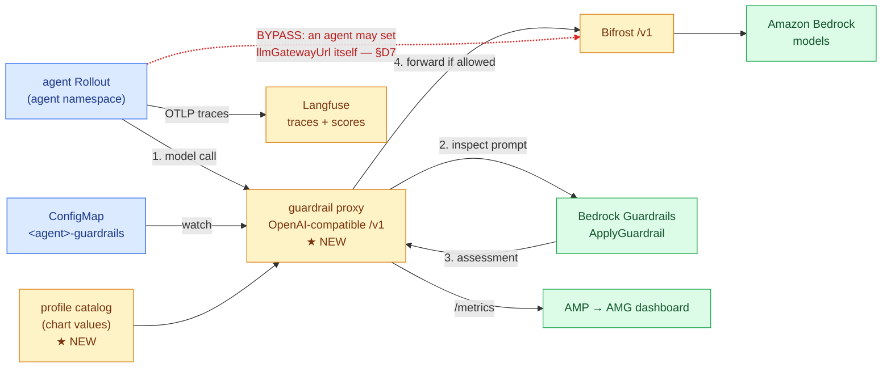
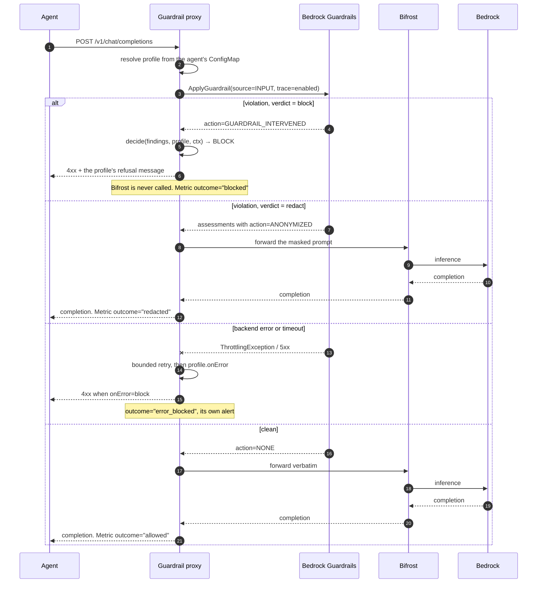
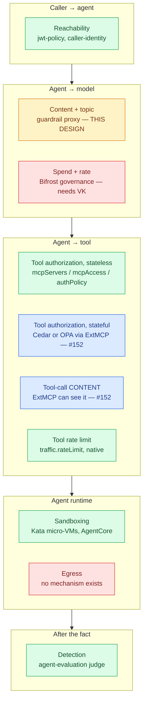

# Agent Guardrails: Runtime Content, Topic and Action Control for OAP Agents

| | |
|---|---|
| **Status** | Proposed — design only, nothing implemented |
| **Author** | @elamaran11 |
| **Reviewers** | TBD |
| **Target** | `agent` component, new `agent-guardrails` addon, `bifrost` chart |
| **Date** | 2026-11-11 |
| **Revision** | 2 |
| **Issues** | #144 (content and topic control), #146 (Dogwood as the decision layer) |
| **Adjacent** | #152 (external policy engine at the MCP hop) — complementary, not competing; see §3.9 |

## Scope

**In scope**

- Inbound and outbound **content** inspection for every agent: prompt injection,
  PII, toxicity, and off-topic requests
- A declarative `guardrails` block on the `agent` component, so a developer
  turns it on without naming a vendor, an ARN, a region or a key
- **Where** the check runs, and what makes that hop hard to skip
- The **decision seam**: how a finding becomes an allow / redact / block verdict,
  and how a stateful policy engine replaces that decision later without an API
  change
- An honest account of what content inspection cannot promise
- Observability that puts a blocked request next to an evaluation score

**Not in scope**

- Tool authorization. Three layers already own it (§2.2) and a fourth writer
  would reintroduce a silent-drop bug the platform has already paid for
- Reachability, sandboxing and spend, each already owned (§2.2)
- Replacing the `authPolicy` CEL surface on `mcp-server`
- Running Dogwood's reference interpreter on the request path (§D6)
- **Inspecting tool-call content, and the external policy engine that would do
  it.** The model hop cannot see a tool call, and the hop that can is the MCP
  hop, which has its own mechanism and its own issue (#152). §3.9 draws the
  boundary and lists what the two designs owe each other

---

## 1. Summary

A developer turns guardrails on by adding one block to an agent:

```yaml
guardrails:
  enabled: true
  profile: standard
```

From that, the platform routes the agent's model calls through an **OAP-owned
inspection proxy** that screens the prompt with **Amazon Bedrock Guardrails**
before Bifrost ever sees it, refuses the request on a violation, and reports
every outcome as `oap_agent_guardrail_*` metrics next to the evaluation scores
already on the dashboard. No vendor, ARN, region or key appears in the
Application.

**Five decisions carry the design, and three of them differ from #144 as
drafted:**

| | Decision | Why it is not what the issue proposed |
|---|---|---|
| D1 | Enforce at a **proxy in front of Bifrost**, not a Bifrost plugin | OAP runs upstream's public OSS image, which is statically linked and **cannot load plugins**; Bifrost's own guardrails are an **Enterprise-licensed image** and **fail open** by default |
| D2 | The agent may only **tighten** the platform profile | `onViolation` as a free choice lets any developer switch enforcement off while the capability still reports as on |
| D3 | **`ApplyGuardrail`**, behind a backend boundary that normalizes findings | The numeric `severityScore` shape #144 and #146 describe is a **different API** (`InvokeGuardrailChecks`), with different price, quota and Region coverage |
| D4 | The verdict is **one function**, and fails **closed** | #146's ask, adopted. Every nearby precedent — Bifrost Enterprise, its judge guardrail, the reference plugin PR, OAP's own `authPolicy` — fails **open** |
| D5 | **Input only** in Phase 1; blocking on output **costs streaming** | Buffer and lose the stream, or stream and lose the guarantee. There is no third option, and every vendor claiming otherwise leaks |

**Two things this design says about itself, because the alternative is the
failure mode OAP has already named:**

- **The hop is not yet unbypassable.** `llmGatewayUrl` is a developer parameter,
  Bifrost needs no credential, and no egress mechanism exists in the repository.
  Until §D7's three changes land, this is a control for cooperating agents and a
  detection for the rest.
- **Content inspection does not close prompt injection, and cannot see tool
  calls at all.** Bedrock Guardrails evaluates neither `toolUse.input` nor
  `toolResult` nor `toolSpec.description` — which on an agent platform is where
  the interesting payloads live.

Dogwood (#146) is **not** a Phase 1 dependency and should not be one: upstream's
interpreter is explicitly not for production, its event store has no eviction and
no persistence, and AgentCore Policy — which is GA, really is Dogwood, and solves
those problems — has no callable authorization API. What Phase 1 owes it is a
decision seam (D4) so the engine can be substituted later without an API change.

---

## 2. Background

### 2.1 Why an agent needs more than a service does

A normal service takes typed input, computes a result, and calls the
dependencies its code names. Three properties break each of those assumptions,
and every one of them is a control gap rather than a quality problem:

| Property | What breaks |
|---|---|
| Input is natural language from a user | Validation cannot be a schema. The input may be an instruction to the model rather than data for it |
| Output is generated, not computed | No code path guarantees what comes back. PII, toxicity or advice can appear in a response no test covered |
| Tool calls are chosen at runtime | Which dependency is called, and with what arguments, is a model decision made per request |

"Guardrails" is used for every consequence of those three at once, which is why
the word causes confusion. The concerns are genuinely separate, with different
enforcement points and different owners.

### 2.2 What OAP already covers — verified against `8be66b1`

Stated precisely so that nothing here is rebuilt. Every row was checked against
the repository, not inferred from a chart name.

| # | Concern | State | Where |
|---|---|---|---|
| 4 | **Tool authorization** | Covered, three layers | `mcpServers` (agent author) → `MCP_SERVER_NAMES`; `mcpAccess` (platform) → `traffic.authorization`; `authPolicy` (server team) → `backend.mcp.authorization` |
| 5 | **Reachability** | Covered | `agent-gateway`: `jwt-policy.yaml`, `caller-identity-policy.yaml`, `credential-passthrough-policy.yaml` |
| 8 | **Sandboxing** | Covered where used | `agentcore-code-interpreter`, `agentcore-browser`, `agent-sandbox` (Kata micro-VMs) |
| 9 | **Detection, post-hoc** | Covered | `agent-evaluation` addon: LLM-as-judge on sampled live traces, including a `safety` evaluator |

The tool-authorization split is deliberate and must not be collapsed. The
ownership boundary is the point: the team that knows `issue_refund` is dangerous
writes the tool rule, not the team that wants to call it. `mcp-access.yaml`
records why the two policies write **different** fields:

> Two policies of equal specificity setting the SAME field tie, and agentgateway
> keeps one at random and silently drops the other while both report Accepted.

That is the whole reason this design adds **no `tools:` key**. A third writer on
`backend.mcp.authorization` would reintroduce that bug.

### 2.3 What OAP does not cover

#### Content and topic: absent entirely

`grep -rin guardrail` over the repository returns six hits, every one of them a
code comment about a memory or session cap. There is no inbound or outbound
content inspection anywhere. A prompt-injection attempt reaches the model and a
PII-bearing completion reaches the user, with nothing in the path that looks at
either.

The closest thing is the `safety` evaluator in the `agent-evaluation` addon, and
it is the right tool for the wrong job here: it runs **after** the response was
returned, on a **sampled** fraction of traces. It measures quality. It cannot
refuse a request.

#### Spend: the mechanism exists and is switched off

`gitops/addons/configs/bifrost/values.yaml` defines `governance` with a
`budget-platform` budget and a `rate-limit-standard` rate limit. Two settings
make them advisory:

```yaml
bifrost.client.enforceAuthOnInference: false
plugins.governance.config.is_vk_mandatory: false
```

The chart's own design notes state the consequence:

> Bifrost runs with governance enabled but `is_vk_mandatory: false` — all
> in-cluster callers can reach the Bedrock backend without authentication.

#### Two things #144 records as covered are not present

| #144 says | Repository at `8be66b1` |
|---|---|
| "The `network-policy-enforcement` addon exists" | No such chart, no registry entry, no `enabled-addons.yaml` key. There is **no egress policy mechanism at all** |
| — | `kyverno`, `kyverno_policies` and `kyverno_policy_reporter` are all `false`, so there is no admission policy engine either |

Both matter to this design, because both are what would make the enforcement
point hard to skip (§2.4).

### 2.3a How this is done in practice

The industry has converged on a shape, and it is worth stating because this
design is an instance of it rather than an invention.

**The enforcement point is a gateway, and every serious implementation is
pre/post around the model call.** Bifrost, LiteLLM, Portkey, Kong AI Gateway and
Cloudflare AI Gateway all expose the same two hooks — inspect the request before
the provider, inspect the response after — and all of them treat the detector as
a pluggable backend rather than something they implement. That is exactly the
seam this design uses; the only question OAP has to answer differently is *how*
to get a hook into its gateway (§D1).

**The detector is almost always a managed service.** The four that matter:

| | Bedrock Guardrails | Azure AI Content Safety | Google Model Armor |
|---|---|---|---|
| Standalone callable | yes (`ApplyGuardrail`) | yes — and *only* standalone; the integrated path needs an Azure-hosted model | yes (`:sanitizeUserPrompt`) |
| Injection detection | yes (`PROMPT_ATTACK`) | yes (Prompt Shields, GA Aug 2024) | yes (`pi_and_jailbreak`) |
| PII | yes, detect **and** mask | **not in this service** — PII is Azure AI Language, a second service at ~2.7× the unit price | yes, incl. de-identification |
| Natural-language denied topics | yes — `definition` + up to 5 `examples` | blocklists and trainable custom categories (preview, retiring 2027-04-30) | no |
| Enforces, or only detects | **enforces** (blocks, masks) | detects — "the API doesn't itself block or route content" | detects — the caller "is responsible for blocking" |
| Throughput | 100 rps (25 in smaller Regions), adjustable | 100 rps on S0, raised only by emailing support | **1,200 QPM** per project |

Two things follow. Bedrock is the only one of the three that both **enforces**
and takes **natural-language topic definitions**, which is why it is the Phase 1
backend for a Bedrock-based platform. And all three are detectors — the gateway
is the policy enforcement point in every case, so the proxy in §D1 is doing the
job these services assume someone is doing.

**In-process libraries are the common mistake.** NeMo Guardrails, Guardrails AI,
LlamaFirewall and Presidio are all good at detection and all live in the
application image, which is precisely what makes them a convention rather than a
control. The pattern that works is to put them *behind* a gateway hook, where the
platform decides whether they ran.

**Everyone fails open, and nearly nobody says so loudly.** This is the most
useful thing the survey turned up, and it is why D4 exists:

- Bifrost Enterprise: "Provider error or timeout | **Fails open**", no documented toggle
- Azure OpenAI's filter: "If the content filtering system is down or otherwise unable to complete the operation in time, your request still completes **without content filtering**"
- Google's inline Vertex integration: skipping sanitization on error or unavailability "can occasionally **expose unscreened prompts or responses**"
- AWS: publishes **no** guidance either way for `ApplyGuardrail` failures

**And everyone's streaming story leaks.** Covered in D5, but the short version
is that the two vendors who document it most honestly both admit the gap: Azure
measured a blocked term escaping in "roughly the last 15 to 30 words" of a
*buffered* stream, and Bedrock's async mode says outright that "response chunks
may contain inappropriate content until guardrails scan completes".

### 2.4 The rule that decides the whole design, and how OAP currently fails it

> **A guardrail belongs at a hop the agent cannot bypass.**

Anything inside the agent image is a convention: a developer can omit it and a
compromised agent certainly will. So the enforcement point matters more than the
detection technology, and the honest question is not "does traffic go through
Bifrost" but "can an agent choose not to".

Today it can. Three facts compose:

| Fact | Source |
|---|---|
| The gateway URL is a **developer-settable parameter** with a default, not a platform constant | `agent.cue`: `llmGatewayUrl: *"http://bifrost.bifrost.svc.cluster.local:8080/v1" \| string` |
| Bifrost requires no credential, so nothing distinguishes a sanctioned caller | `is_vk_mandatory: false`, `enforceAuthOnInference: false` |
| Nothing restricts where an agent pod may connect | no egress policy addon exists (§2.3) |

So an agent can point itself at any reachable OpenAI-compatible endpoint and
leave the platform's path entirely.

**One fact limits the damage, and it is worth being precise about.** Agents hold
no Bedrock IAM permission: `agent.cue` emits no Bedrock policy, and model access
is Bifrost's own ServiceAccount through Pod Identity. So the bypass cannot reach
OAP's own Bedrock path — it can only reach a *different* provider, and only if
that provider is reachable and the agent carries its own credential.

That makes Bifrost the correct enforcement point and an **incomplete** one. This
design treats closing the gap as a named dependency with its own phase, not as
an assumption (§D2, §6).

---

## 3. Decisions

### D1. The enforcement point: an OAP-owned inspection proxy in front of Bifrost

#144 proposes enforcing at Bifrost, on the correct reasoning that every model
call already goes there. The reasoning holds; the *mechanism* does not survive
contact with how OAP runs Bifrost and how Bifrost accepts plugins.

#### What Bifrost actually offers

| Fact | Source |
|---|---|
| The only way a plugin can stop a request is `PreLLMHook` returning `*LLMPluginShortCircuit{Error: ...}`. A returned Go `error` is **logged as a warning and the request continues** | `core/schemas/plugin.go:270, 408-429` |
| There is **no content-guardrail plugin in OSS**. The 12 `plugins/` directories are compat, governance, jsonparser, logging, maxim, mocker, modelcatalogresolver, otel, prompts, routing, semanticcache, telemetry | `plugins/`, and the closed `switch` in `transports/bifrost-http/server/plugins.go` |
| Bifrost's own guardrails framework — including its Bedrock Guardrails integration — is **Enterprise**: "Guardrails are an **enterprise-only** feature. They require the enterprise Bifrost image." | `docs/deployment-guides/helm/guardrails.mdx:7-9` |
| The Enterprise framework **fails open**: "Provider error or timeout \| Fails open: the error is reported and the next profile still runs" | `docs/enterprise/guardrails.mdx:557-561` |
| Loading a custom plugin needs a **dynamically linked** binary. "By default, Bifrost builds are **statically linked** … However, statically linked binaries **cannot load Go plugins**." | `docs/plugins/building-dynamic-binary.mdx` |
| A plugin must match the host binary's Go version, libc and **every transitive dependency**, and must be rebuilt on every Bifrost upgrade: "Do I need to rebuild my plugin when upgrading Bifrost? **Yes, absolutely.**" | `docs/plugins/writing-go-plugin.mdx` |
| A typo in a hook symbol **silently disables that hook** rather than failing the load | `docs/plugins/writing-go-plugin.mdx`; `framework/plugins/soloader.go` |

#### What OAP actually runs

OAP does not build Bifrost. The `bifrost` chart is an umbrella over the upstream
chart as a vendored dependency, and the image is upstream's public OSS build:

```yaml
# gitops/addons/charts/bifrost/Chart.yaml
dependencies:
  - name: bifrost
    version: 2.1.16
    repository: https://maximhq.github.io/bifrost/helm-charts
# charts/bifrost-2.1.16.tgz → values.yaml
image:
  repository: docker.io/maximhq/bifrost   # OAP pins tag v1.5.0
```

So the two Bifrost-native routes both fail a platform requirement:

- **Enterprise guardrails** need a licensed image from a private registry. OAP is
  an open-source reference platform; a capability that only works for customers
  holding a commercial Bifrost licence is not a platform capability
  (`platform-portability.md`: "Every platform capability is a customer
  capability"). It also fails open by default.
- **A custom `.so` plugin** needs OAP to build, publish and version its own
  dynamically linked Bifrost image, in lockstep with upstream's Go toolchain and
  dependency graph, rebuilt on every upgrade. That replaces "wrap the upstream
  chart" with "own a fork of the gateway", for one feature.

#### The options, compared

| Option | Verdict |
|---|---|
| **An OAP-owned inspection proxy in front of Bifrost** (**chosen**) | OpenAI-compatible, owned by this repo like `applications/agent-evaluation`, no Bifrost coupling and no licence. Agents reach it instead of Bifrost by a one-line default change; it inspects, then forwards to Bifrost unchanged. Costs one in-cluster hop |
| Bifrost Enterprise guardrails | Rejected as the default: commercial licence, private image, fails open. **Worth supporting as an alternative backend** for customers who have it (§D3) |
| A custom Bifrost `.so` plugin | Rejected for Phase 1: OAP would own a Bifrost build and a per-upgrade rebuild. Reconsider if upstream ships the planned webhook plugin path, which removes the ABI coupling entirely |
| Agent Gateway | Rejected for content. It sees A2A and MCP traffic, not the model call, so it cannot read a prompt or a completion. It keeps tool authorization, which is its correct job |
| A library in the agent image (NeMo, Guardrails AI, LlamaFirewall, Presidio) | Rejected as the control. It lives where a developer can omit it, which is the definition of a convention rather than a guardrail. Any of them may sit *behind* the proxy later |
| AgentCore policy | Rejected as the platform answer. AgentCore components are optional and per-agent, so binding enforcement there leaves every EKS agent unguarded |
| Kyverno / OPA admission | Yes, but for a different job: what an agent may *declare* (§D5). Not runtime content. Note `kyverno` is `false` in every overlay today |

#### What the proxy is, precisely

One Deployment in a platform namespace, OpenAI-compatible on `/v1`, doing:

1. read the agent's identity from its request
2. resolve that agent's profile from the catalog it holds in memory
3. inspect the prompt; on a violation, apply the verdict (§D4) and **return
   without calling Bifrost**
4. otherwise forward verbatim to Bifrost, and inspect the completion on the way
   back under the same rules

It is deliberately the *same shape* as the evaluation reconciler: a small Python
service in `applications/`, a chart in `gitops/addons/charts/`, a platform-owned
catalog in chart values, and `oap_agent_guardrail_*` metrics.

**Three properties make this honest rather than a workaround:**

- It is a hop, not a library, so a developer cannot omit it from inside an image.
- It holds no new credential beyond its own guardrail-API permission, and never
  the agent's.
- Blocking is its default path on a violation, not an error path, so there is no
  fail-open hiding in a timeout branch (§D4).

**One property makes it incomplete, and must not be glossed:** an agent that
sets `llmGatewayUrl` to Bifrost directly skips it, exactly as it can skip
Bifrost today (§2.4). Closing that is §D7 and Phase 2, and until it is closed
this is a control for cooperating agents and a detection for the rest.

### D2. The developer API: a `guardrails` block that can only tighten the profile

The split that worked for evaluation: the developer declares **what**, the
platform owns **how**. No vendor, ARN, region or key in the Application
(`oam-authoring.md` §1).

File: `platform/oam/definitions/components/agent.cue` (proposed `parameter` addition)

```cue
// +usage=Runtime content and topic guardrails for this agent. Requires the
// agent-guardrails addon on the cluster.
guardrails?: {
	// +usage=Turn guardrails on for this agent.
	enabled: *false | bool
	// +usage=Platform profile name, resolved from the addon's catalog. The profile
	// owns the detectors, their thresholds, and the WEAKEST verdict allowed.
	profile: *"standard" | =~"^[a-z0-9]([a-z0-9]|-[a-z0-9])*$"
	// +usage=Verdict on a violation. May only be STRICTER than the profile's
	// floor, never weaker: report < redact < block. An attempt to weaken is
	// rejected at admission with the profile's floor named in the message.
	onViolation?: "report" | "redact" | "block"
	// +usage=Which directions are inspected. May only ADD to the profile's set.
	inspect?: [..."input" | "output"]
}
```

#### Why the agent may only tighten

`onViolation` as a free per-agent choice means any developer can set `report` and
switch enforcement off for their agent while the capability still reports as on.
That is the failure shape this platform has already named: a control that
produces the appearance of coverage.

So the profile carries a floor and the agent may only move inward. This is not a
new idea in OAP — it is exactly the semantics `mcp-access.yaml` already uses:

> Both are `Require` rules, so a caller must be in both lists: when the server
> has an allowlist, mcpAccess can only narrow it and cannot add an agent the
> server did not list.

The result keeps the developer-facing field #144 proposes and #146 endorses,
while making "turn it down" a platform decision rather than an application one.
A team that genuinely needs a weaker verdict changes the profile it uses, which
is a reviewed chart edit with a name attached.

#### The rendered output

Same mechanism as evaluation: one guarded KubeVela output, so deleting the
Application or setting `enabled: false` removes it and the reconciler converges
by diff, with no finalizer.

```cue
if parameter.guardrails != _|_ && parameter.guardrails.enabled {
	outputs: guardrailSpec: {
		apiVersion: "v1"
		kind:       "ConfigMap"
		metadata: {
			name:      context.name + "-guardrails"
			namespace: context.namespace
			labels: "guardrails.oap.io/agent": context.name
		}
		data: {
			agent:   context.name
			profile: parameter.guardrails.profile
			if parameter.guardrails.onViolation != _|_ {
				onViolation: parameter.guardrails.onViolation
			}
			if parameter.guardrails.inspect != _|_ {
				inspect: strings.Join(parameter.guardrails.inspect, ",")
			}
		}
	}
}
```

There is deliberately **no `tools:` key** (§2.2) and **no threshold number**: a
threshold is a property of a detector, which the profile owns.

File: `platform/oam/examples/example-agent-guardrails.yaml` (proposed)

```yaml
spec:
  components:
    - name: support-assistant
      type: agent
      properties:
        systemMessage: "You are a support assistant."
        modelConfig:
          modelId: claude-sonnet
        guardrails:
          enabled: true
          # What `standard` means — which detectors, at what strength, and the
          # weakest verdict allowed — is in the agent-guardrails chart.
          profile: standard
          # Optional, and only ever stricter than the profile's floor.
          onViolation: block
```

### D3. The detection backend: behind a boundary, Bedrock Guardrails first

Customers run different content-safety stacks, and three of the four candidates
return mutually incompatible value types. So "which service judges the text" is
a property of the addon, not something an agent or the platform's generic code
knows — the same conclusion evaluation reached in its §4a.

```python
class GuardrailBackend(ABC):
    def publish_profiles(self, profiles) -> list[str]   # create/version backend objects
    def inspect(self, text, direction, profile) -> Assessment
```

| Generic — outside the boundary | Backend-specific — behind it |
|---|---|
| reading `guardrails.oap.io/agent` ConfigMaps | how a profile is stored and versioned |
| resolving a profile and its floor | how detectors and strengths are expressed |
| turning an `Assessment` into a verdict (D4) | how findings are named and scored |
| publishing `oap_agent_guardrail_*` metrics | what the service is called, and its quotas |

#### The normalization problem, and the contract that solves it

The four candidate services disagree on the type of a finding's strength. This
is not a detail — a policy written against one shape silently cannot be
evaluated against another.

| Service | Strength type |
|---|---|
| Bedrock `ApplyGuardrail` | **string enum** `NONE \| LOW \| MEDIUM \| HIGH` (content filters only; denied topics, word filters and PII carry **no** strength at all) |
| Bedrock `InvokeGuardrailChecks` | **discrete float** — "numeric value in the range [0, 1] … These scores are discrete with the possible values being 0, 0.2, 0.4, 0.6, 0.8, and 1.0" |
| Azure AI Content Safety | **integer** severity, `0/2/4/6` or the full `0-7` |
| Google Model Armor | **string enum** `LOW_AND_ABOVE \| MEDIUM_AND_ABOVE \| HIGH`, and a boolean `matchState` for several filters |

So the boundary's own `Assessment` is the contract, and it normalizes to the
**four-level enum**, because that is what every backend can express:

```python
@dataclass(frozen=True)
class Finding:
    category: str            # normalized: prompt_attack, pii, hate, denied_topic, ...
    detected: bool
    severity: Severity       # NONE | LOW | MEDIUM | HIGH  — always present
    score: float | None      # 0-1 where the backend gives one; None otherwise
    raw: Mapping[str, Any]   # the backend's own finding, unaltered, for the trace
```

Two rules bind every backend, and both exist because the alternative is a
guardrail that reports clean when it did not run:

- **A profile may not require `score`.** A policy that compares a number is
  only valid on a backend that supplies one, so the catalog declares which
  detectors a profile needs and the reconciler refuses a profile its backend
  cannot satisfy, loudly, at startup.
- **An unparsed response is an error, not a clean result.** Same rule
  evaluation already carries: guessing across candidate key names turns a
  vendor rename into "nothing detected". The backend raises, the verdict is the
  profile's `onError` (D4), and a metric moves.

#### Why Bedrock Guardrails, and which of its two APIs

| Option | Verdict |
|---|---|
| **Bedrock `ApplyGuardrail`** (**chosen, Phase 1**) | Same account OAP already calls for inference. One `bedrock:ApplyGuardrail` permission: "If you are using guardrails independently with the `ApplyGuardrail` API … you only need the `bedrock:ApplyGuardrail` permission." Covers injection, PII, toxicity and **denied topics** in one object, and is the only candidate that both enforces and takes natural-language topic definitions |
| Bedrock `InvokeGuardrailChecks` | **Not Phase 1, but the answer to #146's score question.** It is where numeric `severityScore` actually lives, and it separates prompt attack into `JAILBREAK` / `PROMPT_INJECTION` / `PROMPT_LEAKAGE`. Against it: detect-only ("The API doesn't block, pass, or redact content"), no denied topics, and **7 Regions**. Adopt it behind the same boundary when a policy needs a number |
| Azure AI Content Safety | A real option for a customer already on Azure. Standalone-only by design, which fits a gateway. Against it for OAP's default: cross-cloud egress and credentials, no PII in the standalone API (that is a second service, Azure AI Language, at ~2.7× the unit price), and a documented retirement of groundedness and custom categories on 2027-04-30 |
| Google Model Armor | Also genuinely model-agnostic, and the only candidate with org-wide policy floors. Against it for OAP: cross-cloud hop, a **1,200 QPM per-project** quota, and streaming that is gRPC-only and cannot do PII de-identification |
| An OSS classifier behind the proxy | Keep as an option for air-gapped installs. Not Phase 1: it moves model-hosting and tuning into the platform's scope |

**#146 needs one correction here, and it changes a conclusion.** The issue says
Dogwood's `ContentFilterFinding` / `PromptAttackFinding` / `SensitiveInfoFinding`
carrying `severityScore` / `confidenceScore` is "exactly the finding shape
Bedrock Guardrails emits". It is not the shape `ApplyGuardrail` emits — that API
has no numeric score anywhere except contextual grounding, and prompt attack is a
*content filter category* (`type: PROMPT_ATTACK`), not its own finding type. The
shape it describes is `InvokeGuardrailChecks`. The two APIs differ in price,
quota, Region coverage and whether they enforce at all, so "which Bedrock API"
is a real decision and not a naming detail.

#### Three Bedrock facts that shape the design rather than decorate it

1. **Masking and blocking are indistinguishable from the top-level result.** A
   PII filter set to `ANONYMIZE` "reports the same `stopReason` as a block, so
   you can't distinguish the two from `stopReason` alone". Telling them apart
   needs the trace's per-entry `action` (`ANONYMIZED` vs `BLOCKED`). So the proxy
   always requests the trace and reads `action`, never the summary.
2. **The trace contains the unredacted values.** "The trace returns the unmasked
   values … treat the trace as sensitive data and don't log it alongside ordinary
   responses." So `raw` above never reaches a log or a metric label; it reaches
   the trace store that already holds prompts, and nothing else.
3. **Guardrails do not see tool-call content.** Verbatim: PII is "neither blocked
   nor masked" in `toolUse.input`, `toolResult`, or `toolSpec.description` /
   `inputSchema`. For an agent platform that is a large hole, and it is the
   single strongest argument that content inspection is one layer rather than
   the answer (§D7).

#### Where the guardrail objects live

Declarative, like every other AWS resource in OAP — and this is an **added**
provider, not an upgrade:

| | |
|---|---|
| OAP installs today | `xpkg.upbound.io/upbound/provider-aws-bedrockagentcore:v2.5.3` — the `bedrockagentcore` family |
| A guardrail is | `bedrock.aws.upbound.io/v1beta1`, `kind: Guardrail` — the **`bedrock`** family, a different package |
| Minimum versions | `Guardrail` from **v2.7.0**, `GuardrailVersion` from **v2.9.0** (`crossplane-contrib/provider-upjet-aws`) |

So Phase 1 adds `provider-aws-bedrock` at ≥ v2.9.0 beside the existing provider.
The two families share the `default` ProviderConfig and its Pod Identity
credentials, exactly as `crossplane-agentcore` already documents. Pin the
version in the chart and confirm the published package name before it goes in an
install manifest.

### D4. The verdict is a seam, and it fails closed

This is #146's one substantive ask of #144, and it is right. If the comparison
that turns findings into a verdict is inlined at the call site, a finding can
never be combined with anything else, and "block only if severity is high **and**
no human approved in the last hour" stays unwritable forever.

So the verdict is **one function**, and nothing else may decide:

```python
def decide(assessment: Assessment, profile: Profile, ctx: RequestContext) -> Verdict:
    """The ONLY place a block/redact/report decision is made."""
```

| | |
|---|---|
| Phase 1 implementation | threshold comparison against the profile's per-category minimum severity |
| What it buys | a policy engine (Dogwood, Cedar, OPA) is substituted here with **no change** to the OAM API, the ConfigMap contract or the metrics |
| What `ctx` is for | the request's agent, caller identity and session — the inputs a stateful policy would need. Phase 1 ignores it; passing it now is what keeps the signature stable |

#### Fail-closed, per profile, and stated in the open

#144 calls this "the single most consequential choice". Everything nearby gets it
wrong, which is the strongest available argument for being explicit:

| Precedent | Default |
|---|---|
| Bifrost Enterprise guardrails | "Provider error or timeout \| **Fails open**: the error is reported and the next profile still runs" — with no documented toggle |
| Bifrost's own judge-based guardrail | "Prompt Guardrails therefore **fails open** on judge/runtime errors" |
| The reference plugin PR (#4591) | `FailClosed bool` … "Default false (**fail open**) keeps the gateway available if ATR is down" |
| Bedrock Guardrails | AWS documents the error codes and retry guidance and **publishes no recommendation at all** for what a safety-critical caller should do |
| OAP's own `authPolicy` | the CRD warns `Deny` "is not recommended because expression failures fail to deny" — a CEL error **fails open** today |

**One precedent gets it right, and it is the nearest neighbour.** agentgateway's
MCP guardrail processor (`backend.mcp.guardrails.processors[].remote`, the hook
#152 builds on) ships `failureMode` with **`FailClosed` as the documented
default** — its table row reads "Fail closed (default) … Deny the request". So
the posture argued for here is not novel; it is what the one adjacent
implementation in OAP's own gateway already does, and the odd choice would be to
depart from it.

So the profile declares it, and the platform default is `block`:

```yaml
onError: block   # block | allow — what a backend error or timeout produces
```

Three properties keep this from being a slogan:

- **`block` is the default for every shipped profile**, including `observe`.
  An `observe` profile reports violations and blocks nothing — but a backend it
  cannot reach is an *unknown*, not a clean result, and the one thing a
  monitoring profile must never do is claim coverage it did not have.
- **A fail-closed block is a distinct outcome in the metrics**, never counted as
  a violation. `oap_agent_guardrail_errors_total` and a separate
  `outcome="error_blocked"` label mean "the guardrail broke" never reads as
  "the agent misbehaved".
- **It has its own alert**, because a guardrail that is failing closed is both a
  working control and an outage.

#### Retry is part of the verdict, not a wrapper around it

Bedrock's documented `ApplyGuardrail` quota is **100 requests/second** in the
larger Regions and **25/second elsewhere**, and throttling returns a
`ThrottlingException` that AWS says to handle with "retries with exponential
backoff and random jitter". A guardrail that treats a 429 as `onError` blocks
real traffic during a burst, so the proxy retries inside a bounded budget and
only then applies `onError`. The budget is a chart value and the remaining
latency headroom is what bounds it (§5).

### D5. Input first. Output inspection costs streaming, and that is a contract

#144 lists streaming as needing "an explicit answer, not a default". The honest
answer is that output inspection and token streaming are in genuine conflict,
and every vendor that claims to have solved it has not.

| Approach | What it actually gives you |
|---|---|
| Bedrock `streamProcessingMode: sync` | "guardrails will buffer and apply the configured policies to one or more response chunks before the response is sent back to the user … it provides better accuracy" — i.e. correctness, at the cost of the stream |
| Bedrock `streamProcessingMode: async` | "response chunks may contain inappropriate content until guardrails scan completes" — and "doesn't support the masking of sensitive information with asynchronous mode". **Not a control** |
| Bifrost Enterprise guardrails | "If any matched rule can block, Bifrost holds the complete stream until generation and guardrail evaluation finish" — the same trade, stated plainly |
| Azure OpenAI's buffered default | leaks the tail anyway: "a blocklisted term in roughly the last 15 to 30 words of a streamed response was returned to the client with `finish_reason: "stop"`" |
| Azure's async filter | tokens stream unscanned and the application is told to "stop content display and **remove or replace content that was already displayed**" |

Every "streaming guardrail" is therefore one of: buffer and lose the stream, or
stream and lose the guarantee. There is no third option, and a design that
implies otherwise is the fail-silent shape again.

**The decision:**

| Phase | Inspection | Streaming |
|---|---|---|
| **1** | **input only** | unaffected. No conflict exists on the request path |
| **2** | input + output, `onViolation: report` | unaffected — detection needs no buffering |
| **2** | input + output, `onViolation: block` or `redact` | **the proxy buffers the completion, so this agent does not stream** |

That last row is a **contract, not a surprise**: an agent whose profile blocks on
output does not stream, the `+usage` text says so, and `oap_agent_guardrail_info`
carries a `streaming="buffered"` label so it is visible on the dashboard rather
than discovered in a latency graph.

Starting with input only is also where the value is. Prompt injection, jailbreak
attempts and a user pasting someone else's PII are all inbound, they are the
concerns with no coverage at all today, and inspecting them adds one call to the
request path instead of doubling the response path.

### D6. Dogwood: adopt the decision *shape* now, not the engine

#146 asks whether Dogwood should be the policy language for guardrail and
tool-call decisions. The answer that survives reading the language guide and the
interpreter source is **yes as the target shape, offline first, and never the
reference interpreter on the request path.** Upstream says so itself, in bold:

> This reference interpreter is **NOT** intended for production use.

#### What Dogwood is

| | |
|---|---|
| Repo | `dogwood-policy/dogwood`, Apache-2.0, Rust, created 2026-07-27, latest `v1.1.1` (2026-11-06) |
| Provenance | asserted inside the repo: `NOTICE` reads `Copyright Amazon.com, Inc. or its affiliates`, `SECURITY.md` routes to `aws-security@amazon.com` |
| Relation to Cedar | "an intentional re-implementation of upstream Cedar (the grammar is a faithful translation of `cedar-policy-core` v4.11.0)". Policies **lower to standard Cedar**, temporal and provider terms becoming `context.*` slots filled at runtime |
| Why it matters here | it is the only policy language that can put a content finding, a tool argument and *prior events* in one decision |

#### Five corrections to #146, each of which changes something

| #146 says | Verified |
|---|---|
| Operators are `formerly`, `previous`, `since`, `once`, `always` | **Exactly three**: "There are exactly **three** temporal operators … `formerly`, `previous`, and `since`." `once` is a *user-definable macro* (`def temporal once(?w, ?s) { formerly within ?w ?s }`) and an internal grammar rule name; **`always` does not exist** |
| `when guardrails { … }` is a first-class clause | **Transparent sugar**: "`guardrails { E }` is transparent sugar for a bare `when { E }` … The tag is retained only for surface compatibility" |
| The template's `ContentFilterFinding` etc. is "exactly the finding shape Bedrock Guardrails emits" | The types exist in the generated schema but **no policy in the repo uses them** — a code search for `ContentFilterFinding` across `.dw` files returns zero. The exercised pattern is a provider *output record*, and in the OSS corpus it compares an **enum**: `BedrockGuardrails::ContentFilter([…],["VIOLENCE"]).VIOLENCE.confidence in [BedrockGuardrails::Confidence::"MEDIUM", …]` |
| Base actions are `CallTool`, `InvokeLLM`, `InvokeAgent` | **Six, with a hierarchy**: `Mcp` and `Http` are roots; `CallTool` and `UnknownTool` under `Mcp`; `InvokeLLM` and `InvokeAgent` under `Http` |
| Windows like `within 1h` | True but **capped**: four units only (`s`/`m`/`h`/`d`, no week or month) and a schema `max_window` defaulting to **24h**, so `within 48h` is a validation error unless the schema raises it |

The third row closes the loop with D3. The score-shaped surface #146 describes is
the **managed** AgentCore form,
`ContentFilter(categories, contents)[...].confidenceScore.greaterThan(decimal("0.4"))`,
backed by `InvokeGuardrailChecks`. The open-source corpus form takes its
**arguments in the opposite order** and compares an enum. So "Dogwood consumes
Bedrock findings" is true of two different, incompatible spellings, and a policy
cannot move between them untouched.

#### Three properties that disqualify the interpreter from a request path

Read in the source, not inferred from the README:

1. **The in-memory temporal engine grows without bound and loses everything on
   restart.** `InMemoryTemporalEngine::observe` is an unconditional
   `trace.points.push(...)`; in partitioned mode it is
   `traces.entry(key).or_default().points.push(...)` over a map whose partitions
   are never reclaimed. No eviction, no size cap, no persistence. A
   `formerly within 1h` **permit** therefore denies everything after a pod
   restart — a control that silently inverts.
2. **Every decision is O(trace length).** `evaluate` re-runs the temporal
   interpreter over the whole trace so far, so unbounded growth and per-request
   replay compound.
3. **Provider execution is unconditional.** "Provider execution is
   **unconditional** … For every decision event, every provider invocation in
   the policy set is evaluated" — not gated by the rule's action, its
   principal/resource constraints, its conditions, or whether it could fire at
   all. On a request path that is every guardrail call in every policy, on every
   request.

Three silent-weakening traps compound it, and each is this platform's named
failure shape:

- A field in the `logged` bag but not `request_context` (or the reverse)
  **silently weakens** either the temporal or the Cedar check.
- A qualified-action-name mismatch makes temporal predicates **silently not
  match** while Cedar still authorizes.
- A `pin` that is not universal and symmetric **silently keeps global
  semantics**: "Nothing warns you — the schema builds and evaluates, just
  without isolation." `pin` is the multi-tenancy lever, so getting it subtly
  wrong means one principal's history authorising another's action.

**One genuinely good finding.** A provider's `implementation` is optional, and a
`ProviderResolver` trait lets the host supply the value from its own code: "the
resolver never touches the Rhai sandbox, so it may do whatever a normal Rust
function can (network calls, model invocations, …)". So an adoption **never has
to ship Rhai**, which removes the `http_get` SSRF class — it "performs **no**
host validation … including internal/link-local addresses (`169.254.169.254`,
`127.0.0.1`, RFC-1918)" — and the script-sandbox question with it.

#### Where a production engine could live

**AgentCore Policy is GA and really is Dogwood.** AWS names it outright —
"Dogwood is an open-source policy language … compatible with Cedar" — and
recommends "**Write Dogwood.**" As a service it closes what the interpreter
leaves open: session-scoped durability (24-hour idle timeout), per-caller
isolation ("Two different callers supplying the same session ID get isolated
sessions — the identity is part of the session key"), and service-assigned
timestamps.

**The timeline matters more than the GA badge.** Policy went GA on **2026-03-03**
with Cedar only; Dogwood and temporal policies arrived on **2026-08-06**; Dogwood
itself reached v1.0 on 2026-10-13. So "AgentCore Policy is GA" does **not** mean
temporal policy carries GA-length production history — it is about three months
old.

**And it cannot be called as an authorization API.** Both surfaces were
enumerated: the control plane has only `CreatePolicy` / `CreatePolicyEngine` /
`UpdatePolicy` and their reads, and the data plane has no `Authorize`. There *are*
`AuthorizeAction` and `PartiallyAuthorizeActions`, but they appear under
"Permission-only actions" and are granted **to the Gateway execution role** — the
service invokes them on your behalf. The capability is real; the wire protocol is
private. A decision is reachable only by putting an **AgentCore Gateway on the
data path**. AWS states the Kubernetes case explicitly: a request through "a
Kubernetes cluster … must forward the WAT header, and you must add custom logic
to propagate the WAT through those hops."

Four further limits bear on whether that is attractive:

| Limit | Consequence for OAP |
|---|---|
| Policy evaluation is **MCP-tools-only** — "the gateway always allows MCP prompts … and resources" | Prompts and resources stay ungoverned |
| "**Gateway application logs don't include policy decisions.**" Decisions appear only as CloudWatch metrics and as spans that require traces explicitly enabled | Per-decision audit is opt-in, not a property of turning policy on |
| **400 KB** Cedar schema per engine, auto-generated from every tool across every attached gateway, non-adjustable | This, not policy count, is the sharding wall for a multi-team platform. AWS's own guidance: "consider using separate policy engines for different gateways" |
| **20** temporal policies per engine, **3** temporal operators per policy, **24h** max window, all non-adjustable | A fleet-wide temporal policy set is small by construction |

So the option set is binary, and worth stating plainly:

| Option | Assessment |
|---|---|
| **Offline: author policies, replay recorded traffic** (**chosen, Phase 3**) | Exactly what the reference interpreter is for, zero production risk, and it answers "does this language express the rules we want" before anyone builds an engine |
| Route OAP's MCP traffic through an AgentCore Gateway | The only route to managed Dogwood enforcement. A real option later, but it moves the tool hop off `agent-gateway` onto an AWS service — a platform-shape decision far beyond guardrails — and still leaves every `centralized` agent's **model** call untouched |
| A Dogwood authorization provider in agentgateway | Best long-term shape, since `backend.mcp.authorization` already takes an `action` + expression form. Needs upstream work OAP does not control |
| Build a durable temporal engine | `TemporalEngine` is the seam, and the crate ships its regression corpus behind a `corpus` feature specifically "so that an alternative implementation of the temporal engine can be checked against the same cases". Possible, and far more than this capability needs |
| Ship the reference interpreter on the request path | **No.** See the three properties above |

#### What Phase 3 does, and the one thing that gates it

1. Generate the action schema from OAP's real MCP servers: `dogwood schema mcp
   --manifest tools.json` takes an MCP `tools/list` payload and emits one Cedar
   action per tool, mapping `inputSchema.properties` to `context.input`.
2. Write three policies — one stateless (reproducing something `authPolicy` does
   today, to prove no loss of expressiveness), one `formerly`-based, one
   `count`-based.
3. Replay them over recorded traffic and report which rules the language
   expressed, how often each would have denied real traffic, and a
   false-positive read on the denials.

**The gate is the trace format, and it is a converter rather than a mapping.**
`dogwood replay` consumes a bespoke text format, one line per timepoint:

```text
@0 scope(principal: Drupe::OAuthUser::"alice", resource: Drupe::Gateway::"gw1") request_context(input: { shares: 5 }) Drupe::Action::"ApproveSale"::request(input: { shares: 5 }, callerPrincipal: Drupe::OAuthUser::"alice", requestId: "u1")
```

There is no JSON, NDJSON or OTLP ingestion anywhere in the crate. Converting
OAP's traces means, per event:

| Requirement | Why it is work, not mapping |
|---|---|
| `i64` **seconds**, **strictly increasing** | OTel spans are nanosecond and overlap. "Timestamps measure temporal windows; they do not establish trace order" — trace *position* is the order, so the converter assigns timestamps rather than reusing span times |
| An explicit `::request` / `::response` kind | One tool-call span becomes **two or more** lines: "its eventual `response` or `error` is a separate event" |
| Fields in **both** bags | A field a policy reads *and* correlates on must appear in the trailing logged group **and** `request_context`, or the check silently weakens |
| Fully-qualified quoted action ids | A mismatch makes temporal predicates silently not match |

Whether OAP's Langfuse observations carry tool-call arguments and timestamps at
all is the first thing to check, and it stays an open question (Q4).

#### What Phase 1 owes this option

Nothing in Phase 1 depends on Dogwood, and Phase 1 must not wait for it. The
whole debt is D4's signature: `decide()` takes the findings **and** a request
context, returns a verdict, and is the only place a verdict is made. That is
enough for Dogwood, Cedar or OPA to be substituted later without touching the
OAM API, the ConfigMap contract or the metrics.

### D7. Making the hop hard to skip, and saying plainly what it is not

#### The dependency chain, as three independent changes

§2.4 established that an agent can leave the platform's model path today. A
guardrail at that path inherits the gap, so closing it is part of this design
rather than a footnote. Three changes, each independently useful, none of which
Phase 1 blocks on:

| # | Change | Effect | Owner |
|---|---|---|---|
| 1 | `llmGatewayUrl` becomes platform-set, not a developer parameter — it already defaults correctly, so this removes the override rather than adding a value | an agent can no longer *declare* a different endpoint | this design, Phase 2 |
| 2 | A default-deny egress NetworkPolicy on agent namespaces, allowing the guardrail proxy, the gateway, the collector and DNS | an agent cannot *reach* a different endpoint | new work; **no egress addon exists today** (§2.3) |
| 3 | Per-workload Bifrost virtual keys, then `is_vk_mandatory: true` | Bifrost stops serving unauthenticated in-cluster callers, so the proxy becomes the only holder of a usable key | already designed in `gitops/addons/charts/bifrost/DESIGN.md` |

Only all three together make the hop unbypassable. One alone narrows it:

- With (1) only, a developer cannot declare a bypass but a compromised image can
  still open a socket.
- With (2) only, the policy is the control and the parameter is cosmetic — which
  is why (2) is the highest-value single change of the three.
- With (3) only, Bifrost is protected but a third-party endpoint is not.

**Until at least (2) lands, this capability is a control for cooperating agents
and a detection for everything else.** That sentence belongs in the README row,
not only here.

#### Admission is the cheap half

Two classes of misconfiguration are statically detectable and should fail at
admission rather than at request time, which is the lesson #104 already applied
to the `decentralized` + `evaluation` combination:

| Rejected at admission | Why |
|---|---|
| `guardrails.onViolation` weaker than the profile's floor | the whole point of D2 |
| `guardrails.enabled: false` on an agent in a namespace the platform marks as requiring guardrails | opt-out should be visible and reviewed, not a default |
| An `mcpServers` entry with no matching `mcpAccess` grant | the adjacent gap #144 notes: today it surfaces as a 403 at call time |

The component itself can enforce the first with CUE unification, the way
`evaluation` already rejects a non-`centralized` observability mode. The second
and third need a policy engine, and `kyverno` is `false` in every overlay today —
so this is a real prerequisite, not a configuration flip.

#### What content inspection cannot promise

A design that implies a content filter stops prompt injection is making a claim
the field does not support, and this platform's stated rule is that a guardrail
which appears to cover something it does not is worse than none. So, plainly:

- **Injection detection is a classifier, and classifiers are evadable.** It
  raises the cost of an attack. It does not close the class.
- **Bedrock Guardrails does not see tool-call content at all.** Verbatim: PII is
  "neither blocked nor masked" in `toolUse.input`, `toolResult`, or
  `toolSpec.description` / `inputSchema`. For an agent platform, where the
  interesting payloads are tool arguments and tool results, this is the largest
  single gap in the capability.
- **Indirect injection arrives through tools, which is exactly the unseen path.**
  A poisoned document fetched by an MCP server reaches the model inside a tool
  result the guardrail never inspected.
- **A guardrail is not an authorization control.** What an agent is *allowed to
  do* stays with the three layers in §2.2, and that separation is why this design
  adds no `tools:` key.

The honest framing is that this is one layer: it blocks the direct, obvious and
high-volume cases at a hop a developer does not control, and it makes the rest
visible. The layers that actually bound damage are tool authorization, egress
restriction, sandboxing and spend caps — three of which OAP already has.

**The tool-call gap has a known mechanism, and it is not this hop.** The two
bullets above are the same hole seen twice, and the reason is structural rather
than a Bedrock limitation: a model call carries the prompt and the completion, so
a proxy on that hop can only ever see those. agentgateway's MCP guardrail
processor sits at the JSON-RPC layer and receives "the JSON-RPC method name, the
target backend, the request or response parameters, and selected request
headers" — so it *does* see the tool name and its arguments, and in the response
phase the tool result. That is the hop where indirect injection and tool-argument
PII are inspectable, it is the subject of #152, and §3.9 draws the line between
the two designs. This design does not reach for it, and should not: the same
`Mutate` capability that would let it redact a tool argument is also what creates
#152's processor-ordering trap.

### D8. Observability: mirror the evaluation contract exactly

A blocked request and a badly-scored response are the same question asked at two
different times, so they belong on one dashboard. The metric names deliberately
mirror `oap_agent_eval_*` (`docs/architecture/agent-evaluation.md` §4a) so the
two read together.

| Metric | Labels | Meaning |
|---|---|---|
| `oap_agent_guardrail_requests_total` | `cluster`, `namespace`, `agent`, `direction`, `outcome` | every inspected request. `outcome` is `allowed` \| `blocked` \| `redacted` \| `reported` \| `error_blocked` \| `error_allowed` |
| `oap_agent_guardrail_findings_total` | + `category`, `severity` | findings by normalized category, so "what are we actually catching" is answerable |
| `oap_agent_guardrail_latency_seconds` | + `direction` | histogram of the inspection call. The number that decides whether this is affordable |
| `oap_agent_guardrail_errors_total` | `cluster`, `loop` | backend call failures, separate from violations |
| `oap_agent_guardrail_info` | `profile`, `profile_version`, `guardrail_version`, `on_violation`, `on_error`, `backend`, `streaming` | always 1; join in PromQL. Makes a weakened profile or a buffered agent visible, and names the configuration a verdict came from |
| `oap_agent_guardrail_config_skew` | `cluster` | replicas holding different `profile_version` / `guardrail_version`, so a mid-rollout disagreement is visible rather than reported |
| `oap_agent_guardrail_last_success_timestamp_seconds` | `cluster` | liveness, so silence is distinguishable from health |

Three rules bind it, all inherited from evaluation's hard-won §4a:

- **A fail-closed block is never a violation.** `error_blocked` is its own
  outcome, so "the guardrail broke" cannot read as "the agent misbehaved".
- **An idle agent is absent, not zero.** A zero block-rate reads as "nothing bad
  happened"; absence reads as "no traffic".
- **No finding content in a label.** Categories and severities are bounded
  enums; the matched text and the `raw` assessment go to the trace, never to a
  metric label or a log line — Bedrock's trace "returns the unmasked values".

On the trace itself, a violation sets a Langfuse tag alongside the existing
`langfuse.trace.tags` (`source:<chat|rca>`, agent name), so one trace shows the
block in flight and the judge score afterwards.

#### A decision records what decided it, not just what it decided

Raised on #152 by @Sadrak2017 and adopted here, because it applies to a content
verdict exactly as it does to an authorization one: a refusal that does not name
the configuration that produced it is reproducible but not **explainable**. Replay
a blocked prompt a week later, after the profile has been tuned, and a different
answer is correct behaviour and useless evidence.

Guardrails have two independently mutable inputs, and the proxy records both on
every non-`allowed` decision:

| Recorded | Why it moves on its own |
|---|---|
| `profileVersion` | the catalog is a chart value, so it changes on an addon release |
| `guardrailVersion` | Bedrock guardrails are **versioned objects**, and `ApplyGuardrail` takes `guardrailVersion` as a required path parameter. The platform can publish a new version without the chart changing at all |

So a decision record is the verdict **plus** the findings **plus** that pair, and
`oap_agent_guardrail_info` carries both as labels so a dashboard can say which
configuration a block came from. Two consequences worth stating:

- **The pair belongs in the trace and in `info`, never in a per-request counter
  label.** A version is low-cardinality on `info`; on
  `oap_agent_guardrail_requests_total` it would multiply every series on each
  release.
- **A rollout makes replicas legitimately disagree.** During a chart rollout or a
  guardrail-version publish, two proxy replicas hold different configuration, so
  two identical prompts can get different verdicts and **both be right**. A test
  asserting the replicas agree would hide that; the useful assertion is that the
  record names the version explaining the difference. The same reasoning #104
  applied to data age applies here, so the skew is a metric rather than something
  inferred from a confused report.

Alerts follow #104's rule that the platform pages on the **pipeline**, not on
agent quality: a rising block rate is a product signal for the owning team, while
the error rate, the fail-closed rate and staleness are platform signals. The
`PrometheusRule` is gated on
`.Capabilities.APIVersions.Has "monitoring.coreos.com/v1/PrometheusRule"`, per
the regression #143 fixed.

### 3.9 Relationship to #152: two hops, two engines, one set of lessons

#152 proposes an external policy engine (Cedar, or OPA) behind agentgateway's
**ExtMCP** hook. It is easy to read the two issues as competing proposals for
"the policy layer". They are not, and the distinction is the hop:

| | This design (#144) | #152 |
|---|---|---|
| Hop | agent → **model** | agent → **tool** (MCP) |
| Mechanism | an OAP-owned proxy in front of Bifrost (§D1) | `backend.mcp.guardrails.processors[].remote`, an agentgateway hook that already exists |
| Sees | the prompt and the completion | the JSON-RPC method, **the params — tool name and arguments** — and the result |
| Question answered | "is this text acceptable?" | "is this caller allowed to call this tool, with these arguments, right now?" |
| Decides with | detector findings + thresholds (`decide()`, §D4) | a policy engine over principal / action / resource / entities |
| Fail mode | `onError: block` by default (§D4) | `failureMode: FailClosed`, already the documented default |

Neither hop can do the other's job, and that is structural rather than a
limitation to engineer away. A model call carries no tool name, so no proxy on
that path can authorize a tool. An MCP call carries no prompt, so no processor on
that path can judge what the user asked the model. **A platform that wants both
needs both**, which is why these are two designs rather than one.

#### What this design takes from #152

Three things, already folded in above rather than left as future work:

| Taken | Where it landed |
|---|---|
| `FailClosed` as the default of the nearest adjacent implementation | §D4 — it turns "fail closed" from an argument into a convention already in use in OAP's own gateway |
| Decision provenance: a verdict records the configuration that produced it | §D8 — `profileVersion` + `guardrailVersion`, and the skew metric |
| The tool-call content gap has a hop that can see it | §D7, and the Scope list — it stops being an unanswered hole and becomes a boundary |

#### What this design owes #152, and one trap it should inherit

- **The verdict seam is per-hop, not shared.** §D4's `decide()` is the content
  verdict at the model hop. #152's engine is the authorization decision at the
  tool hop. Sharing one engine across both sounds tidy and is wrong: the inputs,
  the latency budget and the failure blast radius all differ. What they should
  share is the *shape* — one function, fail-closed, provenance recorded.
- **`redact` is a mutation, and mutations have an ordering trap.** #152 records
  that a request-phase processor may rewrite `params` while CEL RBAC still checks
  the **pre-mutation** values, so an authorization processor must run after every
  mutating one. This design has the same hazard in miniature: a `redact` verdict
  changes the prompt that Bifrost then sees. Today nothing downstream authorizes
  on prompt content, so the trap is latent — but anything added that *does* must
  run after redaction, and §D8's record is what makes the before/after visible.
- **Rate and frequency belong to neither engine.** #152 is right that "no more
  than N calls" is not an authorization question; agentgateway answers it
  natively at `spec.traffic.rateLimit`, and Bifrost answers the model-side
  equivalent through `governance` once per-workload virtual keys exist (§2.3).
  Neither this proxy nor a policy engine should be made to count.

#### Sequencing

They are independent and can land in either order. One soft dependency is worth
naming: #152's work establishes whether caller identity actually reaches an
ExtMCP processor — its own task 2, and marked blocking there, because the docs
describe only "selected request headers" and do not confirm JWT claims are
exposed. If that resolves badly, the tool hop can authorize on the tool but not
on the caller, which would make the content layer here relatively *more*
important rather than less.

---

## 4. Architecture

### Where the hop sits



Blue is the agent's own namespace, amber is in-cluster platform, green is AWS.
Only the two boxes marked ★ are new; everything else already runs. The red dashed
edge is the design's own stated weakness (§2.4, §D7), drawn rather than described
so a reviewer sees it.

### One request, in order



### Which concern is enforced at which hop

This is the map the word "guardrails" usually hides, and most of it already
exists. Green is covered today, amber is this design, blue is designed elsewhere
and red is a gap with no mechanism at all.



Read that way, only **two** boxes have no mechanism at anyone's hop: agent egress
and model-call spend. Both are prerequisites this design depends on rather than
owns (§D7).

| Actor | Owns |
|---|---|
| Application developer | `guardrails.enabled`, which profile, and tightening within it |
| Platform engineer | the profile catalog, the floor each profile sets, the backend, the Bedrock guardrail objects |
| KubeVela | rendering the declaration ConfigMap |
| Guardrail proxy | resolving profiles, inspecting, deciding, forwarding, publishing metrics |
| grafana-operator | importing the dashboard |

---

## 4a. The backend boundary, and the two public contracts

Same structure as evaluation's §4a, and for the same reason: a second backend
must be one module, not a branch at every call site.

### Contract 1 — the declaration ConfigMap

Written by the `agent` component as a KubeVela output, named
`<agent>-guardrails`, in the agent's own namespace. Discovered **only** by the
label.

| | |
|---|---|
| label | `guardrails.oap.io/agent: <agent>` (required) |

| Data key | Required | Meaning |
|---|---|---|
| `agent` | yes | agent name |
| `profile` | yes | catalog profile name |
| `onViolation` | no | `report` \| `redact` \| `block`; may only tighten the profile's floor |
| `inspect` | no | comma-separated `input`, `output`; may only add to the profile's set |

There is deliberately no `backend` key, no threshold and no vendor identifier:
each is the addon's concern, not the agent's.

### Contract 2 — the metrics

The table in §D8, with these names and labels. Two rules bind any
implementation: an idle agent is **absent, not zero**, and an unparsed backend
response is an **error, not a clean result**.

---

## 5. Security and cost

| Concern | Control |
|---|---|
| The proxy sees every prompt | It already runs where prompts flow. It holds no agent credential and no model key, logs no content, and the `raw` assessment goes only to the trace store that already holds prompts |
| Guardrail API credential | One `bedrock:ApplyGuardrail` permission on the proxy's own ServiceAccount via Pod Identity. Verbatim: "you only need the `bedrock:ApplyGuardrail` permission" |
| The trace carries unmasked PII | Bedrock's trace "returns the unmasked values". The proxy requests the trace (it must, to tell masking from blocking) and never writes it to a log or a metric label |
| A developer weakening the control | `onViolation` and `inspect` may only tighten (§D2); the profile floor is a reviewed chart edit; `oap_agent_guardrail_info` shows the effective profile on every dashboard |
| A guardrail that silently stops working | `onError` defaults to `block`, `error_blocked` is a distinct outcome, and staleness has its own alert |
| Bypass | Honest answer in §D7: not closed in Phase 1 |
| Cost | Content filters and denied topics **$0.15 / 1,000 text units**; PII **$0.10**; word filters and regex **free**. A text unit is up to 1,000 characters. Input-only inspection on a 2,000-character prompt is 2 units ≈ **$0.0003** per request — but it is **per request**, not sampled, which is a different shape from evaluation's `coverage` dial |
| Throughput | `ApplyGuardrail` is **100 requests/second** in the larger Regions, **25** elsewhere, adjustable. At input-only that is one call per model call, so the quota is the platform's request ceiling and belongs in the validation plan |
| Latency | AWS publishes **no** figure. The response carries `guardrailProcessingLatency` per call, so the proxy records it as a histogram and Phase 1's exit criterion is a measured p50/p99, not an estimate |

---

## 6. Phases

| Phase | Delivers |
|---|---|
| **1** | `agent-guardrails` addon: the proxy, the profile catalog, `provider-aws-bedrock` ≥ v2.9.0 and the `Guardrail` resources, the `guardrails` block on `agent`, **input inspection only**, `oap_agent_guardrail_*` metrics, the dashboard, the staleness and error alerts, and a measured latency and cost report on real hub traffic |
| **2** | Output inspection (buffered when blocking, §D5). The bypass chain in §D7: `llmGatewayUrl` becomes platform-set, a default-deny egress NetworkPolicy, and admission rejection of a weakened or ungranted declaration |
| **3** | The Dogwood offline experiment (§D6): generate the schema from real MCP manifests, write three policies, convert recorded traffic to the replay format, and report what the language expressed. Decides whether a policy engine is worth scoping at all |
| Later | A second backend behind the boundary (Bifrost Enterprise for licensed customers, Azure Content Safety, Model Armor); per-team profiles; human review of blocked requests |

Phase 1 ships with the addon **off by default** in every overlay, as
`agent_evaluation: false` does today, and is flipped on in the same change that
publishes the image.

---

## 7. Validation plan

Nothing here is implemented, so this is what Phase 1 must prove rather than what
has been shown.

**Correctness**

- [ ] CUE renders with `guardrails` absent, off, and on; a `profile` the catalog
      does not define is rejected by the reconciler with an Event on the agent's
      own ConfigMap, not silently ignored
- [ ] `onViolation` weaker than the profile floor is **rejected at admission**,
      with the floor named in the message
- [ ] A known-injection prompt is blocked, the agent receives the profile's
      refusal message, and **Bifrost records no call**
- [ ] A prompt with PII under a `redact` profile reaches the model **masked**,
      proven by reading the trace's per-entry `action: ANONYMIZED` rather than
      `stopReason`
- [ ] A clean prompt is forwarded byte-identical

**Failure behaviour**

- [ ] With the guardrail API unreachable, a `block`-profile agent is refused and
      `outcome="error_blocked"` increments — *not* `blocked`
- [ ] A throttled call is retried within the budget and only then fails closed
- [ ] Killing the proxy does not silently un-guard an agent: measure what the
      agent actually gets, and make it a refusal rather than a direct path

**Operational**

- [ ] Measured added p50/p99 from `guardrailProcessingLatency` and from the
      proxy's own histogram, on real hub traffic
- [ ] Measured cost per 1,000 requests against the $0.15/$0.10 per-text-unit rates
- [ ] Sustained request rate against the 100/sec `ApplyGuardrail` quota, with the
      throttle path exercised
- [ ] The dashboard appears in AMG with no manual import, and a newly guarded
      agent appears on the next scrape
- [ ] The `PrometheusRule` is absent, and the chart still renders, on a cluster
      without the prometheus-operator CRDs

---

## 8. Open questions

1. **Does the profile floor belong in CUE or only in the reconciler?** CUE
   renders without cluster reads, so it cannot see the catalog — the same
   constraint `evaluation.evaluators` already hit. That makes admission rejection
   of a weakened `onViolation` a policy-engine job, and `kyverno` is off in every
   overlay. Ship the reconciler Event first and the hard rejection with Kyverno,
   or wait?
2. **Is the extra hop acceptable, or should this be a Bifrost plugin after all?**
   The proxy costs one in-cluster round trip and a service to run. A plugin costs
   OAP owning a dynamically linked Bifrost build and a rebuild on every upgrade.
   If upstream ships the planned webhook plugin path, the trade changes.
3. **Which profiles ship, and what does each mean?** `strict` / `standard` /
   `observe` is a guess. The denied-topic definitions in particular are
   product-specific and may not have a sensible platform default at all.
4. **Do OAP's Langfuse observations carry tool-call arguments and timestamps**
   in a form convertible to `dogwood replay`'s trace format? This gates Phase 3
   and is #146's own first unknown.
5. **Is Bedrock Guardrails entitled and reachable** in the accounts OAP deploys
   into, and is the Standard tier (which requires cross-Region inference)
   acceptable where denied-topic throughput matters?
6. **Does the platform ever mandate guardrails?** A namespace label that makes
   `enabled: false` a rejected declaration is the mechanism; whether the platform
   should own that decision is a governance question, not a technical one.
7. ~~**Who owns the tool-call content gap?**~~ **Answered by #152.** Bedrock
   Guardrails cannot see `toolUse.input` or `toolResult`, and the hop that can is
   agentgateway's ExtMCP processor, which receives the JSON-RPC params. Kept here
   rather than deleted because the *answer* raises a narrower question for
   reviewers: should a content detector ever run at the MCP hop as well, sharing
   this design's profile catalog, or does tool-call inspection belong wholly to
   #152's policy engine? §3.9 argues the second — one verdict seam per hop — but
   it is a judgement call, not a derivation.
8. **Does the two-tier policy-store question in #152 reach this design?** #152
   proposes git for the baseline plus a runtime store for emergency `forbid`
   overrides with a TTL. The same argument applies to a guardrail profile: an
   incident may want a denied topic added in seconds, not in a chart release.
   This design deliberately keeps the catalog in git (§D2) on the grounds that a
   reviewed definition is the point — but if #152 builds a narrowing-only runtime
   overlay, reusing it here is cheaper than inventing a second mechanism.
