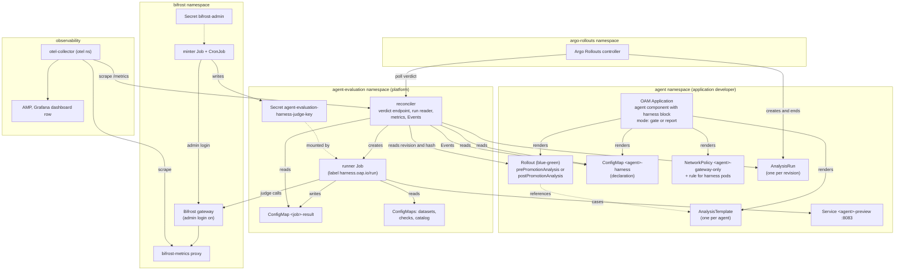
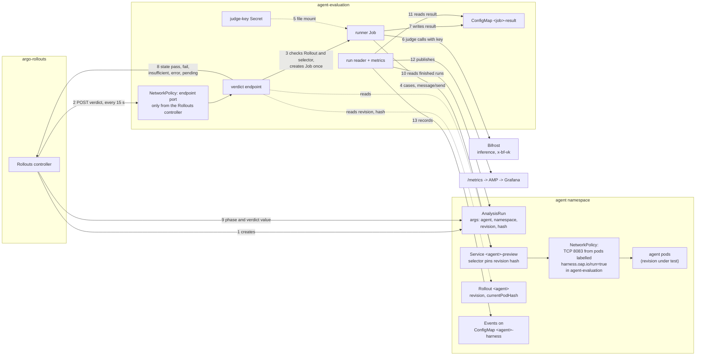
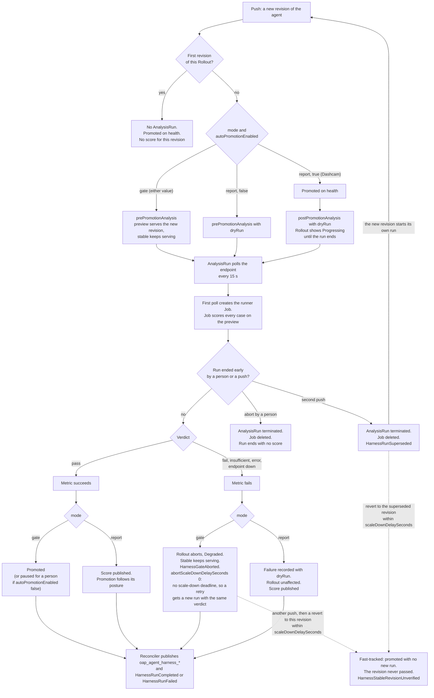

# Agent Harness: Per-Revision Evaluation on Argo Rollouts Analysis
| | |
|---|---|
| **Status** | Implemented on branch `feature/agent-harness-hub` (PR #153), unit-tested, render-checked and validated live on a hub (live passes 8 and 9, section 7: gate preconditions P2 to P6, report, gate and Bifrost scenarios, and the review round 7 retests). The provider choice (D2, web provider with a platform endpoint) is still pending reviewer confirmation. The first cut, the reconciler's own per-revision loop, is replaced; §4b of [agent-evaluation.md](agent-evaluation.md) is now a pointer to this document |
| **Implementation** | Reconciler `applications/agent-evaluation/`, addon `gitops/addons/charts/agent-evaluation/`, `agent` component `platform/oam/definitions/components/agent.cue`, Bifrost chart `gitops/addons/charts/bifrost/` |
| **Operator guide** | [`applications/agent-evaluation/agent-harness.md`](../../applications/agent-evaluation/agent-harness.md) |
| **Parent design** | [Continuous Agent Evaluation](agent-evaluation.md) (this document was its §4b) |
| **Author** | @hmmuthus |
| **Reviewers** | @elamaran11, @shapirov103 |
| **Target** | OAP agent platform: `agent` component, `agent-evaluation` addon, `bifrost` addon |
| **Date** | 2026-11-17 |
| **Issue / PR** | #137 / #153 |
## Scope
**In scope**
- A `harness` block on the `agent` component with `mode: gate | report`
- Scoring each new revision of an agent on a fixed, platform-owned dataset, through the revision's `<agent>-preview` Service
- Report mode: the score is published and never changes a rollout
- Gate mode: a revision that gets an AnalysisRun and does not pass is not promoted, and the stable revision keeps serving. A Rollout's first revision gets no run (section 4.7, row 13)
- Argo Rollouts analysis as the only per-revision machinery (revision detection, run history, cancellation)
- The harness judge key owned by the platform, and the Bifrost management API closed
**Not in scope**
- Team-owned datasets, running each case k times, tool-call checks (`expectTools` is accepted and ignored)
- Multi-agent scoring (#80) and replay from recorded traffic (#146)
- Alert delivery for the pipeline alerts (PF-1, a platform gap shared by every addon alert)
- Pushing the harness image to a public registry (tracked separately by the maintainers)
---
## 1. Summary
Online evaluation (agent-evaluation §4a) scores live traffic after the fact. The
harness answers a different question: how does a **new revision** do on a fixed
set of cases before, or right after, anyone relies on it. The platform sends
every case of the agent's dataset to the revision's `<agent>-preview` Service,
judges each answer against the case's reference, and publishes the result as
`oap_agent_harness_*` metrics and Events on the agent's `<agent>-harness`
ConfigMap.
Every agent is an Argo Rollout, and Argo Rollouts v1.9.0 already creates one
AnalysisRun per new revision, ends it when the revision changes, keeps a
history of runs, and aborts the rollout when a pre-promotion run fails. The
harness uses that. The `agent` component emits one `AnalysisTemplate` per agent
and wires it into the Rollout. The reconciler no longer detects revisions,
numbers runs or supersedes them. It starts the runner Job when Argo Rollouts
asks for a verdict, and publishes metrics and Events from finished runs.
| `mode` | `autoPromotionEnabled` | Rollout field | `dryRun` | What a bad or missing score does |
|---|---|---|---|---|
| `gate` | `true` or `false` | `prePromotionAnalysis` | no | The AnalysisRun fails, the Rollout aborts, the stable revision keeps serving |
| `report` | `true` (Dashcam) | `postPromotionAnalysis` | yes | Nothing. The revision is already live; the score is published |
| `report` | `false` (Manual gate) | `prePromotionAnalysis` | yes | Nothing. The preview waits for a person, who reads the score |
The hold-for-a-person posture stays what it is today (the guide's section 3.6):
`autoPromotionEnabled: false` pauses the preview, and a person promotes or aborts.
Four things are decided here that the PR reviews asked about:
1. Gate and report both run on Argo Rollouts analysis (D1).
2. A gate run with no verdict aborts the rollout. It does not hold (D3).
3. Gate is allowed in every environment. This is a policy statement that the
   maintainers can change (D4).
4. The platform owns the judge key. The Bifrost management API needs a login,
   and the admin credential stays in namespace `bifrost` (D5).
---
## 2. Background
### 2.1 What Argo Rollouts already does for each revision
Measured on Argo Rollouts v1.9.0 on a hub cluster, with a scratch
Rollout (the spike results are listed in section 7, "Verified"):
| Need | What Rollouts does |
|---|---|
| New revision | One AnalysisRun per revision, named `<rollout>-<pod hash>-<revision number>-pre` or `-post`. A retry adds `.N` |
| First revision of a Rollout | No AnalysisRun, pre or post |
| Second push during a run | The old run gets `spec.terminate: true` and ends with phase `Successful` and message `Run Terminated`. A new run starts |
| Rollback to an older revision | A new run starts, with a new revision number, unless the ReplicaSet it returns to is still running (within `scaleDownDelaySeconds`, default 30 s): then no run starts. With `spec.rollbackWindow`, a previously promoted revision is promoted in about 14 seconds with no run |
| Return to a ReplicaSet that still has a scale-down deadline | Promoted at once with no new run, whatever its own run said: a failed or terminated run does not stop it (fast-track, D7) |
| History | `spec.analysis.successfulRunHistoryLimit` and `unsuccessfulRunHistoryLimit` (default 5 each) prune old runs |
| Pre-promotion failure | The Rollout aborts (`Degraded`), the stable Service selector does not change |
| `dryRun` | The failed metric is recorded with `dryRun: true`, the run ends `Successful`, the Rollout is not affected |
| Preview Service | Rollouts points `<agent>-preview` at the new pod hash from the start. After a post-promotion switch, the preview Service follows the active one |
| Job provider | Runs the Job in the AnalysisRun's namespace. It can return only Successful, Failed or Error |
| Web provider | The controller calls an HTTP URL on each poll. It can return Inconclusive, which pauses the rollout |
### 2.2 What PR #153 built first
Report mode shipped as a loop in the reconciler (`harness_loop.py`, 1,197 lines,
plus `bifrost_admin.py`). It detected a new revision, a first revision and a
rollback; stopped a run when the revision moved; numbered runs; named Jobs by
number; pruned old Jobs; and minted the judge key through Bifrost's management
API, which answered without credentials. Review 5925886715 (@shapirov103)
asked for Argo Rollouts analysis in its place and for a platform-owned key.
Review 5931418759 (@elamaran11) asked for gate mode in the same PR and for
this document. The reviewers' rule is: do not build and maintain a controller
for something the platform already runs.
### 2.3 What the reviewers asked to keep
- the `harness` block on `agent`
- the platform-owned dataset catalog
- the NetworkPolicy rule that admits harness pods (label `harness.oap.io/run: "true"`) from the evaluation namespace to port 8083
- harness traffic kept out of online evaluation
Report-mode behaviour that users rely on stays unless analysis makes it
impossible (section 4.7 lists each case): Events on `<agent>-harness`, the
`oap_agent_harness_*` metrics and the dashboard row with digests, the
`insufficient` status and `minJudgedRatio`, the B1 failure classification, the
`general-assistant-v1` and `example-smoke-v1` datasets, and the two promotion
postures in the guide.
---
## 3. Decisions
### D1. Argo Rollouts analysis runs the per-revision work
The `agent` component emits one namespaced `AnalysisTemplate` named
`<agent>-harness` in the agent's namespace when `harness.enabled` is true. It
also adds the analysis reference to the Rollout's `blueGreen` block. Each
revision of the Rollout then gets one AnalysisRun, and Rollouts owns everything
about it: when it starts, when it is cancelled, how long it is kept, what it is
called.
```yaml
# Emitted by the agent component (shape; names come from the agent)
apiVersion: argoproj.io/v1alpha1
kind: AnalysisTemplate
metadata:
  name: support-assistant-harness
spec:
  args: [{name: agent}, {name: namespace}, {name: revision}, {name: hash}]
  dryRun:                      # report mode only
    - metricName: oap-harness
  metrics:
    - name: oap-harness
      interval: 15s
      count: 160               # 40 minutes; the endpoint's total cap is shorter (D3)
      inconclusiveLimit: 160
      consecutiveSuccessLimit: 1
      successCondition: result.state == 'pass'
      failureCondition: result.state in ['fail', 'insufficient', 'error']
      provider:
        web:                   # proposed provider, see D2
          method: POST
          url: http://agent-evaluation-harness-api.<evaluation namespace>.svc.cluster.local:<port>/v1/verdict?namespace={{args.namespace}}&agent={{args.agent}}&revision={{args.revision}}&hash={{args.hash}}
          timeoutSeconds: 20
```
The Rollout side, for `gate` (and for `report` with `autoPromotionEnabled: false`,
where `dryRun` comes from the template):
```yaml
strategy:
  blueGreen:
    prePromotionAnalysis:      # postPromotionAnalysis for report + Dashcam
      templates: [{templateName: support-assistant-harness}]
      analysisRunMetadata:
        labels: {harness.oap.io/agent: support-assistant}
      args:
        - {name: agent,     valueFrom: {fieldRef: {fieldPath: metadata.name}}}
        - {name: namespace, valueFrom: {fieldRef: {fieldPath: metadata.namespace}}}
        - {name: revision,  valueFrom: {fieldRef: {fieldPath: "metadata.annotations['rollout.argoproj.io/revision']"}}}
        - {name: hash,      valueFrom: {podTemplateHashValue: Latest}}
```
The four args resolve per Rollout (verified in the spike: `agent`, `namespace`,
`revision` and `hash` took the values `spike`, `harness-spike`, `25` and
`5ff64c796b`). The label in `analysisRunMetadata` lets the reconciler list the
platform's AnalysisRuns without reading anyone else's. The component sets no
`rollbackWindow` and leaves the Rollouts history limits at their defaults.
`harness.historyLimit` in the chart goes away.
`dryRun` is a field of the template, so report and gate agents use different
templates and the Rollout reference is the same shape. In report mode with
Dashcam, `dryRun` is mandatory: without it a failed post-promotion run rolls
live traffic back (observed in the spike).
Gate relies on one interaction that is not yet verified: the component's
default `autoPromotionSeconds: 10` must not promote a revision before its
pre-promotion run succeeds. This is Gate precondition P1 (section 7). It is
Status: not verified. See P1 in section 7. If the timer can bypass analysis,
the component does not set `autoPromotionSeconds` for `mode: gate` agents.

**Rejected: keep the reconciler's own loop for report mode and add analysis only
for gate.** That is the "second mechanism" the review warns about. Gate would
need analysis and report would need the loop, and the loop would be code kept
for report only.
**Rejected: one `ClusterAnalysisTemplate` shared by all agents.** It worked in
the spike, but the dry-run setting differs by mode, and a namespaced template
lets a team read what its Rollout runs with `kubectl get analysistemplate`.
### D2. Provider: web provider with a platform endpoint (PENDING reviewer confirmation)
> **Pending.** The reviews wrote "job provider". The proposal below differs
> from that text. It is not final until @shapirov103 and @elamaran11 confirm it.
> Sections that depend on it carry the marker `[D2]`.
**Proposed: the `web` provider.** The Argo Rollouts controller calls a small
HTTP endpoint in the reconciler on each poll. The first call for a revision
creates the runner Job in the evaluation namespace. Later calls return its
state. The runner stays the Job it is today.
**Alternative: the `job` provider, with the key and datasets copied into team
namespaces.** The job provider creates its Job in the AnalysisRun's namespace,
which is the agent's namespace. The only way to change that is the controller
environment variable `ARGO_ROLLOUTS_ANALYSIS_JOB_NAMESPACE`, read in
`metricproviders/job/job.go` at v1.9.0. It moves every Job-provider analysis
on the cluster, including appmod's `service-rollout` gates that call
`http://<service>-preview:<port>` by short name, and the controller chart is
appmod's. So the variable is not an option.
| | Web provider (proposed) | Job provider (alternative) |
|---|---|---|
| Where the runner Job runs | `agent-evaluation` namespace | The agent's namespace |
| Judge key | Only in `agent-evaluation` | A copy in every namespace that enables the harness |
| Dataset and check files | Read from the platform ConfigMaps | Copied into each agent namespace |
| Harness NetworkPolicy rule (accepted in review) | Unchanged: pods labelled `harness.oap.io/run: "true"` in the evaluation namespace | Replaced by a same-namespace rule |
| Writer into team namespaces | None | A platform component with write rights there, to copy key and files |
| Runner ServiceAccount and Role | One, in `agent-evaluation` | One per agent namespace |
| New code | An endpoint in the reconciler, and a NetworkPolicy for it | None in the reconciler |
| Open API surface | One endpoint, reachable only from the Rollouts controller (section 5) | None |
| "Hold for a person" on no verdict | Possible later (Inconclusive) | Not possible |
| Matches the review text | No | Yes |
The web provider keeps three things the reviewers asked to keep (platform-owned
key and catalog, the evaluation-namespace NetworkPolicy rule) and adds one
thing they did not ask for: an endpoint. The job provider matches the text but
undoes those three. shapirov103 also wrote that the reconciler should "only
publish metrics from the finished runs". The endpoint is a second job for the
reconciler. It holds the single rule "start the Job for this revision, once",
so it is small, but it is not nothing. If the reviewers choose the job
provider, the pieces marked `[D2]` change as listed in section 4.8 and nothing
else in this document does.
Not yet verified with the web provider: a real `POST` with arguments in the
URL. The spike's test server refused `POST`; `GET` and conditions worked. The
first implementation task is to verify `POST` live. If it fails, the template
switches to `GET` and the handler accepts both. That is a one-line change.
### D3. A run with no verdict aborts the rollout
For `gate`, anything that is not a passing verdict fails the metric, and Argo
Rollouts aborts the revision. The stable revision keeps serving, and the Rollout
shows `Degraded` until a new revision (or the stable template) is pushed. A
platform fault therefore blocks a team's rollout, and the team pushes a new
revision. When `kubectl argo rollouts retry` makes Rollouts create a new run
(`.N`), that run asks for the same Job and receives the same verdict, so a
retry does not re-score. A retry inside the aborted preview's scale-down
deadline created no run at all and promoted the failed revision (D7); for a
gate the component sets `abortScaleDownDelaySeconds: 0` so that the aborted
preview has no deadline. The hub retest confirmed that
for a retry. A revert to an aborted or superseded revision within
`scaleDownDelaySeconds` of the push that replaced it still promotes it, and is
detected, not prevented (D7). A person who wants a hold uses
`autoPromotionEnabled: false`: the revision must still pass the analysis, and
then waits for the person.
| Situation | Endpoint answers | Metric result | Gate outcome |
|---|---|---|---|
| Ratio at or above `threshold` | `pass` | success | promoted (or paused for a person if `autoPromotionEnabled: false`) |
| Ratio below `threshold` | `fail` | failure | abort |
| `insufficient` (fewer than `minJudgedRatio` of cases judged) | `insufficient` | failure | abort |
| Judge key Secret missing | `error` | failure | abort |
| Gate agent while `harness.judge.virtualKey.required` is `false` | `error` ("gate needs a required judge key") | failure | abort |
| Runner Job failed, deadline exceeded, or result unreadable | `error` | failure | abort |
| Preview Service no longer selects the revision | `error` | failure | abort |
| Declaration missing or invalid, dataset unknown, `ExternalName` preview | `error` | failure | abort |
| Endpoint unreachable, HTTP error, timeout | none | Error. After `consecutiveErrorLimit` + 1 consecutive errors (default 12, so 13) the run is Error | abort |
| Job still waiting for a slot after `slotWaitSeconds`, or running past `runTimeoutSeconds + slotWaitSeconds` (the Job is deleted) | `error` | failure | abort |
| Run still going | `pending` | inconclusive | keeps polling |
`pending` counts as an inconclusive measurement. Without
`consecutiveSuccessLimit`, a metric that ends its `count` with inconclusive
results not above `inconclusiveLimit` ends `Successful` (the spike saw this).
The template sets `consecutiveSuccessLimit: 1`, and then Argo Rollouts v1.9.0
ends a metric that reaches its count without that success as `Inconclusive`
(`analysis/analysis.go:616-632`, "ConsecutiveSuccessLimit Not Reached and
FailureLimit Not Violated"); an Inconclusive pre-promotion run pauses the
Rollout rather than promoting it. So 160 `pending` answers would not promote
an unscored revision. An earlier version of this section said they would end
the run as a pass, which was wrong. The endpoint still owns the clock, so the
run ends with a verdict (`error`, an abort) well before the count runs out,
and the paused-and-unscored state is never reached:
- At the first poll for a revision the endpoint creates the Job (suspended when no
  slot is free, Contract 6 step 5). Its `creationTimestamp` starts the slot
  wait and the total cap.
- Every poll computes `now - creationTimestamp`. A Job still suspended past
  `harness.slotWaitSeconds` is deleted and the answer is `error` ("no slot in
  time"). A running Job past `harness.runTimeoutSeconds +
  harness.slotWaitSeconds` is deleted too (it stops calling the agent and the
  judge and frees its slot), and the answer is `error`. Defaults: 1800 s and
  300 s, so 2100 s.
- The run's own clock starts at the unsuspend. The patch that unsuspends the
  Job also sets the pod-template annotation `harness.oap.io/run-deadline`
  (unsuspend time + `runTimeoutSeconds`), and the runner reads it as
  `HARNESS_RUN_DEADLINE_EPOCH` through the downward API. So a Job that waited
  in the queue still gets its full run time, and the runner stops (60 s
  margin) before the Job's `activeDeadlineSeconds`, which also counts from the
  unsuspend. An env value set at create time could not do this: a Job's pod
  template env is immutable, while its labels and annotations may change while
  it is suspended and has never started (checked on Kubernetes 1.35). A
  runner that finds no annotation counts from its own start.
- Invariant: `count x interval` must exceed that total by at least 300 s. The
  template's 160 x 15 s is 2400 s. The chart fails to render when
  `runTimeoutSeconds + slotWaitSeconds > 2100`, and a chart test asserts it.
- A unit test feeds the endpoint `pending` for the full poll count against a
  Job that is never unsuspended. It must answer `error` before the last poll, not
  let the run end `Successful`.
The Job's `activeDeadlineSeconds` still ends a running Job at
`runTimeoutSeconds`, which is a second bound on the run itself.

The endpoint lives in the reconciler pod, but its availability does not
depend on that pod's readiness. `/readyz` requires the Langfuse rules loop, so
a Langfuse outage makes the pod NotReady after about 90 s (6 x 15 s). The
verdict Service sets `publishNotReadyAddresses: true`, so polls still reach the
endpoint, which does not use Langfuse. The smaller alternative, a readiness
check of the endpoint's own, cannot help: Service endpoints follow the pod's
single Ready condition, so it would only work by taking Langfuse out of
`/readyz`, which would hide a Langfuse fault from the metrics Service and the
alerts. While the pod is starting, before the endpoint listens, a poll is
refused and counts as an error, as before.

A restart of that pod (including an Argo CD sync that changes any harness
value, which stops the old pod first because the chart uses `Recreate`) must
end before `consecutiveErrorLimit` + 1 polls in a row go unanswered, or every
in-flight gate run ends in Error and aborts. The limit is the platform value
`global.agentEvaluation.harnessConsecutiveErrorLimit` on the
oam-agent-components chart, default 12: 13 polls, about 195 s when the
connection is refused (a restart), and up to 13 x 35 s (interval plus the web provider's
20 s timeout) when polls time out. Measured on the hub (live pass 9): a restart leaves the
endpoint unanswered for 5 to 6 s and the pod Ready after 19 to 22 s, plus up to
5 s for a cold image pull. The limit for that gap is its length plus 60 s of
margin, divided by the 15 s interval, rounded up, minus 1: 5 for 27 s. The
default of 12 keeps room for a start on a node that has to be created, which was
not measured. A higher limit slows the abort when the endpoint is really down:
13 timed-out polls took 413 s on the hub. Errors use polls too, so `count x interval -
(limit + 1) x interval` must stay at or above `runTimeoutSeconds +
slotWaitSeconds` (2100 s at most); a render test checks it at the default.

In report mode every row above is recorded and none of them is meant to change
the rollout. For `failed` metrics `dryRun` is verified. For the `Error` outcome
(endpoint unreachable, for example during a reconciler restart) it is not: see
P6. If P6 fails, the template for Dashcam sets `consecutiveErrorLimit` above the
reconciler's start-up time, at the cost of a slower end to a run when the
endpoint is down. The Events and metrics carry the outcome.
Fail closed is the choice because a gate that promotes on "unknown" protects
nothing, the stable revision keeps serving, and the rule fits in one line:
"promoted only on a passing score". The web provider could hold instead (map
`insufficient` and `error` to Inconclusive by changing the failure condition).
That is a later option that needs no new code.
### D4. Gate is allowed in every environment (answer to #137 Q2)
**Policy statement, not a technical limit.** The `agent` component accepts
`mode: gate` in any environment (dev, staging, prod) and does not tie it to
one. A failed gate aborts only the preview revision. The stable revision keeps
serving, so a gate is as safe in dev as in prod. The risk in #137's question
is a flaky dataset that blocks every dev promotion until the team switches the
harness off. The mitigation is a practice, not code: a team starts a new
dataset in `report`, reads the scores over several revisions, sets
`threshold` where the dataset is steady, and then moves to `gate` (guide
section 3). The maintainers can restrict gate to some environments later with
an admission rule on the component. This document does not add one.
### D5. The platform owns the judge key; the Bifrost management API needs a login
The Bifrost management API (`/api/*` and `/metrics`) answers any pod without
credentials today. Any pod can list every virtual key value and change
budgets. This closes in three steps. The scratch evidence (Bifrost v1.5.0 with
`auth_config`) is listed in section 7, "Verified".
1. **Auth on.** The Bifrost chart sets `auth_config` with `is_enabled: true` and
   `disable_auth_on_inference: true`, with credentials from Secret
   `bifrost-admin` through `env.BIFROST_ADMIN_USERNAME` and
   `env.BIFROST_ADMIN_PASSWORD`. Inference (`/v1`, `/anthropic`) stays as it is:
   agents, Langfuse and the runner Job reach it with no admin credential, and an
   unknown `x-bf-vk` still gets 401. `/health` stays open for probes. The password
   is generated per cluster by a PreSync hook Job (`bifrost-admin-init`) that
   creates the Secret only if it does not exist. The chart keeps no default
   password in git. (`bifrost-admin` today renders with the default
   `bifrost-admin`, a known string, so the template changes.)
2. **A platform minter owns the key.** `mint: false` is the chart default and
   `bifrost_admin.py` leaves the reconciler. The minter is an Argo CD PostSync
   hook Job plus a CronJob (every 15 minutes, to heal a key deleted by hand) in
   the Bifrost chart. It runs in namespace `bifrost` with Secret `bifrost-admin`
   mounted, mints one key named `oap-harness-judge-<config hash>` with
   `provider_configs[{provider: bedrock, allowed_models, key_ids: ["*"]}]`, a
   budget and a rate limit, and writes Secret
   `agent-evaluation-harness-judge-key`. The key's models, budget and rate limit
   move from `harness.judge.virtualKey.*` in the evaluation chart to a `judgeKey`
   block in the Bifrost chart (off by default; on for clusters with the
   harness). The evaluation chart keeps `harness.judge.virtualKey.secretRef` and
   `required`. The minter's rule on each run: list keys with the admin credential and look
   for the name. If the key exists, copy its value into the Secret (the list API
   returns key values; this is how a Secret emptied or deleted by hand is
   rebuilt, and why the CronJob can heal it: Argo CD recreates the empty
   Secret, the next minter run fills it). If the key does not exist, create it and write the
   Secret. If the key exists and the list does not return its value, delete that
   key and mint a new one under the name with a counter appended
   (`oap-harness-judge-<config hash>-2`, then `-3`), and the Secret carries the
   new value. Any Bifrost or Kubernetes API failure leaves the Secret as it was,
   fails the Job and logs the status code at ERROR. A config change makes a new
   key, rewrites the Secret and deletes the older key, and only when no Job
   labelled `harness.oap.io/run=true` in `agent-evaluation` is unfinished (no
   `Complete` or `Failed` condition, so a suspended Job waiting for a slot
   counts), because a running Job mounts the value with `subPath` when its pod
   starts and never sees an update. The rule against the race (a Job starting
   between the check and the delete): the minter writes the Secret first and
   lists the Jobs again immediately before deleting. A Job whose pod starts
   after the write mounts the current key; a Job that started earlier is
   unfinished at that re-check and blocks the delete, which the next run
   retries. With `judgeKey.enabled` but no harness in `agent-evaluation`, the
   minter's Role is absent, the Secret read gets 403, and the minter logs
   "harness not enabled" and exits 0, so the PostSync hook does not mark the
   Bifrost sync Failed. A 404 (Role present, Secret not yet created) is an
   error that the hook's retries and the CronJob repeat.
3. **The collector scrapes `/metrics` without holding the admin credential.**
   With auth on, `/metrics` needs the admin credential, and the otel-collector
   runs in namespace `otel`. A `basic_auth` block there would copy the admin
   credential into a second namespace. Decision: a small proxy Deployment
   `bifrost-metrics` in namespace `bifrost` mounts `bifrost-admin`, adds the
   Basic header, and serves only `GET /metrics` on its own Service. A
   NetworkPolicy admits only the `otel` namespace to it. The collector's
   `bifrost-llm-gateway` job (in `collector.yaml` and `amp-metrics.yaml`) points
   at the proxy Service and carries no credential. The alternative from the
   Bifrost review, `basic_auth` on the scrape job with the password in a Secret
   in `otel`, is rejected because it breaks the rule "no admin credential outside
   namespace `bifrost`". Bifrost's scoped API keys would solve it but are
   Enterprise only. **This differs from the wording in the approved decisions
   ("collector uses `basic_auth`") and needs a go.**
**Where the key is readable** (least privilege, `[D2]` web provider):
| Reader or writer | Where | Access |
|---|---|---|
| Runner Job pod | `agent-evaluation` | Mounts the Secret as a file (kubelet, no RBAC) |
| Reconciler | `agent-evaluation` | `get` on that one Secret, to publish `judge_key_present` and fail closed. No write |
| Minter (`bifrost:bifrost-vk-minter`) | `agent-evaluation` | `get`, `update`, `patch` on the one Secret, which the evaluation chart pre-creates empty (no `create`: RBAC cannot scope it by name); `list` on `jobs` for the delete guard |
| Bifrost admin credential | `bifrost` only | Secret `bifrost-admin`, mounted by Bifrost, the minter, the metrics proxy and the init hook |
| Team namespaces | none | No key, no admin credential |
The evaluation chart pre-creates the Secret with no `data`
(`35-harness-judge-key-secret.yaml`), and the minter fills `data` and the
`harness.oap.io/judge-key-name` annotation with a merge patch. Argo CD syncs
with ServerSideApply, so it does not own and does not reset those fields, and
the registry entry ignores `/data` and that annotation in the diff (the same
`ignoreDifferences` pattern as the `ExternalSecret` there); `helm lookup` was
the alternative and cannot work, because Argo CD renders with `helm template`,
where lookup returns nothing. A missing Secret is a minter error that the next
run retries. An empty Secret is "key missing" for the reconciler and the
endpoint, so no Job starts and nothing mounts it while it is empty.
The evaluation chart renders the Role and RoleBinding in `agent-evaluation` and
binds them to the minter's ServiceAccount, since it owns the namespace and the
Secret name. With the job provider alternative the key would also be copied into
each team namespace `[D2]`, which is why that alternative is rejected.
Each cluster, hub or spoke, runs its own Bifrost, admin Secret, minter and key.
A virtual key is valid only in the Bifrost that minted it, so Secrets Manager
and External Secrets cannot carry it.
With `required: true` (default) and no Secret, no run starts. In gate mode the
rollout aborts (D3). The reconciler records `HarnessJudgeKeyUnavailable`, sets
`oap_agent_harness_judge_key_present 0`, and `AgentHarnessJudgeKeyMissing`
fires. The Event text says "the platform judge-key Secret is missing", not
"minted".
### D6. The revision check: start and end, not per reply
Guide §8 says gate needs a per-reply revision check, because the run must score
the revision it was asked for. Analysis covers most of that and not all.
What Rollouts guarantees:
- A run can reach only the revision under analysis, because Rollouts injects the
  pod-template hash into the preview Service selector.
- Only the AnalysisRun created for a revision can promote it through analysis,
  and Rollouts terminates that run when the revision changes. So a revision is
  never promoted by another revision's score. It does not cover a revision that
  gets no run: the first revision of a Rollout, and the first push after gate is
  enabled on a running agent (section 4.7, row 13). It also does not cover
  the fast-track in D7: a return to a ReplicaSet that still has a scale-down
  deadline is promoted without checking its run, so a revision whose run failed
  or was terminated can go live when a person returns to it within
  `scaleDownDelaySeconds` (30 s by default) of the push that replaced it.
What it does not guarantee: after a second push, the old run's Job kept getting
replies from the new revision for about 25 seconds before Rollouts ended it.
Rollouts discards that run's result, so nothing wrong is promoted, but a runner
that writes its own result writes one for the wrong revision.
Decision, and the loss:
1. The endpoint reads the Rollout (Contract 6 step 2), then checks that
   `<agent>-preview` selects `hash` before it creates the Job, and again when it computes the verdict. A mismatch is an `error`
   verdict.
2. When a poll arrives for revision N, the endpoint deletes any active Job of
   the same agent with a lower revision number. That stops the old run's cases
   within one poll of the new run's first call instead of waiting for the
   reconciler's next pass. The 15 seconds of the poll interval start at that
   first call, not at the push: Rollouts creates the new run and the run's
   first poll arrives some seconds after the push, and the older Job runs
   until then. Live check 10 records the seconds from push to Job deletion.
3. The reconciler skips AnalysisRuns with `spec.terminate: true` (they end
   `Successful`) and records them as `HarnessRunSuperseded`.

The exact per-reply check stays a follow-up. It needs the `strands-agent` base
image to echo the pod-template hash in its reply. The published image does not
(PF-2). The follow-up adds the env var `OAP_AGENT_REVISION` from the downward
API, and the runner compares it on every reply. Until then, a window
of a few replies from the wrong revision is possible, and its result is dropped
by the end check or by Rollouts' termination.
### D7. Rollback
A rollback is a push of an older template. Rollouts treats it as a new
revision with a new revision number, creates a new AnalysisRun, and the harness
scores it like any other revision, with four exceptions. The Job name includes
the revision number, so the earlier run's Job and result are not reused. Four
cases do not run:
- With `spec.rollbackWindow` set on the Rollout, a previously promoted revision
  inside the window is promoted in about 14 seconds with no run. The component
  does not set `rollbackWindow`. A team that adds it by hand loses one data
  point in report mode. In gate mode a revision that passed a gate run before
  comes back with no new run, but a revision promoted unscored earlier (before
  the harness was enabled, or while the agent was in `report`) also comes back
  unscored. A revision that failed before is analysed again even inside the
  window.
- Rolling back to the current stable template while another revision is in
  flight returns to stable with no run. This comes from the Argo Rollouts
  documentation and is not run yet (live check 11).
- A rollback within `scaleDownDelaySeconds` (default 30 s) to the ReplicaSet
  that is still running returns with no AnalysisRun. It is not scored and, in
  gate mode, not re-gated. This was observed in pass 8 in report mode. After
  scale-down a rollback gets a run. Earlier versions of this document called
  this path safe because that ReplicaSet was the promoted stable. That holds
  only for the previous stable; the next bullet shows the same mechanism
  promoting revisions that never passed.
- **Fast-track of a ReplicaSet with a scale-down deadline (a known Argo
  Rollouts v1.9.0 limitation; a gate does not cover it).** In Argo Rollouts
  v1.9.0, `isBlueGreenFastTracked` (`rollout/bluegreen.go:113-116`) is true for
  any new ReplicaSet that carries a `scale-down-deadline` annotation, and
  `reconcileActiveService` (`rollout/service.go:105-107`) then switches the
  active Service to it without checking `completedPrePromotionAnalysis`. Three
  kinds of ReplicaSet carry that deadline: the previous stable after a
  promotion (`scaleDownDelaySeconds`), an aborted preview
  (`abortScaleDownDelaySeconds`, default 30 s), and any other old ReplicaSet
  still scaled up, such as a superseded preview (`scaleDownDelaySeconds`,
  added by `scaleDownDelayHelper`, `rollout/replicaset.go:304`, called from
  `rollout/bluegreen.go:234`; read at the v1.9.0 tag on 2026-11-20). The reviewer reproduced it
  on kind. It was reproduced on the hub on 2026-11-19 with PR head 4572ba8f and
  retested the same day with `abortScaleDownDelaySeconds: 0` (image
  `3e0448a3`), on a gate agent whose every run failed:
  | Path | Before the fix (4572ba8f) | With `abortScaleDownDelaySeconds: 0` (retest on the hub) |
  |---|---|---|
  | 1. `kubectl argo rollouts retry` 4 s after the abort | Promoted the failed revision with no new AnalysisRun; the old stable was scaled down | **Closed.** A new run `...-23-pre.1` was created and failed; the Rollout stayed aborted and the stable Service kept the old stable |
  | 2. Push a new revision, revert to the aborted one 14 s after the abort | Promoted; its only run is the Failed one | **Still promotes** (revert 15 s after the abort). The aborted ReplicaSet became stable and active within about 3 s, with only its Failed run `...-24-pre`. After the newer push, the aborted ReplicaSet is an old ReplicaSet and gets the `scaleDownDelaySeconds` deadline |
  | 3. Supersede a revision mid-analysis, revert to it 9 s later | Promoted; its only run was terminated with no verdict (phase `Successful`, `Run Terminated`) | **Still promotes.** The superseded revision became stable and active; both of its runs (`...-19-pre`, `...-27-pre`) are `Run Terminated` with one Inconclusive measurement and no verdict |
  | Control: retry 40 s after the abort (the retry ran at 46 s in the first test and at 47 s in the retest) | Aborted again: the new run `.1` Failed | **Aborted again**: the new run `...-30-pre.1` Failed; the stable stayed |
  What the guarantee is. A gate blocks a revision whose analysis failed, was
  insufficient, errored, or ended with no verdict, with these exceptions: a
  revision that gets no analysis at all (the first revision of a Rollout, the
  first push after gate is enabled, a return inside `rollbackWindow`, a fast
  revert to the previous stable), and a return to a failed or superseded
  revision within `scaleDownDelaySeconds` (30 s by default) of the push that
  replaced it. The last exception is Argo Rollouts behavior in v1.9.0. The
  platform cannot close it without changing a setting for every gate agent
  (see the lever below), so it is documented here and in the guide, and the
  upstream report is drafted and not yet filed.
  What the platform does. A gate renders `abortScaleDownDelaySeconds: 0`, which
  closes path 1 (the cost is that an aborted gate preview stays scaled up until
  the next revision replaces it). `scaleDownDelaySeconds` is not changed for a
  gate. To find a promotion without a pass, the reader raises the
  `HarnessStableRevisionUnverified` Warning Event on `<agent>-harness` and sets
  `oap_agent_harness_unverified_stable` when a gate Rollout's `status.stableRS`
  hash has harness runs and none passed. Both were seen on the hub after paths 2
  and 3 ("none passed (fail)" and "none passed (no verdict)"). Where a rule
  evaluator runs, the `AgentHarnessGateUnverifiedStable` alert is meant to fire on the same
  metric (promtool checked the rule syntax; it was not seen firing). On this hub nothing evaluates the PrometheusRule (PF-1), so the
  Event and the metric are the signals. A person who sees it aborts or rolls
  back by pushing a known good template.
  The per-agent lever. The agent component already has the parameter
  `scaleDownDelaySeconds` (default 30). It is a team choice per agent, not a
  platform default for gates, and the component has no new parameter for it.
  Two values were run on a second gate agent on the hub:
  - `0` closes paths 2 and 3 only because Argo Rollouts v1.9.0 then never
    scales an old ReplicaSet down. After eight revisions, eight old ReplicaSets
    each still ran one pod and none had a deadline. Do not use it. Upstream
    issues 1639 and 1992 (both open, checked on GitHub on 2026-11-20) report
    that `scaleDownDelaySeconds: 0` leaves old ReplicaSets running.
  - `1` closes both paths: a revert 14 s after an abort and a revert 10 s after
    a supersede each got a new run and failed again. Old ReplicaSets scale down
    about a second after a promotion (the eight ReplicaSets left by the `0`
    test scaled down after the change to `1`). The cost: no instant rollback to
    the previous stable (a rollback to it started new pods, got a new run and
    settled in 57 s, instead of switching at once and unscored), and no drain
    time for requests in flight on the old pods. Argo Rollouts documents the
    delay as the time nodes need to see the Service change, so a value this
    small can drop requests. The drain behavior was not measured.
The `trigger` label of `oap_agent_harness_info` was `first-revision`,
`new-revision` or `rollback`. Analysis cannot tell these apart, so the value is
always `new-revision`. The label stays so the dashboard row and any query keep
working.
### D8. The reconciler keeps what only it can do
| Removed (Rollouts does it) | Kept |
|---|---|
| Revision detection, `status.currentPodHash` reads | Declaration parsing and validation (`<agent>-harness`) |
| First-revision handling and rollback detection | The judge-key presence check, `judge_key_present`, fail closed |
| Supersede logic and the in-memory "last seen active" state | The runner Job body and the result ConfigMap (`caseResults`, digests, counts) |
| Run numbers and run-number Job names | Events on `<agent>-harness` |
| Per-agent history pruning by count | `oap_agent_harness_*` metrics and the dashboard |
| `bifrost_admin.py`, `test_bifrost_admin.py`, the mint branch of `_ensure_judge_key`, `_write_secret` | Datasets, checks and the `expected-answer` judge |
| `BIFROST_ADMIN_URL`, budget and rate-limit settings | Exclusion from online evaluation |
| Secret create/update RBAC | The harness NetworkPolicy rule (emitted by the component) |
| `harness.historyLimit` | Slots (`maxConcurrentJobs`) and the Job deadline |
New in the reconciler: the verdict endpoint `[D2]`, the AnalysisRun reader and a
read-only `rollouts` get, which the endpoint needs to check its caller's
arguments (Contract 6 step 2).
The reconciler lists AnalysisRuns with the label `harness.oap.io/agent` and
skips runs that are still running or terminated. Of the rest it takes the run
with the highest revision per agent (the `rollout.argoproj.io/revision`
annotation of the AnalysisRun; ties: newest `startedAt`), whatever the
Rollout's current revision is, so the series for revision N-1 stay published
while the run for N is going. The Rollout's current revision decides only two
things: which Jobs are stale and deleted, and which runs are stale for Events
(a finished run below the current revision still gets its Event once). It reads the verdict from the metric's measurement value and the Job name
inside it, reads that Job's result ConfigMap, and publishes. It deletes the Job
of a terminated run, and a finished Job whose AnalysisRun Rollouts has pruned.
It keeps one in-memory set of AnalysisRun UIDs it has already recorded, and
nothing else. A finished run stays listed until Rollouts prunes it (5 and 5 by
default), so without the set every pass would write its Event again. The rule:
- An Event (`HarnessRunCompleted`, `HarnessRunFailed`, `HarnessRunSuperseded`,
  `HarnessGateAborted`) is written once per UID per process, when the UID
  enters the set. The result gauges are set on every pass and need no set.
- `oap_agent_harness_runs_total{result}` is incremented in the same step, so it
  is a true counter inside one process.
- The set is rebuilt on restart. A restart writes one repeat Event for each
  still-listed run and counts it again in `runs_total`. The operator guide
  already lists the repeated `HarnessRunCompleted` Events. Alerts and dashboards
  use `increase()` over a window longer than a restart, not absolute values.
- `HarnessRunSuperseded` is written by the reader only, once per terminated run.
  The endpoint deletes the older Job and writes no Event.
- Unit tests: two passes over the same finished run write one Event and add one
  to the counter. Run N-1 finished and run N Running: the series for N-1 are
  still published.
---
## 4. Architecture
### 4.1 Block diagram: the parts
The parts and who owns each. The agent team owns the agent and its `harness`
block. The platform owns everything in `agent-evaluation` and `bifrost`.

### 4.2 Architecture diagram: data flow
One revision, from the Rollouts controller's call to the published score. Both
modes follow the same path. The only difference is on the Rollout side: in
`gate` mode the controller acts on the failure; in `report` mode `dryRun`
records it.

Reading the numbers:
1. Rollouts creates the AnalysisRun when a new revision appears and the
   Rollout wires the template (`pre` before promotion, `post` after).
2. The controller calls the endpoint each 15 seconds. The NetworkPolicy on the
   reconciler pods admits that port only from the Rollouts controller pods.
3. On the first call the endpoint reads the Rollout and requires its revision
   and `currentPodHash` to equal the call's `revision` and `hash`, then reads
   `<agent>-harness`, reads the preview Service, confirms it selects `hash`, confirms the judge key Secret exists, and
   creates the Job. Later calls find the Job by its name.
4. The Job sends each case to `<agent>-preview:8083`. The agent's
   `<agent>-gateway-only` policy admits it because of the one rule the component
   adds when the harness is enabled.
5. The Secret is mounted as a file. It exists only in `agent-evaluation`.
6. The Job calls Bifrost for the judge with `x-bf-vk`. It carries no admin
   credential.
7. The Job writes `<job>-result` with an `ownerReference` to itself and exits 0.
8. The endpoint reads the result, applies `threshold` and `minJudgedRatio`, and
   answers with one state.
9. The controller records the measurement. A failure aborts the rollout (gate)
   or is marked `dryRun` (report).
10. to 13. The reconciler reads finished AnalysisRuns by label, takes the Job
    name from the verdict, reads the result, and publishes metrics and Events.
    Events are written on `<agent>-harness`, so a team reads them with
    `kubectl describe` in its own namespace.
### 4.3 Run lifecycle: push to promote or abort

A rollback is a push in this diagram: a new revision number, a new run. The
flow ends with no score for the first revision and for the cases in D7 (a fast
revert, a `rollbackWindow` return, a return to stable while another revision is
in flight). The dotted branch is the fast-track in D7: a return to a revision
whose ReplicaSet still has a scale-down deadline is promoted with no new run,
even after an abort or a supersede. A gate's aborted preview gets no deadline
(`abortScaleDownDelaySeconds: 0`), so a retry no longer takes that branch; a
revert to an aborted or superseded revision within `scaleDownDelaySeconds` of
the push that replaced it still does, and the reader then raises
`HarnessStableRevisionUnverified`.
### 4.4 Components, in prose
**The `agent` component** renders the Rollout, the `<agent>-harness`
declaration, the AnalysisTemplate (when `harness.enabled`), the NetworkPolicy
rule. Agents without an enabled harness block
render exactly what they render today.
**The reconciler** is the existing `agent-evaluation` reconciler, which already
holds the judge catalog and aliases, the `/metrics` Service and the Event
recorder (the argument for Q5). The harness stays its own loop and thread with
its own error counter (`loop="harness"`), off by default (`harness.enabled`),
and out of `/readyz`. It now has two parts `[D2]`: the verdict endpoint on its
own listener (default port 8081, Service `agent-evaluation-harness-api`, not the
metrics port), and the run reader that publishes.
**The runner** is `python -m app.harness_runner` as a Job in the evaluation
namespace under ServiceAccount `agent-evaluation-harness-runner`. It waits up to
`harness.readyTimeoutSeconds` for the preview's agent card, sends the cases,
judges them and writes one `<job>-result` ConfigMap. **It exits 0 once the
result is written.** The endpoint, not the runner, decides pass or fail against
the threshold, so the runner has no mode or threshold logic. With the job
provider alternative the runner would exit non-zero below threshold and carry
that logic `[D2]`.
**Bifrost** gets login on `/api/*` and `/metrics`, the minter and the metrics
proxy (D5).
A gate needs the harness on the cluster. The agent component compares the
platform value `global.agentEvaluation.harnessEnabled` (oam-agent-components,
default `"false"`, set per cluster in the overlay next to agent-evaluation's
`harness.enabled`) and rejects `mode: gate` at render when it is not `"true"`,
with the named conflict `_harnessPlatformRequired`, the same pattern as the
sandbox-operator guard from #151. Report mode is not blocked. Known gap: the
two switches are separate values in two charts, so an operator sets them
together; nothing checks that agent-evaluation's `harness.enabled` matches.
### 4.5 What the first revision and enablement look like
A Rollout's first revision gets no analysis, pre or post. The same holds when
a team switches the harness on for an agent that already has a stable revision:
nothing runs until the next push. The old "first-revision baseline" and
"baseline at enablement" behaviours are gone, and the dashboard shows no data
for an agent until its second revision is scored.
### 4.6 Judge calls and datasets
Unchanged from report mode: the judge runs at temperature 0, one agent sample
and one judge sample per case, the `expected-answer` check prompt in
`files/harness/checks/`, and the two shipped datasets (Contract 4).
### 4.7 What analysis cannot do (R2)
The reviewer asked to write down every report-mode behaviour that analysis
cannot cover. Each row gives what is lost, why, and what replaces it.
| # | Behaviour | Why analysis cannot do it | Replacement or effect |
|---|---|---|---|
| 1 | Baseline score for the first revision (`trigger="first-revision"`) | Rollouts creates no AnalysisRun for the first revision, pre or post (observed) | None. The first scored revision is the second one. The dashboard stays empty until then |
| 2 | Baseline when the harness is turned on for an agent that already has a stable revision | Analysis starts only on a new revision | None. The next push is the first scored revision. The guide says so |
| 3 | A Rollout that is `Healthy` right after promotion (Dashcam) | `postPromotionAnalysis` keeps the Rollout `Progressing` ("waiting for analysis to complete") and the old ReplicaSet scaled up until the run ends | Visible in Argo CD for the length of a run (minutes). Accepted. Promotion itself is not delayed |
| 4 | `trigger` values `first-revision` and `rollback` | A rollback is a new revision with a new number | The label is always `new-revision` (D7) |
| 5 | Exact per-reply revision check | Needs the agent image to echo its revision | Start and end preview-selector check, plus the Job deletion on a newer poll (D6). Exact check is a follow-up |
| 6 | A run ended by a second push has a verdict | Rollouts ends it as `Successful` with `Run Terminated` and no verdict | Treated as superseded: `HarnessRunSuperseded`, nothing published |
| 7 | Reading the score from the run phase | A failed `dryRun` metric leaves the run `Successful` | The reconciler reads the metric's verdict value, not the run phase |
| 8 | Case results, digests and counts in the AnalysisRun | The AnalysisRun keeps only the verdict body and phase | The reconciler still reads the result ConfigMap by the Job name in the verdict |
| 9 | Rollback re-run when `spec.rollbackWindow` is set | The fast path promotes with no run | The component does not set it. One data point lost if a team does |
| 10 | Hold for a person on no verdict | Only the web provider can return Inconclusive. The job provider cannot | Abort (D3). A hold comes from `autoPromotionEnabled: false` |
| 11 | Run numbers (`n` >= 2) for one revision, and re-scoring on `kubectl argo rollouts retry` | One AnalysisRun per revision. A retry makes a new run `.N` of the same revision, and the web call carries no run name | When the retry creates a run `.N`, it reuses the delivered verdict, except after a slot timeout, where the Job is deleted and a retry starts a new run. A retry inside the aborted preview's scale-down deadline created no run and promoted (row 15); a gate sets `abortScaleDownDelaySeconds: 0` against that, and the retest on the hub made new runs for a retry at 4 s and at 40 s after the abort. To re-score, push a new revision (or delete the Job in `agent-evaluation` by hand). A retry that re-scores is a follow-up, only after a live test |
| 12 | Metrics survive AnalysisRun pruning | Rollouts keeps 5 successful and 5 unsuccessful runs by default | The series follow the highest-revision finished run, which is always kept. A run pruned before the reconciler reads it (a restart gap over 5 revisions) is not published |
| 13 | Gate on a revision with no AnalysisRun | Rollouts creates no run for the first revision of a Rollout, and none for the first push after gate is enabled when the template does not change | Not scored, promoted on health. A gate agent's first revision is unprotected. A revision promoted unscored can return unscored inside `rollbackWindow` (D7) |
| 14 | Report mode never changes a rollout during an endpoint outage | `dryRun` is verified for a `Failed` metric, not for a measurement `Error` (P6) | If P6 fails, Dashcam needs `consecutiveErrorLimit` above the reconciler's start-up time, set in the template (D3) |
| 15 | Gate on a return to a ReplicaSet that still has a scale-down deadline (fast revert, retry, revert to an aborted or superseded revision) | Rollouts fast-tracks any ReplicaSet with a `scale-down-deadline` and switches the active Service without checking the pre-promotion run (`rollout/bluegreen.go:113-116`, `rollout/service.go:105-107`). Reproduced on the hub for a retry, a revert to an aborted revision and a revert to a superseded one (D7) | Not safe: a revision whose run failed or ended with no verdict is promoted with no new run. A gate sets `abortScaleDownDelaySeconds: 0`, which closes the retry path (retested on the hub). The two reverts inside `scaleDownDelaySeconds` stay open (D7 table, retested on the hub): this is Argo Rollouts v1.9.0 behavior and a known limitation. Setting `scaleDownDelaySeconds` per agent is the lever, with the trade-offs in D7; `0` must not be used. The reader raises `HarnessStableRevisionUnverified` and `oap_agent_harness_unverified_stable`. A fast revert to the previous stable is not scored either. After scale-down a return gets a run |
Behaviours kept as they were: Events on `<agent>-harness`, the metric names
and labels (Contract 5), the dashboard row with digests, `insufficient` and
`minJudgedRatio`, B1 classification, the two datasets, exclusion from online
evaluation, the manual-gate posture documentation.
### 4.8 If the reviewers choose the job provider `[D2]`
Same template shape, `provider.job` in place of `provider.web`. The pieces that
change:
- The runner Job spec moves into the template. It runs in the agent's namespace
  under a ServiceAccount the component creates, and exits non-zero below
  threshold, which fails the AnalysisRun.
- The endpoint, its Service, its NetworkPolicy and its section 5 risk go away.
- The judge-key Secret and the dataset and check ConfigMaps are copied into each
  agent namespace that enables the harness, by a platform component with write
  rights there. This is the cost the reviewers asked us not to take.
- The harness NetworkPolicy rule changes from "pods labelled
  `harness.oap.io/run: "true"` in the evaluation namespace" to a same-namespace
  rule.
- Hold on no verdict is impossible. Abort is the only outcome.
- The Job name is `<analysisrun uid>.<metric>.<n>`, owned by the AnalysisRun, so
  Rollouts deletes it with the run and the reconciler's Job pruning goes away.
---
## 4a. Contracts
The contract numbers continue the two in agent-evaluation §4a. Contracts 3, 4
and 5 keep the numbers they had in §4b.
### Contract 3: the `<agent>-harness` ConfigMap
Written by the `agent` component as a KubeVela output in the agent's own
namespace; discovered **only** by the label.
| | |
|---|---|
| label | `harness.oap.io/agent: <agent>` (required) |
| Data key | Meaning |
|---|---|
| `agent` | agent name |
| `dataset` | catalog dataset name (`^[a-z0-9]([a-z0-9]\|-[a-z0-9])*$`, at most 63 characters). `<namespace>/<name>` is reserved for team-owned datasets and rejected today |
| `checks` | JSON list of check names; `["expected-answer"]` is the only accepted value |
| `threshold` | fraction in (0, 1], default `0.8`, as a string |
| `mode` | `gate` or `report` (default `report`) |
`mode` changes in the CUE (`mode: *"report" | "gate"`) and in the reconciler
(`VALID_MODES` in `harness_declarations.py`). In the declaration it only
labels the series (`info{mode}`) and the Event text. What makes a rollout
abort or not is the Rollout's analysis reference and the template's `dryRun`,
both rendered by the component from the same parameter. A hand-written
ConfigMap with `mode: gate` therefore changes nothing in a Rollout.
The ConfigMap is team-writable and its values reach a platform Job, so it
carries no target. The reconciler accepts `agent` only as a DNS-1123 label and
derives the target from it: `http://<agent>-preview.<namespace>.svc.cluster.local:8083/`
(`<agent>-preview` must be a DNS-1035 label of at most 63 characters).
`previewService` / `previewPort` keys, if present (hand-written or older
declarations), are ignored. Before it creates a Job, the endpoint reads that
Service and refuses one of type `ExternalName` (`HarnessPreviewUnsupported`,
since it would resolve to any host the team names), one that is missing, and one
whose selector does not pin `rollouts-pod-template-hash` to the revision. Each is
an `error` verdict. Residual limits, to be closed before gate mode is
relied on (section 5): the check runs when the Job is created and when the
verdict is computed, not at every connection. The runner resolves the Service
name on every connection, and a team that controls its namespace can attach
hand-made EndpointSlices to the Service that point anywhere.
A malformed declaration, or one naming a dataset the chart does not ship, is
reported as an Event on that ConfigMap (`InvalidHarnessDeclaration`,
`UnknownDataset`) and answers `error` to the endpoint; it never stops the
reader's pass. History is removed only when the ConfigMap itself goes away.
Every harness Event is recorded on this ConfigMap, prefixed `[<cluster>]`, so a
team reads its runs in its own namespace:
| Reason | Type | Written by | When |
|---|---|---|---|
| `HarnessRunStarted` | Normal | endpoint | The Job is created. Message carries the revision and `trigger=new-revision` |
| `HarnessRunCompleted` | Normal | reader | A finished run with a verdict of `pass`, `fail` or `insufficient`, with the counts. For `insufficient` it says how many cases were judged |
| `HarnessRunFailed` | Warning | reader | A finished run with an `error` verdict, or one that ended with no verdict (endpoint unreachable) |
| `HarnessRunSuperseded` | Normal | reader | The AnalysisRun was terminated (a newer revision, or an abort). The endpoint deletes the older Job and writes no Event |
| `HarnessGateAborted` | Warning | reader | `mode: gate` and the run did not pass. The Rollout aborted. The message carries the verdict |
| `HarnessStableRevisionUnverified` | Warning | reader | `mode: gate` and the Rollout's `status.stableRS` hash has harness AnalysisRuns, none with a `pass` verdict: the revision became stable without a pass (Argo Rollouts fast-track, section 4.7 row 15, or a manual promote). Once per Rollout UID and hash per process (the D8 rule). A stable hash with no run at all is not flagged: the reader cannot tell it from a revision promoted before the harness was enabled |
| `HarnessJudgeKeyUnavailable` | Warning | endpoint | The judge key Secret is missing and `required` is true |
| `UnknownDataset`, `InvalidHarnessDeclaration` | Warning | endpoint, reader | Refusals |
| `HarnessPreviewUnsupported` | Warning | endpoint | `ExternalName` or missing preview Service, or no `previewService` on the Rollout |
`HarnessWaitingForPreview` (a run waiting for the preview to select the
revision) is gone: Rollouts sets the selector before the run starts, so a
mismatch is an error, not a wait. A run that started but whose AnalysisRun ends
with no verdict (an Error phase) is recorded as `HarnessRunFailed`.
The runner's `<job>-result` ConfigMaps also carry `harness.oap.io/agent`, so the
reader lists declarations with `harness.oap.io/agent,!harness.oap.io/result` and
never reads a result as a declaration.
### Contract 6: the verdict endpoint `[D2]`
Started with the harness loop (`harness.enabled`), on its own listener, so a
failing endpoint cannot touch `/metrics` or the probes.
| | |
|---|---|
| Listener | `harness.api.port`, default 8081. Service `agent-evaluation-harness-api` (ClusterIP, same port, `publishNotReadyAddresses: true`). Not the metrics port. The pod's `/readyz` requires the Langfuse rules loop (`main.py`, on a spoke the hub's Langfuse), and Service endpoints follow that one Ready condition. So the verdict Service publishes not-ready addresses: a Langfuse outage that turns the pod NotReady (after 6 x 15 s) does not stop verdicts, and the pod's own readiness stays honest for the metrics Service and the Langfuse alerts |
| Request | `POST /v1/verdict?namespace=<ns>&agent=<agent>&revision=<n>&hash=<hash>`. No body. Any other path or method is 404 or 405 |
| Caller | Only the Argo Rollouts controller. A NetworkPolicy enforces it (section 5). There is no credential |
Input validation (every field is required; the endpoint fails with HTTP 400
and an `error` body on the first violation, and starts no Job):
| Field | Rule |
|---|---|
| `namespace` | DNS-1123 label, at most 63 characters |
| `agent` | DNS-1123 label, and `<agent>-preview` is a DNS-1035 label of at most 63 characters |
| `revision` | decimal integer, 1 to 9 digits |
| `hash` | `^[a-z0-9]([-a-z0-9]*[a-z0-9])?$`, at most 63 characters |
| Query string | at most 512 bytes; unknown parameters are rejected |
The endpoint never takes the dataset, checks, threshold, mode, Job name or
target from the request. It reads them from the agent's `<agent>-harness`
ConfigMap, so a caller can start runs only for declared agents, on the declared
dataset, against the derived preview Service.
Response, HTTP 200, JSON:
```json
{"state": "pending|pass|fail|insufficient|error",
 "message": "plain text, at most 300 characters",
 "job": "oap-harness-1a2b3c4d5e6f"}
```
`job` is present once the Job exists. The response carries no ratio and no
counts. Answers that are not 200: 400 for invalid input, 503 when the
Kubernetes API fails (a transient error the controller counts as a measurement
error). The endpoint logs invalid input and API failures at WARNING with the
namespace and agent, and logs each verdict delivered at INFO. It never logs the
judge key and never returns it.
Handler, in order. Every step is idempotent, so repeated polls are safe. The
handler serialises steps 5 and 6 (the Job lookup, the creation, and the
slot count and unsuspend) with one process-wide lock. The reconciler runs as a
single replica. With more replicas the lock does not span pods, and
`maxConcurrentJobs` would apply per replica, so the harness loop needs one replica.
The chart keeps `strategy: Recreate` and `replicaCount: 1`, and fails to render
when the harness is enabled and `replicaCount` is above 1. Under `Recreate` the
old pod stops before the new one starts, so every change that restarts the
Deployment (an image bump or a values change through Argo CD) makes the
endpoint unreachable for the whole start-up. D3 says what that does to
in-flight gate runs, so sync the reconciler only when no gate run is active. A unit test sends two concurrent polls for different
agents with `maxConcurrentJobs: 1` and asserts that one Job is unsuspended.
1. Validate the input.
2. Read the Rollout `<agent>` in `<namespace>`, before anything else. Every
   failure in this step uses one fixed message, "not the current revision", and
   has no side effect: no declaration is read, no Job is created or deleted and
   no Event is written. So a caller cannot learn whether another team's agent
   has a declaration, and cannot write Events on it.
   - Rollout missing, or the call's `revision` higher than the Rollout's
     `rollout.argoproj.io/revision` annotation: `error`.
   - The Rollout's revision higher than the call's: answer `pending`. Rollouts
     is about to terminate this run (it does so about 25 seconds after the
     second push, section 7), and an `error` here could fail the old run before
     it is terminated.
   - Same revision but `status.currentPodHash` different from `hash`: `error`.
3. Read the declaration `<agent>-harness`. Missing, invalid or an unknown
   dataset: `error`, plus the Event from section 4a. Only a caller that passed
   step 2 reaches this step, so Events are written only for the current
   revision of an existing Rollout. Then read the Service `<agent>-preview`.
   Missing, `ExternalName`, or a selector `rollouts-pod-template-hash` different
   from `hash`: `error`.
4. Compute the Job name,
   `oap-harness-<sha256(namespace/agent/revision/hash/dataset)[:12]>`, and look
   it up by name in the evaluation namespace.
5. **No Job.** If a Job of the same agent exists with a higher revision number,
   answer `error` ("superseded"). Step 2 already answers `pending` for a stale call, so
   this case is a race between two polls. If the
   declaration says `mode: gate` and `harness.judge.virtualKey.required` is
   `false`, answer `error`. Check the judge key Secret (`error` and
   `HarnessJudgeKeyUnavailable` if missing and `required`). Only now, after
   steps 2 and 3 passed, delete the active Jobs of the same agent with a lower revision
   number. Create the Job with `suspend: true` and `activeDeadlineSeconds`
   (a 409 conflict means another poll created it), record `HarnessRunStarted`,
   and answer `pending`. A suspended Job is the wait for a slot; its age is
   the wait.
6. **Job suspended.** If `now - creationTimestamp` is above
   `harness.slotWaitSeconds`, delete the Job and answer `error` ("no slot in
   time"). This is the one case where a later `retry` starts a new Job and
   re-scores, because the Job is gone. Otherwise, when fewer than
   `maxConcurrentJobs` unsuspended Jobs are active, patch `suspend: false` and
   the pod-template annotation `harness.oap.io/run-deadline` (now +
   `runTimeoutSeconds`) in one request; the run's deadline counts from here.
   Answer `pending`.
7. **Job active.** If `now - creationTimestamp` is above
   `harness.runTimeoutSeconds + harness.slotWaitSeconds`, delete the Job and
   answer `error` ("the run exceeded its total time limit"); otherwise answer
   `pending`. A Job past its `activeDeadlineSeconds` is finished and failed, so
   step 8 handles it first.
8. **Job failed.** Answer `error` with the reason.
9. **Job complete.** Read `<job>-result`, accept it only when an
   `ownerReference` carries this Job's uid (as before), and otherwise answer
   `error`. Confirm again that `<agent>-preview` selects `hash` and that the
   Rollout still has the same `currentPodHash` (`error` if not). Map `status`:
   `error` to `error`, `insufficient` to `insufficient`, `completed` to `pass`
   when `passRatio >= threshold` and to `fail` below it. A repeated poll for the
   same Job returns the same verdict. There is no retry rule: a retried
   AnalysisRun, when Rollouts creates one, reads the delivered verdict
   (section 4.7 row 11; a retry inside a scale-down deadline creates none, D7).
The `threshold` and `mode` are read at step 3 on every poll. Changing only the
threshold therefore changes a verdict not yet delivered, and nothing else.
### Contract 4: the dataset schema

A dataset is a chart file `gitops/addons/charts/agent-evaluation/files/harness/datasets/<name>.yaml`,
rendered into ConfigMap `agent-evaluation-harness-datasets` and referenced by
name. Changing a case is a reviewed chart change.

| Key | Rule |
|---|---|
| `name` | must equal the file name without `.yaml`, and match the dataset-name pattern above |
| `description` | free text |
| `cases[].id` | same pattern, at most 40 characters, unique in the file |
| `cases[].input` | non-empty string, sent to the agent as one A2A message |
| `cases[].expected` | non-empty string: what a correct answer must contain or do, judged by meaning, not wording. May contain `{{now}}`, rendered as the current UTC time (ISO 8601, seconds, `Z`) at judge time |
| `cases[].expectTools` | optional list of strings. **Accepted and ignored** in the first cut (no tool-call capture yet); a run that sees it reports `expectToolsIgnored: true` |
| `cases[].tags` | optional list of strings, copied to the result |

Any other key on a case (for example the typo `expectTool`) is rejected: the
dataset fails to load and the run is a run error. A run with `expectTools`
says so in its log line and its `HarnessRunCompleted` Event.

Zero cases, or more than `harness.maxCases` (default 50), is a run error. Cases
are never truncated. Case errors sit outside the pass ratio, so a floor keeps an
outage from reading as a pass: a run publishes `pass_ratio` and `threshold_met`
only when judged cases (passed plus failed) are at least `harness.minJudgedRatio`
(default 0.8) of all cases. Below it the run's status is `insufficient`: the
counts and `info{status="insufficient"}` are published, the ratio and
`threshold_met` are absent, the `HarnessRunCompleted` Event says how many cases
were judged, and `result.json` has `status: "insufficient"`, null `passRatio`
and `thresholdMet`. A run where nothing was judged stays a run error. Two datasets ship, and neither was harvested from hub
failures (no failure data exists; the header of each file says so):
`general-assistant-v1`, 20 cases written from the failure classes the
`expected-answer` check scores and from what the platform's sample agents can
do without tools (the example Application uses it), and `example-smoke-v1`, the
four-case format example. A dataset harvested from real traces and failures is
a TODO on #137.

Design note, not a commitment: the harvest TODO shares ground with #146 (the
replay work). Both are a fixed corpus, run offline, with a pass or fail before
release, and both need recorded traffic in a replayable form. #146's gate is
whether Langfuse observations carry tool-call arguments and timestamps in a form
that converts cleanly. The harvest TODO has to answer the same question, so the
trace-to-case converter should be solved once and shared, not designed twice
with separate formats. If both land, the harness could also assert that policy
holds over the corpus, in addition to task outcomes: a deterministic check, no
judge, no model calls. Nothing here is built or scheduled.

The `expected-answer` check prompt lives in `files/harness/checks/`, not
`files/evaluators/`, and is not in the evaluator `catalog`, so the hub never
publishes it to Langfuse. It frames the input, the reference and the agent's
answer as untrusted data and asks for only `{"score": <0..1>, "reasoning": ...}`.
A case passes when `score >= casePassScore` (default 0.7). The judge's whole
reply must be that JSON object (one surrounding code fence is tolerated); any
other judge reply is a case **error**, never a pass. Case outcomes:

- **failed** (in the pass ratio): judged below `casePassScore`, or the agent's
  own reply is not a usable answer: A2A Task not `completed`, JSON-RPC error,
  error payload, non-JSON reply, reply with no text, any non-2xx HTTP status
  (4xx included), a read timeout, or a connection dropped after the request was
  sent (crash or OOM on that input). These score 0: `<agent>-preview:8083` is
  the agent container itself, so that is how the revision answered.
- **error** (counted in `errors`, outside the pass ratio): the judge failed
  after its retries (up to 3 attempts, 2 s then 4 s backoff, only on transport
  errors, HTTP 429 and 5xx), or a failure to connect to the preview
  (ConnectError, ConnectTimeout, PoolTimeout).

`pass_ratio = passed / (passed + failed)`. A run in which every case errored is
a run error, not a 0% run: nothing was judged. An agent that fails every case
is a completed run with ratio 0.

### Contract 5: the harness metrics

Common labels `cluster`, `namespace`, `agent`, `dataset`. One set of series per
agent, following its current declaration: the latest finished run on the
declared dataset, shown against the declared threshold. Changing only the
threshold starts no run; the series switch to the new threshold at the next
pass. An agent with no finished run on its declared dataset has no result
series.

| Metric | Extra labels | Meaning |
|---|---|---|
| `oap_agent_harness_cases` | | cases in the latest completed run |
| `oap_agent_harness_passed` | | cases at or above `casePassScore` |
| `oap_agent_harness_failed` | | cases judged below it |
| `oap_agent_harness_case_errors` | | cases with no verdict (judge error after retries, failure to connect to the preview, run deadline); outside the pass ratio |
| `oap_agent_harness_pass_ratio` | | `passed / (passed + failed)`; an agent's unusable reply is a failed case, errors are excluded |
| `oap_agent_harness_threshold` | | the agent's declared threshold |
| `oap_agent_harness_threshold_met` | | 1 when `pass_ratio >= threshold` (the declared threshold). Informational only |
| `oap_agent_harness_last_run_timestamp_seconds` | | when the latest run finished |
| `oap_agent_harness_info` | `revision`, `mode`, `judge_model`, `trigger`, `status`, `dataset_digest`, `checks_digest` | always 1; `mode` is `gate` or `report`; `trigger` is always `new-revision` (analysis cannot tell a first revision or a rollback apart, D7), `status` `completed`, `insufficient` or `error`; the digests are the first 12 hex characters of sha256 over the dataset file and over the selected checks (`name`, `casePassScore`, prompt, in declared order), empty when unknown |
| `oap_agent_harness_judge_key_present` | `cluster` only | 1 when the harness judge key is in its Secret |
| `oap_agent_harness_unverified_stable` | `cluster`, `namespace`, `agent`, `revision` (the stable pod-template hash) | 1 while a gate agent's stable revision has harness runs and none passed (same rule as `HarnessStableRevisionUnverified`). Absent, not 0, when the stable revision passed or has no run. Alert `AgentHarnessGateUnverifiedStable`; with PF-1 nothing on this platform evaluates the PrometheusRule today, so the alert cannot fire, and the Warning Event `HarnessStableRevisionUnverified` and this metric are the signals |
| `oap_agent_harness_runs_total` | `cluster`, `result` | runs by `completed`, `insufficient`, `error`, `superseded`. A counter that increments once per AnalysisRun UID per process (D8); a restart can count a still-listed run again, so use `increase()` over a window longer than a restart. A gate run that did not pass is also in `oap_agent_harness_info{mode="gate"}` with its status |

The two rules of Contract 2 bind these too:

- **Absent, not zero.** An agent with no harness, or no finished run yet, has no
  series. An errored run publishes `info{status="error"}`, the threshold and the
  timestamp, and **no** counts or pass ratio, so an outage never reads as a 0%
  revision. An `insufficient` run publishes the counts but no pass ratio or
  `threshold_met`, so a judge outage never reads as 100%.
- **Not understood is an error.** A result the reconciler cannot parse is
  published as an errored run (`info{status="error"}`, threshold, timestamp) with
  no counts or pass ratio. It does not fail the pass.

Loop health is the existing pair with `loop="harness"`:
`oap_agent_eval_last_success_timestamp_seconds` and `oap_agent_eval_errors_total`.
The harness loop is deliberately **not** in `/readyz`: an unready pod drops out
of the metrics Service and would hide every `oap_agent_eval_*` series. The
`AgentHarnessStale` alert covers it instead, `AgentHarnessReconcileErrors`
reports a failing harness loop (its Kubernetes Job, AnalysisRun, Service or Secret calls, or
the verdict endpoint), and `AgentHarnessJudgeKeyMissing` reports a missing
judge key. `AgentEvaluationReconcileErrors` excludes `loop="harness"`: it is
about Langfuse calls, which the harness loop does not make.
`AgentHarnessJudgeKeyMissing` is `warning` when
`harness.judge.virtualKey.required` is true (no run starts) and `info` when it is
false (report runs go on with an un-budgeted judge; a gate agent gets an `error`
verdict and aborts, D3). A pass without a required judge
key does not count as complete and counts in `errors_total`, so
`AgentHarnessStale` and `AgentHarnessReconcileErrors` also follow a missing
key; fix the key first. A missing optional key (`required: false`, for example
the platform minter not having written the Secret) neither fails the pass nor counts in
`errors_total`, so only the `info` `AgentHarnessJudgeKeyMissing` fires.
Like the rest of the chart's alerts these are
pipeline alerts; there is no alert on the pass ratio.

**PF-1 (deferred, platform gap):** the PrometheusRule renders where the CRD
exists, but nothing evaluates it today. Metrics reach AMP through the managed
scraper, no Prometheus or ruler loads PrometheusRule objects, and nothing
copies them into AMP rule groups; the workspace also has no Alertmanager
definition. The same holds for every addon PrometheusRule, so it is out of
scope for #137 and waits on Q7. Until then watch the two expressions on the
dashboard ([guide §4.6](../../applications/agent-evaluation/agent-harness.md#46-alerts-and-the-pf-1-caveat)).

### Harness traffic is marked and excluded from online evaluation

A harness case must not be scored again by the online evaluators, or read as
live traffic. The marker is the A2A `contextId`, which the platform base image
already maps to the trace's `session.id`:

- the runner sends `contextId = <job-name>-<uid8>-<caseId>`
  (`oap-harness-<12 hex>-<8 hex>-<caseId>`) on every case; the Job name hashes
  namespace, agent, revision number, pod hash and dataset, so no two runs share a
  session (the runner adds the first 8 characters of its Job uid, so a Job
  recreated under the same name after someone deleted it gets fresh sessions);
- `strands-agent-base` tags such traces `source:harness` instead of
  `source:chat`, the same transport-agnostic rule as `incident-` to `source:rca`;
- every online rule the reconciler writes carries two extra filter clauses,
  unconditionally (not behind `harness.enabled`, so toggling the harness never
  churns rules): `tags` `none of` `["source:harness"]`, and `sessionId`
  `does not contain` `oap-harness-`. The second clause works with images that
  predate the tag.

Evidence, Langfuse source at `v4.72.0`: observation evals are filtered in memory
by `InMemoryFilterService.evaluateFilter`, which ANDs every clause; `none of` on
an `arrayOptions` column is "no element in the list"; `does not contain` on a
string is `!String(field ?? "").includes(value)`, so a trace with no session id
is **not** excluded; `tags` and `sessionId` are observation-eval filter columns
mapped to the trace's tags and session id. **Verified on a live hub:** the public
rule API persisted both clauses on every `oap-*` rule, harness traces got no
score and normal traffic was still scored. Both are read-only checks in
TESTING.md.

Why not the Langfuse `environment`: it is set per resource (one value per pod)
or per span. The resource form cannot separate harness requests, because the
preview pods **are** the live pods on a first deploy and after promotion; the
span form only lands on spans Strands decorates, splitting one trace across
environments. Langfuse hides its own `sdk-experiment` traffic by environment,
which is the follow-up if the platform moves to Langfuse experiments.

Limitation: an agent image that is not the platform base image and does not map
`contextId` to `session.id` is not excluded.

**PF-2 (known limitation):** the published `strands-agent` image predates the
marking change, so harness traces from it are tagged `source:chat`, not
`source:harness`. Exclusion then relies on the `sessionId` clause alone, which
held in every test pass (no harness trace was scored). Publishing a base image
with the change and bumping its pin makes both clauses effective.

### Execution: a Job in the platform namespace
- The endpoint creates one `batch/v1` Job **in the `agent-evaluation` release
  namespace**, never in the agent's, running the reconciler image with
  `python -m app.harness_runner` under ServiceAccount
  `agent-evaluation-harness-runner`. The Job waits up to
  `harness.readyTimeoutSeconds` for the preview's A2A agent card, sends the cases
  (`message/send`, no caller identity, so each case gets a fresh session), judges
  them, writes one `<job>-result` ConfigMap (`result.json`), and **exits 0**.
  `backoffLimit: 0` and `activeDeadlineSeconds: harness.runTimeoutSeconds`: a
  failed run is reported, never retried by the Job, because a retry would drive
  the agent again and the result ConfigMap is create-only. Two settings keep a
  node change from failing a run (a failed Job aborts a gate): the pod carries
  `karpenter.sh/do-not-disrupt: "true"`, so Karpenter and EKS Auto Mode do not
  consolidate or drift its node, and `podFailurePolicy` ignores a pod failure
  with the `DisruptionTarget` condition (drain, preemption, a disruption the
  annotation did not stop), so the Job starts a new pod without counting it,
  inside the same run deadline. `backoffLimit: 1` was the alternative; it
  would also retry a real failure, which re-drives the agent with the same
  cases for no gain. Both fields were accepted by a Kubernetes 1.35 API server;
  `podFailurePolicy` is GA since 1.31.
- **Result ownership** is as before. The runner gives its result ConfigMap an
  `ownerReference` to its Job (the Job's uid comes from the pod label
  `batch.kubernetes.io/controller-uid` through the downward API;
  `blockOwnerDeletion` is not set, so the runner needs no Job rights). The
  endpoint and the reader accept a result only when one of its ownerReferences
  carries the Job's uid. The runner only creates: if a result exists it exits 1.
  Before the endpoint creates a Job it deletes a result left under that Job's
  name.
- **Job labels:** `harness.oap.io/run: "true"` on the pod template (the
  NetworkPolicy selector below), and `harness.oap.io/agent`,
  `harness.oap.io/namespace` and `harness.oap.io/revision` on the Job, so the
  endpoint and the reader find a revision's Jobs without a name lookup.
- **Revision check.** The runner does not check the revision. The endpoint
  does, at Job creation and at verdict time (D6), because it already reads the
  preview Service and the runner would need a new grant in team namespaces for
  the same read.
- **Network path.** The Job calls `<agent>-preview` directly, not through the
  gateway, and the agent component's `<agent>-gateway-only` NetworkPolicy
  otherwise admits only the gateway namespace (and
  `global.agentGateway.extraIngressNamespaces`). When the agent's own `harness`
  block is enabled, the component adds one ingress rule: TCP 8083 from pods
  labelled `harness.oap.io/run: "true"` in the namespace
  `global.agentEvaluation.namespace` (default `agent-evaluation`), with both
  selectors in one `from` entry. The reconciler sets that label on every runner
  Job's pod template; its own Deployment pods do not carry it. Agents without an
  enabled harness block render the gateway-only policy unchanged. The runner
  sends no `X-Forwarded-User`, so it reaches the agent as an anonymous caller.
  The policy does not enforce that: any pod labelled `harness.oap.io/run: "true"`
  in the agent-evaluation namespace can send `X-Forwarded-User` to an agent with
  an enabled harness block (and through a harness-enabled supervisor to its
  sub-agents); see `docs/agent-delegation/DESIGN.md` §5. Enforced only where the
  cluster enforces NetworkPolicy. This rule is unchanged `[D2]`.
- **Endpoint ingress.** The chart renders a NetworkPolicy on the reconciler
  pods. It admits TCP on `harness.api.port` only from pods labelled
  `app.kubernetes.io/component: rollouts-controller` in the namespace
  `argo-rollouts` (both configurable in `harness.api.rolloutsNamespace` and
  `rolloutsPodLabels`), and it admits the metrics port from anywhere, as today,
  because a policy that selects a pod denies every port it does not list.
- **Slots.** At most `harness.maxConcurrentJobs` Jobs are active per cluster.
  A run that finds no free slot has a suspended Job, and the endpoint answers
  `pending`; the controller's next poll unsuspends it when a slot is free. Waiting
  runs are not ordered: whichever poll arrives when a slot frees takes it.
  `harness.slotWaitSeconds` (default 300) bounds the wait: a Job still
  suspended after it is deleted and the run answers `error`. The
  old longest-waiting-first ordering and its in-memory state are gone.
- **Pruning.** The reader deletes the Job of a terminated AnalysisRun and a
  finished Job whose AnalysisRun Rollouts has pruned (its result ConfigMap goes
  with it, through the ownerReference). It deletes all of an agent's Jobs when
  the `<agent>-harness` ConfigMap goes away. There is no count limit of its own:
  the AnalysisRun history limits (5 and 5) set the number kept.
- **Harness turned off.** Every Job carries an `ownerReference` to the chart's
  `agent-evaluation-harness-catalog` ConfigMap (rendered only with
  `harness.enabled`), so Argo CD pruning it lets the garbage collector delete
  the Jobs and their results. The judge-key Secret is the minter's, not the
  catalog's: turning the harness off leaves the Secret and the Bifrost key until
  an operator removes `judgeKey.enabled` and deletes them (guide section 4.1).
  The Rollout keeps its analysis reference until the Application re-renders
  without the `harness` block.
- **Cost of a run** is unchanged: at most one agent call per case and three
  judge calls per case, bounded by `maxCases`, `maxConcurrentJobs`, the run
  time-out and the key's budget and rate limit.
### RBAC (least privilege)
| Principal | Scope | Grants |
|---|---|---|
| Reconciler | ClusterRole | `configmaps` get/list/watch; `events` create/patch/get; `analysisruns` (argoproj.io) get/list/watch; `services` get; `rollouts` (argoproj.io) get, for the endpoint's argument check. **Not granted:** list, watch, or any write on Rollouts |
| Reconciler | Role in `agent-evaluation` | `jobs` create/get/list/watch/delete/patch (`patch` is new, to unsuspend a Job); `configmaps` delete; `secrets` get on `agent-evaluation-harness-judge-key` only. **Removed:** `secrets` create/update/patch |
| Runner pod | Role in `agent-evaluation` | `configmaps` create (its result). Unchanged |
| Minter | Role in `agent-evaluation`, rendered by the evaluation chart | `secrets` get/update/patch on the one Secret (pre-created by the chart); `jobs` list. **Removed:** `secrets` create |
| Minter, init hook, metrics proxy | namespace `bifrost` | `bifrost-admin` read (mounted); the init hook also creates that Secret |
| Team namespaces | | Nothing is added. The component renders its own objects there, as before |
The reconciler cannot read the Bifrost admin credential: it is in another
namespace and no rule grants it.
### Dropped from agent-evaluation §4b
This section replaces §4b entirely. Of its text, these parts are gone because
analysis does them: the revision-detection steps, the first-revision baseline,
the rollback re-run rule and its accepted limits, the superseded rule, the
aborted-Rollout rule, the run-number Job names, the longest-waiting-first slot
order and the per-agent pruning. The "Judge credentials on spokes" argument is
in D5. "Why report mode does not hold promotion" is in the guide's section 3.6
and in D1 here.
---
## 5. Security and cost
**Endpoint exposure `[D2]`.** The endpoint is the one new network surface. It
starts a platform Job when called, so the protections are layered:
- **Reachability.** Only the Rollouts controller can reach it, by the
  NetworkPolicy above. This holds where the cluster enforces NetworkPolicy. On
  a cluster that does not, any pod can call it.
- **What a caller can do.** The endpoint takes `namespace`, `agent`, `revision`
  and `hash` from the URL, and the Rollouts controller cannot say which team's
  template made the call. So the endpoint trusts none of them: it reads the
  Rollout `<agent>` in `<namespace>` and acts only when the Rollout's
  `rollout.argoproj.io/revision` annotation and `status.currentPodHash` equal the
  call's values (Contract 6 step 2). A mismatch is an `error` (or `pending` when
  the Rollout is already past the call's revision) with no side effect and one
  fixed message,
  so another team cannot delete a Job, supersede a run or start one for a
  revision that is not current. After the check a caller can start or read the
  run for the one current revision of a declared agent, on the declared dataset,
  against the derived preview Service. That starts the run a moment early and
  nothing else. The `hash` is not secret (the Service selector shows it), which is
  why the check is the Rollout and not the hash. Cost is one Job per (revision
  number, hash), capped by slots and the one-active-Job-per-agent rule.
- **What it never returns.** The judge key, the admin credential, case inputs
  or judge reasoning. The verdict has a state, a short message and a Job name.
  It has no ratio, so a caller cannot read another team's score.
- **No credential in team namespaces.** The Rollouts controller needs none. The
  AnalysisTemplate in the team's namespace holds only a URL. A team that edits
  its template can point the controller elsewhere or change the conditions, which
  weakens its own gate (it can already change its Rollout). It cannot use the
  template to act on another team's agent, because of the Rollout check above.
  The harness is a guard against regressions, not a boundary against the owning team.
**Runner egress (proposed, pending confirmation, section 8 item 4).** The
runner pods have no egress policy, so a Service redirected with hand-made
EndpointSlices can aim a Job at any address it can reach. The reviewers did not
ask for an egress policy, so it is not part of the approved scope. If confirmed,
the evaluation chart renders one egress NetworkPolicy for pods labelled
`harness.oap.io/run: "true"`, and only when the cluster-specific values are set:
`harness.egress.bifrostNamespace`, `harness.egress.bifrostPort` and
`harness.egress.apiServerCidr` (the API server address cannot be selected by
label). No port or namespace is a literal in the template. It allows DNS, the
Bifrost Service, port 8083 to pods in any namespace, and the API server. A wrong
value stops every run with an `error`, which aborts a gate, so live check 15
runs a gate to completion with the policy on. A Service of type `ExternalName`
is already refused. Enforced only where the cluster enforces NetworkPolicy.
- *Gate is not a security control against the agent's own team.* A team that
  controls its namespace controls its own Rollout and Service. The design does
  not try to stop it from weakening its own gate.
**Bifrost.** `/api/*` and `/metrics` need the admin login after D5. A pod in
any namespace gets 401. The admin credential lives only in `bifrost`. The
minter's authority outside `bifrost` is one Secret in `agent-evaluation` and a
Job list there.
**Cost.** As §4b (Q3 below): a per-cluster key budget (default USD 20 per month
and 2,000 requests per hour, now `judgeKey.budget` and `judgeKey.rateLimit` in
the Bifrost chart), `maxCases`, `maxConcurrentJobs` and `runTimeoutSeconds`.
Gate mode scores every revision, so a team that pushes often spends more; the
budget is the ceiling. A run that hits the budget fails its case calls, becomes
`insufficient` or `error`, and aborts the gate (D3). A budget that is too small
therefore blocks gate teams, and `AgentHarnessJudgeKeyMissing` does not fire for
it. The dashboard's run status shows it.
---
## 6. Phases
| Phase | Delivers | Status |
|---|---|---|
| **3a** | Report mode on the reconciler's own loop (#137): `harness` block, declaration ConfigMap, platform datasets, Job per revision, `expected-answer` judge, metrics, dashboard row, alerts, online exclusion, two examples | Implemented in PR #153 (first cut). Replaced by 3b |
| **3b** | This document: `mode: gate \| report` on analysis, AnalysisTemplate per agent, the endpoint `[D2]`, the slim reconciler, Bifrost Option A (minter, admin login, metrics proxy); runner egress policy only if confirmed (section 8) | Implemented on the PR branch: CUE, endpoint, reader, minter, admin login, metrics proxy, chart changes, docs. Provider pending; live validation pending |
| **3c** | Follow-ups: the agent image echoes its revision for the exact per-reply check; team-owned datasets (`<namespace>/<name>`); `expectTools`; k runs per case; hold-on-no-verdict through Inconclusive; a harvested dataset from real failures (shares ground with #146); a public image registry | Not scheduled |
The order of work inside 3b was: (1) Bifrost Option A, because the minter and
the key location do not depend on the provider; (2) this document; (3) the CUE
and reconciler changes and the endpoint. The runner is unchanged: it exits 0
once a result is written, and the endpoint maps the result to the verdict. The
live checks (section 7) come last. If D2 changes, only the pieces marked `[D2]`
change (section 4.8).
---
## 7. Validation plan
### Verified (spike, Argo Rollouts v1.9.0, hub cluster)
- No AnalysisRun for the first revision, pre or post.
- A new revision gets one run. A failing pre-promotion run aborts the rollout and
  the stable Service selector does not move.
- A second push terminates the old run (`Successful`, `Run Terminated`); its Job
  kept reading the new revision for about 25 seconds.
- A rollback to an older revision creates a new run. `rollbackWindow` skips the
  run for a promoted revision and does not skip a previously failed one.
- Pass 8: a rollback within `scaleDownDelaySeconds` (30 s by default) of the
  previous promotion, while the old ReplicaSet is still up, creates no run.
  After scale-down, a rollback creates a run again (report mode, observed).
- 2026-11-19, hub, gate agent, PR head 4572ba8f: a retry 4 s after an abort, a
  revert to an aborted revision 14 s after the abort, and a revert to a
  superseded revision 9 s after the supersede all promoted a revision that
  never passed, with no new AnalysisRun. A retry 46 s after the abort aborted
  again (D7, section 4.7 row 15).
- `dryRun` with the web and the job provider: the metric is `Failed` with
  `dryRun: true`, the run ends `Successful`, the Rollout is unaffected.
  `postPromotionAnalysis` without `dryRun` rolls live traffic back.
- Post-promotion with `dryRun`: promotion is not delayed, and the Rollout is
  `Progressing` until the run ends.
- The job provider runs the Job in the AnalysisRun's namespace, with no
  per-template field to change it.
- A web call from the controller to a Service in another namespace works.
  Without `jsonPath` conditions read `result.state`. Arguments resolve from the
  Rollout (`agent`, `namespace`, `revision`, `hash`). A `ClusterAnalysisTemplate`
  worked.
- No-verdict mapping: Job failures and invalid specs abort; only the web
  provider can pause (Inconclusive). Clearing the pause conditions re-runs the
  analysis. `status.promoteFull: true` promotes.
- Bifrost v1.5.0 scratch with `auth_config`: no credentials gives 401 on
  `/api/*` and `/metrics`; Basic credentials work; inference passes auth with
  `disable_auth_on_inference: true`; existing virtual keys survive; a Job with a
  narrow Role minted a key and wrote the Secret, and its ServiceAccount could not
  read `bifrost-admin`.
### Gate preconditions (must pass before D1 and D2 are approved for gate)
Each is a live check on Argo Rollouts v1.9.0. Gate mode is not relied on, and
the gate wiring is not approved, until all pass. Record the date here.
- **P1.** `autoPromotionSeconds` (the component default is 10) does not promote a
  revision before its pre-promotion run succeeds, with `autoPromotionEnabled`
  true. If it can, the component omits `autoPromotionSeconds` for gate agents.
- **P2.** `analysisRunMetadata.labels` land on both pre- and post-promotion runs,
  because the reader finds runs by `harness.oap.io/agent`.
- **P3.** The web provider sends `POST` with URL arguments (the spike's test
  server refused `POST`). If not, the template and handler use `GET`.
- **P4.** `consecutiveSuccessLimit: 1` with `pending` (inconclusive) answers ends
  the run at the first `pass`, and `count` above `inconclusiveLimit` behaves as D3
  states.
- **P5 (first implementation check).** The Rollouts controller's pod labels on the
  hub match the endpoint NetworkPolicy selector
  (`app.kubernetes.io/component: rollouts-controller`). Read it from the live
  pod and record it here. The chart makes it configurable until then.
- **P6.** Report, Dashcam, endpoint scaled to zero for more than 75 seconds: the
  run ends `Successful` or Error with `dryRun`, and the Rollout is not rolled
  back. Record the date here.

**Result (live pass 8, 2026-11-18, hub, Argo Rollouts v1.9.0).** P2 to P6
passed. P5: the controller pod carries `app.kubernetes.io/name: argo-rollouts`,
the chart default for `harness.api.controller.podLabels`, and a pod in another
namespace and the API-server proxy both time out on the endpoint port. P6: with
the endpoint unreachable for more than 75 seconds, the Dashcam run ended
`Successful` with `dryRunSummary error:1` and the Rollout was not rolled back.
P1 holds by construction: the component omits `autoPromotionSeconds` for gate
agents, and no gate revision promoted before its pre-promotion run succeeded.
P1 with `autoPromotionSeconds` set on a gate agent was not exercised. The same
pass ran the Bifrost checks (items 1 to 5, without the counter-rename scratch
test), items 6 to 10, item 11 for a plain rollback and the fast revert (the
`rollbackWindow` case is from the spike; the mid-flight return to stable was
not run), the first half of 12 (by status patch, not the plugin), 13, and the
first half of 14 (a new agent's first revision). Gaps are listed under "Not
verified yet".
**Result (live pass 9, 2026-11-19 and 20, hub, Argo Rollouts v1.9.0, reconciler image `3e0448a3`).**
The review round 7 fixes were retested from the start, and the whole pass 8
scenario table (report, gate and Bifrost) passed again on that build.
- Fast-track: path 1 and the 40 s control are closed, paths 2 and 3 still promote
  (D7 table). The `HarnessStableRevisionUnverified` Event and
  `oap_agent_harness_unverified_stable` appeared after both. The retry that Pass
  8 (G9) ran 4 minutes after the abort returns the same Job and verdict, and a
  retry 4 s after an abort now creates a new run and aborts again.
- Reconciler restart (`kubectl rollout restart`, strategy `Recreate`), measured
  three times: the verdict endpoint went unanswered for about 5 to 6 s (one
  refused poll or one 3 s timeout seen from a probe polling every second), and
  the pod became Ready after 19 to 22 s. The endpoint answered before the pod
  was Ready because the verdict Service publishes not-ready addresses. A cold
  image pull on a node without the image took 0.5 to 5.0 s. A restart in the
  middle of a gate run did not abort it: the same Job finished, the run ended
  `Successful` and the revision was promoted.
  With the formula in D3 (gap, plus 60 s of margin, divided by the
  15 s interval, rounded up, minus 1), the largest gap seen, 22 s plus a 5 s
  pull, needs `consecutiveErrorLimit` 5. The default stays 12 (13 polls, 195 s
  when refused), which also covers a start on a node that has to be created, not
  measured here. The cost showed when the endpoint was made unreachable by a
  NetworkPolicy: the gate aborted after 13 timed-out polls, 413 s.
- Langfuse outage: with the reconciler's egress to the Langfuse namespace
  dropped for 4 min 30 s (and the pod NotReady on `/readyz` from 51 s on), a
  gate revision that passed was promoted and one that failed was aborted. The
  verdict Service stayed available while the metrics Service was NotReady.
- Slot wait, with `maxConcurrentJobs: 1`: the second gate run's Job waited 30 s
  suspended, then started with a run deadline 1800 s after it was unsuspended
  (not after it was created). With `slotWaitSeconds: 15`, a Job still suspended
  after the wait was deleted and the run answered `error` "no slot in time", and
  the gate aborted.
- Judge-key Secret: Argo CD recreated the deleted Secret empty within seconds,
  the revision then aborted (gate) or was recorded (report) as "judge key
  missing", and the minter CronJob restored the same Bifrost key. A forced Argo
  CD sync left the Secret data unchanged.
### To run on the PR branch
Bifrost Option A (live, test cluster):
1. From a pod in another namespace, the management API and `/metrics` return 401
   without credentials, and `/health` returns 200.
2. Inference with the judge key works; the Langfuse judge works.
3. Bifrost `/metrics` still arrives in AMP through the metrics proxy.
4. The minter wrote `agent-evaluation-harness-judge-key`; deleting it makes the
   next pass record `HarnessJudgeKeyUnavailable` and the CronJob restores it with
   the same key (the key list shows one key, not two). Then delete only the key's
   Secret copy while the Bifrost key stays, and again with the Bifrost key
   present and its value withheld in a scratch test, to see the counter rename.
5. `kubectl auth can-i get secret/bifrost-admin -n bifrost` is `no` for every
   service account outside `bifrost`, and no Secret with an admin credential
   exists outside `bifrost`.
Gate and report (after D2 is confirmed), each with the Event, the metric and the
Rollout state recorded:
6. Gate preconditions P1 to P6 pass.
7. Gate: a passing revision promotes; a failing one aborts and stable keeps
   serving; an `insufficient` one aborts; a missing judge key aborts; the endpoint
   scaled to zero aborts after the consecutive-error limit.
8. Gate with `autoPromotionEnabled: false`: a pass pauses for a person, a fail
   aborts before the pause.
9. Report, Dashcam: promotion is not delayed, a low score is published, the
   Rollout shows `Progressing` until the run ends. With the endpoint scaled to
   zero for more than 75 seconds mid-run, the Rollout is not rolled back (P6). Report, Manual gate: the
   preview is scored and waits.
10. A second push mid-run: the older Job is deleted within one poll of the new run's first call (record the seconds from push to deletion),
    `HarnessRunSuperseded`, nothing published for the older revision.
11. Rollback to an older revision: a new run; with `rollbackWindow`, none; within
    `scaleDownDelaySeconds` to the ReplicaSet still running, none (observed in
    pass 8, report mode).
    Also roll back to the current stable template mid-flight: it should return
    to stable with no run (documented, not yet run).
12. `kubectl argo rollouts retry rollout` after a failed gate, once inside the
    abort's scale-down window and once after it: inside, with
    `abortScaleDownDelaySeconds: 0`, the retry must create a run and not
    promote; after it, the same verdict comes back (no re-score), as section
    4.7 row 11 says. Pass 8 (G9) retried only after the 30 s window, so it did
    not exercise the fast-track path, and this document then called that path
    safe. That was wrong (D7). Pass 9 ran both: the retry 4 s after an abort created a
    new run and aborted again, and the retry 4 minutes after returned the same
    Job and verdict with no new Job.
    Calls with another team's `namespace` and `agent` and a wrong revision or hash
    start nothing, delete nothing and write no Event (Contract 6 step 2). A call
    with a stale revision gets `pending`.
13. A call from a pod that is not the Rollouts controller to the endpoint port
    is refused, on a cluster that enforces NetworkPolicy.
14. The first revision of a new agent and the first run after enabling the
    harness show no score, as in section 4.7 (rows 1, 2 and 13).
15. Only if the egress policy is confirmed: a gate run completes with the policy
    on, with the values taken from chart values.
Unit tests (no cluster, `pytest tests/`): the endpoint handler for each row of D3
and each step of Contract 6 (idempotent poll, 409 on create, supersede delete,
suspended Job and slot wait, the total cap with all-`pending` polls giving
`error`, the Rollout argument check (missing, higher, lower revision, wrong hash),
a stale-revision poll answering `pending` and not failing the old run, the
reader ordering by revision and publishing the highest-revision finished run
whatever the Rollout's current revision (run N-1 finished and N Running: the
N-1 series are still published) and deleting only Jobs below the current
revision, two concurrent polls with `maxConcurrentJobs: 1`, no Event written before the
Rollout check, a gate agent with `required: false`); the reader (terminated run skipped, `dryRun`
failure read from the verdict, pruned-run Job delete, restart republishes);
declaration `mode: gate`; `app.harness_loop` no longer imports `bifrost_admin`;
`helm template` assertions for `HARNESS_JUDGE_KEY_MINT: "false"`, the reconciler
Role with no secret write, the minter Role with `resourceNames`, the endpoint
NetworkPolicy (and the egress one when its values are set), and `basic_auth` absent from the collector;
`vela dry-run` of the three examples (report, manual gate, gate); `cue vet` of
the AnalysisTemplate and the Rollout fragment.
### Not verified yet
- P1 with `autoPromotionSeconds` set on a gate agent (the component omits it).
- Item 11's mid-flight return to the stable template; item 12's calls with
  another team's `namespace`, `agent`, revision or hash (unit-tested only); the
  first run after enabling the harness on an agent that already has a stable
  revision (item 14); the runner egress policy (item 15).
- The minter's handling of an existing key whose value Bifrost withholds
  (unit-tested only, `test_vk_minter.py`).
- Alert state for `AgentHarnessJudgeKeyMissing` (only the metric was checked).
- A Job in another namespace calling into a NetworkPolicy-restricted agent: not
  needed for the web provider's design, tested in the existing manual-gate run.
- Behaviour on a spoke.
- Bifrost auth on the hub's Postgres-backed store (verified on SQLite).
- The PostSync minter's ordering against `agent-evaluation` sync waves.
---
## 8. Open questions
### Pending reviewer confirmation
1. **Provider (D2).** Web provider with a platform endpoint, or the job provider
   with the key and datasets copied into team namespaces. Proposed: web.
2. **The endpoint itself.** Review 5925886715 wrote that the reconciler should
   only publish metrics from finished runs. The endpoint starts Jobs. If it
   stays, the NetworkPolicy that admits only the Rollouts controller is a
   condition of the design.
3. **The metrics proxy (D5 step 3)** in place of `basic_auth` in the collector.
   This keeps the admin credential in `bifrost`.
4. **Runner egress NetworkPolicy (section 5).** Not asked for in the reviews.
   Proposed only. Without a go it moves to phase 3c.
5. **Gate in every environment (D4).** A policy statement the maintainers can
   change.
### Agent harness (#137): the five questions
- **Q1. Where datasets live.** Decided for now: as files in the
  `agent-evaluation` chart (`files/harness/datasets/*.yaml`, rendered into the
  `agent-evaluation-harness-datasets` ConfigMap), referenced by name from the
  `harness` block. This is an interim store: a dataset change is a platform
  chart change, so a team cannot yet own and grow its dataset on its own. The
  `<namespace>/<name>` form is reserved for team-owned datasets and rejected
  today (Contract 3). Because a name alone does not show an in-place edit, each
  run records a content digest of its dataset and of its check prompt
  (`datasetDigest` and `checksDigest` in `result.json`, `dataset_digest` and
  `checks_digest` on `oap_agent_harness_info`, and the dashboard's "Latest run").
- **Q2. Is `mode: gate` allowed outside prod?** Yes, in every environment. This
  is a policy statement, not a technical limit (D4). The mitigation for a flaky
  dataset is practice: start in `report`, tune `threshold`, then move to `gate`.
- **Q3. Cost.** Bounded per cluster, not per team: the harness judge key is
  minted per cluster by the platform minter with a budget and a rate limit
  (default USD 20 per month and 2,000 requests per hour, `judgeKey.budget` and
  `judgeKey.rateLimit` in the Bifrost chart); `maxCases` (50) caps a dataset;
  `maxConcurrentJobs` (2) caps parallel runs; and the run deadline
  (`runTimeoutSeconds`, 1800 s) caps one run's wall time. A run makes at most one
  agent call per case and at most three judge calls per case (retries). In gate
  mode every revision is scored, so the budget is a ceiling that can block
  teams (section 5). Not decided: tiering (a smaller dataset on every revision
  and the full one less often, or a cheaper judge for the harness).
- **Q4. Non-determinism.** The judge runs at temperature 0; each case gets one
  agent sample and one judge sample; a judge call is retried on transient errors
  (transport, 429, 5xx: 3 attempts, 2 s then 4 s backoff); and cases are
  classified so a flake from the judge or the infrastructure does not move the
  ratio. Anything that comes from the revision does: an agent-side failure
  (failed A2A Task, JSON-RPC error, error payload, any non-2xx status including
  a 5xx, read timeout, connection dropped after the request) is a failed case,
  while judge and infrastructure errors are left out of the denominator
  (`pass_ratio = passed / (passed + failed)`). The shipped `general-assistant-v1`
  has 20 cases, so one case moves the ratio by 0.05. Below
  `harness.minJudgedRatio` judged cases (default 0.8) the run is `insufficient`
  and publishes no ratio. In gate mode `insufficient` aborts (D3). Pending a
  decision: running each case k times with a per-case pass rate.
- **Q5. Reuse the reconciler or a separate addon.** Decided: reuse the
  `agent-evaluation` reconciler. The harness needs what the reconciler already
  has on every cluster that runs agents: the judge model catalog and its aliases
  (`judge.models`, so harness and online scores name the same judge), the
  `/metrics` Service the AMP scraper reads and the dashboard queries, and the
  Event recorder teams read with `kubectl describe`. A second addon would
  duplicate all three and add a second image, chart and set of RBAC to version in
  lockstep. The cost of sharing is contained: the harness is its own loop in its
  own thread with its own error counter (`loop="harness"`) and alerts, off by
  default (`harness.enabled`), and out of `/readyz`. With analysis the loop is
  small, and the endpoint `[D2]` adds the one thing a separate addon would also
  need. The runner is a Job in the platform namespace, not part of the reconciler
  pod.
### Smaller open items
- The exact per-reply revision check needs the base image to echo the revision
  (and the env var `OAP_AGENT_REVISION`, added with it).
- The reconciler image `agent-evaluation` is not in a public registry yet; the
  maintainers plan a consolidated public ECR. Not new in this PR.
- PF-1 (alerts evaluated nowhere) and PF-2 (the published `strands-agent` image
  predates the `source:harness` tag) stay as documented.
